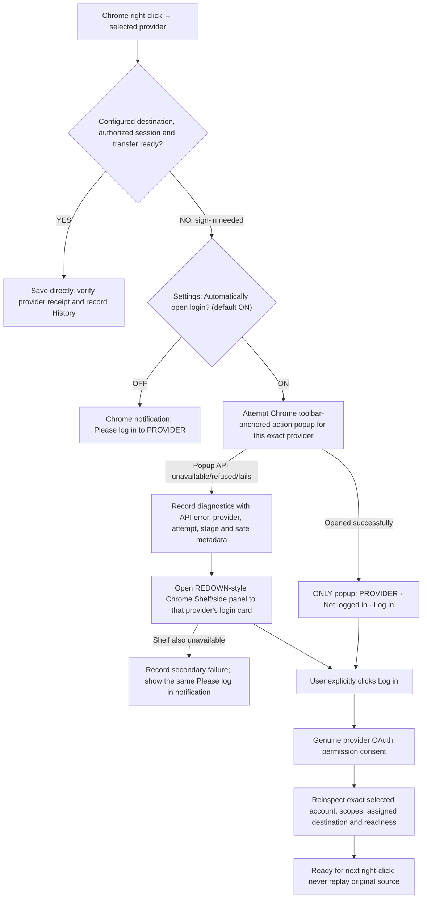

# CODEX P0 — REDOWN right-click parity; popup → Shelf fallback; notification-only setting

**NOVEMBER 7 MASTER PRECEDENCE:** [docs/CODEX_MASTER_2026-11-07_SINGLE_ENGINE_REDOWN_PARITY_AND_WORKINGS.md](./CODEX_MASTER_2026-11-07_SINGLE_ENGINE_REDOWN_PARITY_AND_WORKINGS.md) is the current source of desired behavior and [11.2026/workings/right-click-workings.json](../11.2026/workings/right-click-workings.json) is the incomplete source-grounded actual-behavior bootstrap Codex must complete before refactoring. Older details here are historical when inconsistent: no automatic R2 activation/checkout website navigation or cloud actions if R2 is inactive/unknown; new user with active R2 gets one approved reuse-or-create redown setup and subsequent direct saves. The four-provider native menu rules and permanent redown deletion are unchanged. Use one current V3+1 engine and the existing trusted API.

**Final owner interaction decision, November 7, 2026.** This file is the controlling specification for disconnected/right-click login presentation, replacing the popup-only clause in `docs/CODEX_P0_SIMPLE_RIGHT_CLICK_LOGIN_OR_SAVE_POPUP_2026-11-07.md`. It complements—not replaces—the November 6 native menu, Cloudflare `redown`, GUI/API parity and REDOWN-class Explorer performance requirements.

**Implementation, not another proposal.** Use latest Click2Cloud `main` as the source; create a fresh development branch. Work continuously for approximately **30 minutes**, completing multiple useful milestones, writing tests, making coherent commits, and furnishing a factual handoff. Preserve REDOWN read-only. Do not merge, publish, or change cloud resources/OAuth client registration without explicit authorization.

## One user-facing rule: connected saves; disconnected shows one login path

**Clarifications:**
- The *first preference* is the compact popup anchored to the extension icon; it does not rearrange the website and collapses when dismissed.
- The *fallback* is Click2Cloud's REDOWN-style Shelf, implemented as Chrome's integrated side panel and deep-linked to the selected provider's login card. The Shelf includes all provider cards, but highlights the exact provider the user clicked.
- **Exactly one extension-owned interface at a time.** Open the Shelf only if the popup was refused or failed; never launch both preemptively. Never spawn a separate `chrome.windows.create({type:'popup'})` or arbitrary extension tab for these login prompts.
- The Settings toggle **Automatically open login after an unconnected right-click** defaults **ON** and applies to all providers. **OFF** means no programmatic popup attempt, no Shelf attempt, only a Chrome OS/browser notification with exact message **`Please log in to Cloudflare`**, **`Please log in to Google Drive`**, **`Please log in to Dropbox`**, or **`Please log in to OneDrive`**, as appropriate. The notification must not falsely imply an upload occurred.
- Keep the new toggle independent of the **four per-provider Show/Hide right-click menu controls**: disabling automatic login UI does not remove native menu items, saved target paths, credentials, provider connections or visibility choices. Likewise hiding a provider still removes its native row regardless of notification preference.
- A login-required action is not an upload. Showing UI or a notification must never authorize a transfer, trigger OAuth before a user's explicit Log in selection, auto-create `redown`, or replay the previously clicked page after permission consent.
- Only a genuinely READY provider/destination can save instantly. An expired access token with a valid refresh token should refresh transparently where permitted; do not prompt for login until renewal actually fails. Never artificially lengthen access-token validity or use refresh tokens beyond provider policy. Reauthorization must ask for the correct, justified OAuth scopes and selected account.
- Connected but unready destinations use the same single-surface decision (popup → Shelf, or notification-only if setting OFF), but show the honest required repair/first-time setup/Manage Destinations state instead of incorrectly saying simply `Not logged in`. Approved initial `redown` setup remains separately consented and deletion is permanent until explicit user request.

## Exact architecture / requirements

1. Read `AGENTS.md`, `foundations/cloudflare/README.md`, `foundations/other_clouds/README.md`, `docs/CODEX_NOV06_STRICT_NATIVE_MENU_AND_EXPLORER_PARITY_30MIN.md`, and the newer/older popup-only document as overridden above.
2. Inspect REDOWN **read-only** for behavioral parity: `extension/background.js` native `chrome.contextMenus.onClicked` → `resolveActiveRightClick` → `saveResolvedRightClick` → `verifyCloudflareReceipt`; `extension/right-click-v3.js` menu projection; `extension/shelf.html`/`shelf.js` provider cards; `extension/cloudflare-auth.js`/`cloudflare-api.js` token renewal. Recreate only the relevant behavior through Click2Cloud's current V3+1 engine, registrar, action resolver, API and state store—no duplicate save or menu engines.
3. For the toolbar popup, use `manifest.action.default_popup`. With a default popup set, `chrome.action.onClicked` is not used for toolbar clicks; remove any old tab-opening conflict. On a native context-menu click with login needed, attempt `chrome.action.openPopup` **in the original user-activation window when technically permitted**, with the correct popup provider context prepared first. Inspect API outcomes; do not claim the popup opened based solely on a successful function return if Chrome hasn't rendered it.
4. For the fallback, add/configure `sidePanel` permission and `side_panel.default_path` (or an equivalent Chrome-supported dynamic panel) to open a responsive REDOWN-like Shelf with all provider cards and the clicked provider's login card selected. If side panel cannot open, use notification as final fallback. Respect Chrome API limitations, gesture/visibility constraints, and tab/window scoping; emit diagnostic evidence whenever an attempt fails. Both surfaces are clients of one existing typed provider API and one OAuth coordinator. Never run separate login pipelines.
5. For notification-only preference, add/verify Chrome `notifications` permission and meaningful small icon assets (where required). Notifications should be localized/mapped from the actual target provider; avoid repeated spam from rapid right-click attempts by deduplicating/throttling identical notices. If notification creation fails, record that failure; use a small toolbar badge as last passive cue without opening UI.
6. Implement a persistent **boolean** with a migration-safe default `true` in `src/api/config.mjs`, a versioned, validated configuration mutation operation in `src/api/service.mjs`, and a labeled Settings checkbox in the existing UI. Ensure the action, popup, Shelf, automated tests and programmatic clients observe the same value. Preserve backups/migrations; never confuse this setting with provider menu visibility.
7. Preserve the exact native menu rules: four provider rows by default in order (Google Drive, Dropbox, OneDrive, Cloudflare); user can independently hide provider rows. Cloudflare one visible chosen destination → flat direct save; two or more active assigned targets → one Cloudflare submenu; empty returning config → Manage Destinations; never recreate explicitly deleted `redown`; never add duplicate `Cloudflare R2` entries. Ready save never launches login UI.
8. Fix the reported Click2Cloud `INSUFFICIENT_PERMISSION` diagnosis: `src/cloudflare/onboarding.mjs` maps every bucket-list HTTP 403 to that generic label. Identify the extension token's actual granted scopes, consent-selected account, status and safely redacted Cloudflare errors. Differentiate revoked token, missing R2 scopes, wrong account, account OAuth policy, actual R2 activation and API failure. REDOWN's extra Chrome manifest permissions are **not** equivalent to Cloudflare OAuth grants. Request only justified registered scopes; neither broaden client permissions nor edit production OAuth client silently.
9. Keep REDOWN-equivalent or better File Explorer performance repair as P0: instant left/right-click selection, cached sorted lists, windowed rows, accurate folder traversal and breadcrumb, canceled stale requests, previews, context actions, History GO TO, and measured 1,000+ file behavior. Do not declare Explorer repaired based only on fixtures.
10. Ensure diagnostics distinguish `POPUP_OPEN_FAILED`, `SHELF_FALLBACK_OPENED`, `SHELF_OPEN_FAILED`, `LOGIN_NOTIFICATION_CREATED`, `LOGIN_NOTIFICATION_FAILED`, `OAUTH_RECONNECT_REQUIRED`, `SAVE_READY`, `SAVE_VERIFIED`, and genuine upload failures. Record limited, nonsecret metadata; no tokens, original source URL, or other browsing provenance in notifications/logs.

## Acceptance tests — show receipts, not guesses

- Default ON + disconnected Cloudflare right-click → one toolbar popup, Cloudflare Log in card, no other extension UI, no automatic OAuth; click Log in → genuine provider consent; next ready click saves directly.
- Default ON + deliberately forced `chrome.action.openPopup` refusal → **diagnostic record, then Shelf fallback** with Cloudflare selected and other providers still available; no separate window/tab; only one surface active.
- Default ON + popup refusal + Shelf refusal → diagnostic records for both, user sees **Please log in to Cloudflare** notification, with no fake save.
- **Settings OFF** + disconnected right-click for *each* of the four providers → exactly the matching **Please log in to PROVIDER** notification, zero popup/Shelf attempts, no auth/transfer action. Setting persists across reload, browser restart, and service worker restart.
- Existing authorization with refresh-token success → silent renewal, then ready direct save, no login prompt. Refresh invalid/revoked → one truthful login path.
- Configured but unready (not simply logged out) → correct repair/Manage Destinations flow; `redown` removed never recreated, and user-approved new setup remains explicit.
- User disables provider visibility separately → provider absent from menu regardless of auto-login setting, and all credentials/destinations remain intact.
- Real Chrome native menu/notification/toolbar popup/side-panel behavior must be tested in an installed extension. Mock tests alone cannot prove that Chrome permits programmatic opening in the context-menu event.
- Maintain REDOWN-class Explorer traversal responsiveness and real TRUE REMOTE R2 receipt/readback as explicit acceptance, not deferred marketing claims.

## Execution and evidence

Implement the source modifications. Run the existing focused suite, provider/login tests, menu and Explorer performance tests, extension build, and real installed-Chrome tests if available. Make cohesive commits and provide full before/after behavior, SHAs, exact PASS/FAIL/BLOCKED/NOT TESTED evidence, error codes, any genuine platform blocker, and what remains for the next run. Work continuously for approximately 30 minutes, advancing through as many meaningful P0 milestones as possible. Do not merge/deploy or claim live cloud verification without genuine authorized proof.
