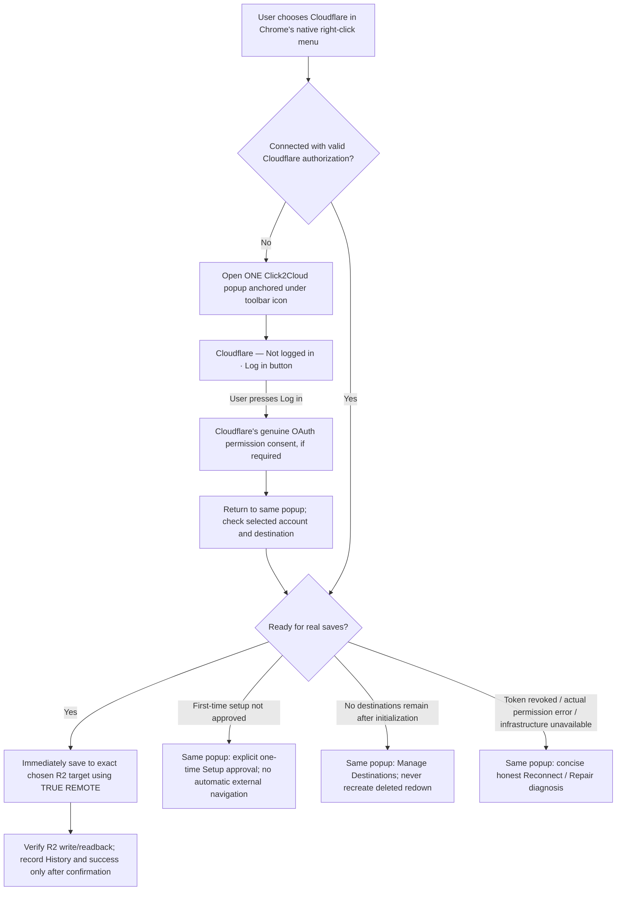

# Click2Cloud P0 — Right-click either saves or opens ONE anchored login popup

**Latest owner decision: November 7, 2026. This is the controlling interaction rule for Click2Cloud.** It supersedes older instructions that right-click automatically opens the REDOWN Shelf, a side panel, a separate popup window, a dashboard tab, or Cloudflare's R2 activation page. Preserve all non-conflicting November 6 menu, `redown` lifecycle, cloud privacy, GUI/API parity and REDOWN-equivalent Explorer performance requirements.

## The entire user-facing rule

**One screen decision:** Click2Cloud uses the **Chrome action popup** (the standard small panel anchored below its toolbar icon, automatically closing when dismissed), NOT a docked Shelf, Chrome side panel, `chrome.windows.create({type:'popup'})`, extension-created tab, full dashboard, or multiple surfaces. The popup offers Remotes, login/permission state, one-time setup, Manage Destinations and error handling as needed. It does not resize or displace the user's website. The full Explorer may remain an explicitly chosen separate workspace action, not an automatic login detour.

**Disconnected right-click:** Open that popup and show only **"Cloudflare — Not logged in"** with a **Log in** button. Opening the popup must not itself begin OAuth, claim an upload, auto-create any bucket, or replay the original clicked URL. Clicking **Log in** uses the existing secure OAuth owner and Cloudflare's authentic permission consent. After successful login, update popup state. An explicit new right-click is required for a save; never replay the pre-login click.

**Connected and ready right-click:** One native click dispatches a real TRUE REMOTE transfer immediately to the exact assigned account/bucket/prefix and independent R2 confirmation, with no popup, Shelf, activation tab or dashboard navigation. Access token renewal should be attempted transparently using a valid refresh token; a temporarily expired access token does not require an immediate login if refresh succeeds. Only an actual failed/revoked refresh or unresolved authorization requires the popup Log in/reconnect action. No arbitrary client-side extension of Cloudflare-issued token lifetimes.

**Connected but not ready:** Remain in the SAME popup, show only the minimal real next action. For approved initial setup, reuse or (with explicit approval) create `redown` and prepare authorized Worker/readback; never do this silently when login succeeds. If the user intentionally removed `redown`, do not recreate it, and offer Manage Destinations instead. If OAuth lacks R2 permissions, show a clear permission diagnosis and user-controlled reauthorization. If R2 subscription is genuinely not activated, do not automatically redirect to the R2 dashboard: show a factual `R2 needs activation in Cloudflare` state, with a voluntary official activation link only if Cloudflare requires that external account checkout. No extension can bypass Cloudflare's own required activation/billing authorization.

**Where does the popup come from on native right-click?** Chrome 127+ exposes `chrome.action.openPopup({windowId})`. Use it in the real native context-menu user gesture and verify on installed Chrome. Chrome may refuse to open it (e.g., extension pinning/focus/gesture restrictions). When it fails, set a small informative action badge or notification and invite the user to click the toolbar icon; do not make a second popup/tab/side panel. Chrome's own secure `chrome.identity.launchWebAuthFlow` consent window is a distinct provider-controlled OAuth step, not a second Click2Cloud interface.

**Toolbar click:** `manifest.action.default_popup` owns the one extension login/status popup. Remove the existing `chrome.action.onClicked` tab-opening behavior: Chrome does not dispatch `onClicked` when `default_popup` is configured. The popup supports provider context/intent through transient session state, not a second login engine. Keep the actual saving and OAuth in a durable MV3 worker so closing the popup cannot destroy an ongoing legitimate transfer or authentication attempt.

## Native menu shape is unchanged

Four providers shown by default: Google Drive, Dropbox, OneDrive, Cloudflare. Settings may independently hide a provider without disconnecting it. Cloudflare has exactly one native provider item. Zero *active assigned* Cloudflare targets after initialization: flat clickable action opens the anchored popup's Manage Destinations; one: flat direct save; two or more: single Cloudflare submenu listing only explicit chosen active destinations. Newly discovered but unassigned R2 buckets do not create menu entries. If an explicitly deleted `redown` leaves one surviving target, that target becomes the flat direct-save destination. Deleted `redown` is not recreated. Brand-new authorized first-time setup may create/reuse `redown` only after explicit approval. Existing selected targets always prevail.

## Fix the reported OAuth error, don't paper over it

The owner's matching OAuth client ID is `59535938bc4cc093003b4385a7e2b005`. The developer saw `INSUFFICIENT_PERMISSION` after a fresh install. `src/cloudflare/onboarding.mjs` currently maps **every** R2 bucket-list HTTP 403 to that generic label. Cloudflare currently recognizes the R2 read/write scopes and both REDOWN's `workers-scripts.read/write` and Click2Cloud's `workers-scripts.content_read/edit` scopes; simply having 9 versus 5 Chrome manifest permissions is NOT a proof of missing OAuth scopes. A separate connected Cloudflare credential successfully listed R2 buckets including `redown` but cannot prove extension token permissions.

Inspect the **extension's own token**: actual consent-selected account, granted scopes, token refresh/rotation, raw Cloudflare HTTP status and sanitized `errors[].code`, account-level public OAuth access restrictions, R2 bucket-list account identity, and Worker setup scopes. Diagnose 403 from actual provider evidence, preserving secrets. Distinguish insufficient grant, wrong selected account, token invalid/expired, API authorization policy, other 403 and network errors. Never auto-broaden permissions, change the OAuth client or mutate Cloudflare resources without explicit owner approval. Only show successful login or ready status when the respective actual checks pass.

## Actual REDOWN behavior and Explorer parity

For context-menu save, read REDOWN `extension/background.js` `chrome.contextMenus.onClicked`, `resolveActiveRightClick`, `saveResolvedRightClick` and `verifyCloudflareReceipt`; `extension/right-click-v3.js` `simpleTargets`/`resolve`; `extension/cloudflare-auth.js` and `extension/cloudflare-api.js` for OAuth/refresh. REDOWN also has a Shelf, but **Click2Cloud deliberately uses the toolbar popup instead**. Do not copy REDOWN's historical menu engines or its custom login windows.

Retain the demanding Click2Cloud File Explorer performance/bug repair in `docs/CODEX_NOV06_STRICT_NATIVE_MENU_AND_EXPLORER_PARITY_30MIN.md`: selection, right-click actions, sorting, virtualization, folder traversal, stale-request cancellation, previews, History GO TO, and usable 1,000+ file directories; compare measured behavior to REDOWN. Zero freezes and no imaginary performance measurements.

## Required code paths and acceptance

- `extension/manifest.json`, `extension/background.mjs`, `src/chrome/provider-panel.mjs`, `extension/connect.html`, `extension/connect.mjs`, `extension/app.mjs`: converge on a single action popup and a single authenticated API state. Use an appropriate Chrome toolbar popup width and min/max height with accessible scroll/focus; its provider login card is `Not logged in · Log in`.
- `src/auth/cloudflare-oauth.mjs`: reliable refresh-token handling and exact account/scope diagnosis, no repeated login on every right-click; avoid token exposure or infinite retry loops.
- `src/cloudflare/onboarding.mjs`, `src/cloudflare/inventory.mjs`: diagnose HTTP 403 accurately; keep first-use explicit setup in-popup, no automatic R2 activation redirect, no `redown` resurrection.
- `src/core/menu-spec.mjs`, `src/core/engine.mjs`, `src/chrome/registrar.mjs`: one native provider owner, direct ready save, accurate pending/unready route and native ACK.
- Test disconnected native click opens **one** anchored popup and nothing else; login begins only on button click; consent returns and updates state; a new right-click saves when ready; connected ready click never launches UI; no-target click goes to popup Manage Destinations; 403 reports its real cause; refresh resumes without visible login if valid; popup failure triggers only an unobtrusive toolbar cue; auth failure never fabricates a save. Test multiple windows, extension icon pinning and MV3 service-worker restarts.
- Preserve GUI-to-API parity: same operations, validation, authorization, outcomes, observable states and exact destination routing. No bloat/duplicate engines, no silent provisioning, no hidden setup side effects.
- Deliver branch/commit list; actual test and installed-Chrome results, what failed, external limits and next actions.

**Execution cadence:** Start from latest Click2Cloud `main` on a fresh implementation branch. Work for approximately 30 minutes continuously; milestones are checkpoints and work continues past each one. Repair code and tests rather than writing a plan alone. Report verifiable results at handoff. REDOWN and live Cloudflare resources unchanged unless separately and expressly authorized.
