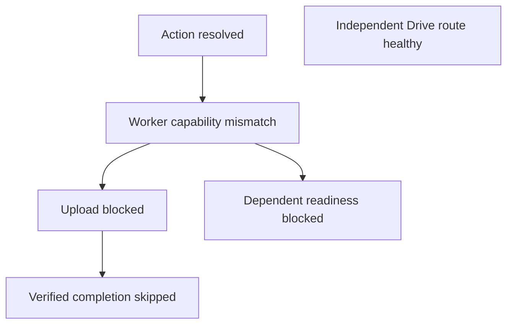

# V3+1 Glaciaring and Agent Debug API

## Corrected owner priority — cover everything important, expose it programmatically, never game the metric

**This correction supersedes any earlier line suggesting that Glaciaring should reduce *checks, coverage, fault detection, or investigative completeness*.** See the [P0 no-shortcut implementation contract](CODEX_BUILD_REAL_V3_PLUS_ONE_NOW.md#p0-correction--complete-inspectability-no-diagnostic-shortcuts-owner-requirement).

Glaciaring means the full supported V3+1 right-click operation graph—every critical path, state, mode, menu node/action, capability, provider handoff, save result, lifecycle transition and failure class—is **quickly inspectable and traceable from a stable programmatic surface**, with **efficiently encoded boundary evidence and negligible measured latency overhead**. A diagnostic signal can compress a large subsystem's result, but **may never falsely conceal a failure class or independent error**. The user wants to stop having to manually explain and rediscover the same system, *not* instruct agents to investigate less carefully.

**Never optimize agent steps or runtime performance by omitting diagnostic observations.** A code agent must not skip error pathways, reduce fault corpus coverage, declare success after finding a plausible first failure, hide failing tests, fake green status for missing events, or sample away mandatory status transitions. If all critical failures cannot be detected while meeting latency targets, the implementation is **NOT DONE**: improve event encoding, storage and retrieval or explicitly report the conflict.

The actual proof is a **source-backed observability coverage map** (state/branch/error → checkpoint/code → trace/receipt → test), adversarial negative tests including missing/misleading signals and simultaneous independent faults, full available paginated trace/menu access, correctness of root-cause candidate ranking without ignoring other faults, and matched performance tests. Only **after those gates pass** is fewer Work/Codex iterations a desirable measured outcome.

This seed and the references remain design material, not code or proof of live Chrome/cloud parity.

Design seed, November 3, 2026. The [condition-to-behavior contract](V3P1_COMPLETE_CONDITION_TO_BEHAVIOR_CONTRACT.md) governs product behavior. The [source audit](../final-review/V3_VS_V3PLUS1_SOURCE_AUDIT_2026-11-03.md) governs preservation and transplant gates. This seed adds observability and proof requirements. Examples below are synthetic.

## Owner's clarifications: preserve the correct meaning

- **[GLACIARING — Minimal Diagnostic Traversal](references/GLACIARING_MINIMAL_TRAVERSAL_OWNER_INTENT.md):** Glaciaring primarily reduces the *investigation/traversal* a coding agent must perform. Place inexpensive signals at critical boundaries, not exhaustive line-by-line traces. Ordinary saves must remain responsive, and detailed output belongs only in authorized Debug Mode/on-demand diagnostics. Coverage refers to meaningful behavioral boundaries, with gaps marked UNKNOWN, not a percentage of logged lines.
- **[Canonical Menu Twin and Iterative Convergence](references/CANONICAL_MENU_CONVERGENCE_OWNER_INTENT.md):** The full menu exists as one exact programmatic MenuSpec before the user sees it. Human and AI inspector/mirror share that structure and a pure resolver; Chrome generates its native menu from the same plan. Compare *desired → generated → acknowledged → independently observed*, locate mismatches and preserve approved known-good golden baselines across future mode/provider changes.

**Joint objective:** give Work/Codex **comprehensive, faithfully correlated programmatic evidence of all supported critical errors and menu behavior** without increasing lag or latency. Reducing investigation iterations follows from coverage and correct diagnosis; it may never be achieved by skipping checks. The latest [Codex implementation request](CODEX_BUILD_REAL_V3_PLUS_ONE_NOW.md#p0-glaciaring-minimal-diagnostic-traversal--canonical-menu-convergence-owner-requirement) and [autonomous runbook](CODEX_AUTONOMOUS_V3P1_RUNBOOK.md#glaciaring-and-convergence-execution-gates-p0--diagnostics-must-save-engineering-work) specify concrete acceptance tests: boundary fault injection, cascade vs independent faults, regression diffs, diagnostic-off equivalence, and measured enabled-vs-disabled runtime and investigation cost. Treat performance budgets as targets to validate, not evidence already achieved.

## Source baseline and ownership

Click2Cloud baseline `f69d1e83b63216df335b2b1f07b42d134a13133b`, REDOWN reference `89211efc08bfb6f4370f9293cc98ebea2050f859`. Click2Cloud `npm test` passed 26 tests. The tests cover deterministic projection, flat providers, mode output isolation, adapter behavior and dashboard controls with injected transports. They do not establish real native registration, durable mode isolation or provider writes.

| Current source | Disposition |
|---|---|
| Click2Cloud `src/core/menu-compiler.mjs`, `tests/menu-compiler.test.mjs` | Preserve normalization and projection invariants. The current single-bucket compiler branches in one function and cannot identify repeated bucket names across accounts. Add mode-owned revisioned inputs and shared canonical identity before certifying parity. |
| `src/core/save-dispatcher.mjs` | Preserve shared entry point and minimal provider payload. Whole Uint8Array and adapter Boolean confirmation are prototype limits. Adapt to existing capture/stream and provider receipt evidence. |
| `src/explorer/{index,file-api,configuration,r2-adapter}.mjs`, `cloudflare-api.js` | Reuse file operations, option resolution, pagination, staged readback and ambiguity handling. Inject trusted host transports. Keep read-only discovery separate from provisioning. |
| `src/dashboard/{controls,redown-bridge}.mjs`, `dashboard/` | Reuse Refresh/Activate control semantics. Standalone dashboard is not a trusted REDOWN sender. Add a Click2Cloud-local host boundary under the runbook, with unchanged REDOWN sender checks. |
| REDOWN `extension/background.js` (`verifyCloudflareReceipt`, `activateAllBuckets`, `runGlobalActivation`, `reconcileMenus`, `contextMenus.onClicked`) | Preserve one activation authority, one registrar and listener per host, retry-failed activation, startup reconciliation, exact-route verification and verified completion handoff. Adapt registrar inputs and receipts, including legacy URL-forwarding receipt fields. Keep existing History/counters/celebration behind verified completion. |
| REDOWN `extension/{google-drive,dropbox,onedrive}-{menu,provider}.js` | Reuse independent flat provider fragments and provider upload owners. Normalize status/receipt at adapters. Mode changes must leave unrelated provider ownership and behavior intact. |
| REDOWN `extension/right-click-v3.js`, `extension/beta/right-click-v3-ui.js` | Preserve bounded/resumable discovery, path identity, overflow reachability, revisions, editor drafts and explicit Apply. Adapt projection and editor to independent mode state. Activation must not append Depth participation. |
| REDOWN `extension/right-click-current.js`, `right-click-backup.js`, `right-click-engine-settings.js` | Reuse transaction, journal, backup and recovery ownership. Adapt schema/namespaces, keeping diagnostics separate from restore authority. Preserve validated encrypted exports and credential exclusion. |
| REDOWN `extension/runtime-diagnostics.js`, `explorer-diagnostics*.js` | Reuse sanitized envelope conventions and Explorer diagnosis ownership. Runtime diagnostics already offers opt-in bounded observations and export. Its per-record pruning and memory-only lifecycle are not the Glaciaring hot path or durable evidence model. |

New work consists of the canonical introspection projection, generation evidence, boundary vocabulary, causal reconstruction and sanitized debug receipt. Reuse is a source-backed proposal with live compatibility gates.

## Canonical menu and action identity

A mode owns its configuration, validator, projector and migration. It reads a shared immutable inventory revision with coverage and freshness. Each provider supplies a fragment. A pure composer validates and orders all fragments into one immutable MenuSpec plus an omission index. Neither preview nor registrar adds a destination. Same canonical input produces the same ordered spec. Apply assigns a monotonic generation distinct from its content digest and from each mode/config/inventory revision.

Define an ordered node record with item ID, parent ID, sibling index, native type, title, contexts, visibility, enabled, role (branch, save, navigation, separator), mode origin, reason code and optional action ID. Children are derived by parent and order. Actions reference exact provider/connection/account/bucket/prefix/operation tuples, using opaque stable internal IDs and explicit canonicalization per adapter. Action IDs identify behavior, while item IDs distinguish multiple menu placements. Reject identifier collisions and unstable reorderings. Separate display labels from authority. A branch has no direct save. Use an explicit Save here child where needed. Preserve the special Cloudflare Home save action and separate REDOWN navigation. The omission index reports reason and origin for candidates considered, with a coverage limit for undiscovered inventory.

Fixture below shows extra Simple destinations. Production output also carries context filters and revision metadata. IDs and labels are synthetic.

```json
{
  "schemaVersion": "1.0",
  "generation": 42,
  "mode": "simple",
  "inventoryRevision": 12,
  "nodes": [
    {"id":"root","parent":null,"index":0,"type":"normal","title":"REDOWN","enabled":true,"role":"branch"},
    {"id":"cf","parent":"root","index":0,"type":"normal","title":"Cloudflare","enabled":true,"role":"branch"},
    {"id":"photos","parent":"cf","index":0,"type":"normal","title":"Photos","enabled":true,"role":"save","actionId":"a1","origin":"simple"},
    {"id":"sep","parent":"cf","index":1,"type":"separator","enabled":true,"role":"separator"},
    {"id":"home","parent":"cf","index":2,"type":"normal","title":"Home","enabled":true,"role":"save","actionId":"a0","origin":"simple"},
    {"id":"drive","parent":"root","index":1,"type":"normal","title":"Google Drive","enabled":true,"role":"save","actionId":"a2","origin":"provider"}
  ],
  "actions": {
    "a0":{"provider":"cloudflare","connection":"c1","account":"acct1","bucket":"redown","prefix":"","permission":"write"},
    "a1":{"provider":"cloudflare","connection":"c1","account":"acct1","bucket":"redown","prefix":"Photos/","permission":"write"},
    "a2":{"provider":"google-drive","connection":"c2","account":"acct2","destination":"folder1","permission":"write"}
  },
  "omissions":[{"candidate":"fixture-archived","code":"CAPABILITY_STALE","origin":"simple"}]
}
```

Keep raw labels and exact routes inside the trusted host. Default agent view preserves topology and equivalence via stable opaque aliases within an export comparison scope. Explicit local user disclosure may show exact routes and labels in the trusted UI. Exports carry sanitized fixture equivalents. Hashing guessable private paths without a secret is insufficient.

### Native parity and recovery

[Chrome contextMenus reference](https://developer.chrome.com/docs/extensions/reference/api/contextMenus) exposes create/update/remove, callbacks and click events. Create returns an ID before callback success is known. The API exposes no native-tree enumeration or pixel inspection. The action context-menu top-level limit is specific to that surface. Test the actual webpage context independently.

Record desired generation, per-operation plan and ACKs, last fully ACKed generation, uncertain items and recovery reason. Register parent-first and remove obsolete descendants before their parents. Capture errors inside callbacks or supported promise rejection. Serialize registration, fence callbacks by attempt and generation, and advance the applied pointer only for a complete current attempt. Partial apply is not atomic. Disable dispatch for ambiguous items while reconciling, including stale IDs whose authorization or route changed. Reconstruct from desired state and ACK journal after restart, with a bounded owned-menu rebuild if observations are insufficient. Never infer rendered appearance from ACK. Distinguish plan, registration ACK, installed-browser observation and real upload verification in receipts. Track inventory completeness independently.

Mirror and machine tree consume the same node records. Use a shared pure resolver for a native ID (via the acknowledged binding), mirror selection or diagnostic action ID. Validate the same effective generation, applicability and canonical action. Live invocation separately checks current authority and source context and enters the existing dispatcher. A diagnostic action returns a simulated intent summary with no source capture, network or History writes.

## Boundary instrumentation

Inject an optional synchronous sink at **all supported critical operation/decision/error boundaries** (as verified by a coverage ledger), conceptually `emit(module, stage, outcome, code, correlation, smallFacts)`. No direct imports by business modules. Sink failures and absent sinks are fail-open for observation only. Business authorization and receipt gates remain fail-closed. In production emit enum/integer fields into bounded preallocated slots. Avoid allocation, JSON, stack capture, hashing, disk, network and per-event wall-clock formatting on the click path. Use monotonic durations within an epoch. Reuse existing request identity where available. Resolve source anchors from a build-scoped stage manifest at query time.

Each stage records operation ID, attempt, parent operation, typed dependency edge, worker epoch/sequence, generation/revision if applicable, outcome (started, ok, blocked, failed, uncertain, cancelled, skipped), code and bounded facts. End states are observational and do not change business state. Separate an authorization block from a fault and an ambiguous write from a confirmed failure. Missing observations are unknown.

| Module / operation key | Evidence and example failure codes |
|---|---|
| Connection / grant check | Session epoch, authorization and freshness, `AUTH_REQUIRED`, `AUTH_REVOKED` |
| R2 / entitlement and activation job | Approved scope, verified entitlement, per-bucket attempt, `ENTITLEMENT_UNKNOWN`, `ACTIVATION_PARTIAL` |
| Worker / provision and negotiate | Binding/capability check result and verified version class, `CAPABILITY_MISMATCH`, `PROVISION_UNCERTAIN` |
| File API / adapter invocation | Provider capability and operation kind, `UNSUPPORTED_OPERATION`, `TRANSPORT_TIMEOUT` |
| Inventory / scan and page | Revision, counts, age, completeness, `CURSOR_REPEATED`, `INVENTORY_PARTIAL` |
| Simple, Narrow, Depth / validate and project | Independent config revision, output counts and excluded candidates, `LABEL_COLLISION`, `DEPTH_BUDGET` |
| Compiler / compose and validate | Spec digest and ordering checks, `INVALID_PARENT`, `ID_COLLISION` |
| Registrar / apply and repair | Plan, operation ACKs, generation fence, `NATIVE_ACK_ERROR`, `NATIVE_ACK_UNKNOWN` |
| Resolver / select action | Entry surface, applied binding, opaque canonical identity, `STALE_GENERATION`, `ACTION_UNAVAILABLE` |
| Capture / select and acquire bytes | Source kind and byte-count band, `CAPTURE_DENIED`, `CAPTURE_INTERRUPTED` |
| Intent / build and validate | Action alias and policy flags, `DESTINATION_CHANGED`, `INTENT_INVALID` |
| Transfer / upload and verify | Attempt and independent receipt result, `UPLOAD_UNCERTAIN`, `RECEIPT_MISMATCH` |
| Completion / History and feedback | Verified receipt reference and idempotent commit state, `HANDOFF_PENDING`; count once |
| Configuration / persist, backup, migrate, restore | Namespace/revision, commit state, `REVISION_CONFLICT`, `MIGRATION_QUARANTINED` |
| Lifecycle / startup, suspension recovery, concurrent Apply | Epoch and durable checkpoint reference, `OBSERVATION_GAP`, `APPLY_SUPERSEDED` |

On definitive failure or terminal uncertainty, preserve all available pertinent sanitized boundary facts and their explicit gap/drop counts for deferred bounded snapshot processing (with truthful pagination or truncation markers). Follow explicit requires/produces and retry-of edges, prioritize observed failed prerequisites as leads **while retaining all other connected and independently failing evidence**; identify probable origins without closing the investigation prematurely. Mark simultaneous or disconnected faults independently. Do not infer causality from clock order or a shared account alone. Distinguish observed, inferred and missing edges. Never call providers to fill gaps automatically. Retain enough provenance to map stable stage IDs to source and tests at the exact revision. Across MV3 suspension, reuse existing durable business checkpoints for correlation and explicitly report lost volatile breadcrumbs. Optional local failure persistence is opt-in, quota bounded and must not delay or participate in business commits.

Normal synthetic timeline: `select/ok → capture/ok → intent/ok → upload/ok → verify/ok → history/ok`. All share operation `op7`, generation 42, epoch `e1`; each arrow is an observed dependency. A click pulse may occur at select and conveys no receipt.



## Agent API v1

One extension-local diagnostic channel with a strictly allowlisted sender, current session and explicit diagnostic grant bound to the local workbench. No content-script, external page, or public Worker access. Query rights do not include setup, save, refresh, repair or live probes. Export requires a distinct user gesture and shows redaction and scope. Validate requests and responses against closed schemas. Schema v1 envelope carries version, request ID, build, completeness, evidence gaps, typed result and bounded cursor. Unknown enum values degrade to UNKNOWN, incompatible major versions fail explicitly. Query cursor is scoped to immutable snapshot/generation and expires. Every method below is read-only, requires the diagnostic grant, and persists nothing on invocation.

| Method and input | Output and agent use | Cost / incomplete semantics | Acceptance |
|---|---|---|---|
| `describeEngine()` | Module manifest, contracts, latest passive health, supported capabilities | O(modules); stale or never observed stays unknown | Disabled sink and stale health cannot report ready |
| `inspectMenu({generation,itemId?,candidate?,compareTo?,cursor?,limit?})` | Tree page, action or omission explanation, projected vs ACK ledger, optional structural generation diff | Indexed lookup or bounded page/diff; missing revision or partial inventory is explicit | Nested traversal, ordering, stale ACK, unexplored candidate and vanished generation |
| `inspectOperation({operationId,view,cursor?})` | Timeline or causal graph with facts, candidates, evidence refs and gaps | Bounded matching/graph traversal; eviction and MV3 epoch gaps explicit | Inject independent fault plus cascade; reject temporal-only attribution |
| `getDiagnosticSnapshot({operationId?,compareTo?})` | Sanitized receipt or bounded comparison of available snapshots | Deferred serialization under export cap; missing fields and truncation marked | Golden schema, eviction, dropped records, redaction and stable alias tests |
| `simulateMenuAction({generation,actionId,fixtureContext})` | Same resolver result with route alias and applicability; no business effects | Indexed resolution, fixture validation; missing binding or unverifiable runtime authority explicit | Same canonical result as native ID for same generation/context; spies see zero capture/upload/storage/History calls |

Scenarios belong in a fixture test runner outside the production query API. Optional live testing uses the separately authorized dispatcher and documented disposable scope under the runbook. Never send URLs, credentials, headers, raw exception strings, object contents, filenames, private labels or provider response bodies into diagnostics. The historical REDOWN remote ingest strategy forwards the source URL to its Worker. Keep that strategy explicit and independently test the bytes-only provider path; never label legacy ingestion as provenance-free.

### Agent Debug Receipt example

```json
{
  "schemaVersion":"1.0",
  "evidenceClass":"synthetic",
  "build":"fixture-build",
  "operationId":"op8",
  "desiredGeneration":43,
  "acknowledgedGeneration":42,
  "completeness":"partial",
  "gaps":["OBSERVATION_GAP"],
  "facts":[
    {"id":"s1","stage":"resolver.select","outcome":"ok","generation":42,"actionAlias":"a1"},
    {"id":"s2","stage":"worker.negotiate","outcome":"failed","code":"CAPABILITY_MISMATCH"},
    {"id":"s3","stage":"transfer.upload","outcome":"blocked","requires":["s2"]},
    {"id":"s4","stage":"completion.history","outcome":"skipped","requires":["s3"]}
  ],
  "candidates":[{"stage":"worker.negotiate","basis":["s2","s3"],"classification":"earliest-observed-failure"}],
  "sourceAnchors":["worker.negotiate@fixture-build","resolver.select@fixture-build"],
  "focusedRepro":"Fixture: resolve generation 42, return incompatible Worker capability, assert zero uploads and verified feedback",
  "invariants":["action-equivalence","no-success-without-receipt"]
}
```

Production receipts also include browser/host version, mode/config/inventory revisions, timings, attempt/epoch identifiers, coverage, dropped counts, comparable spec/plan fingerprints, source manifest with commit anchors, fixture identifiers and verification evidence class. Use `unknown` where evidence is unavailable.

## Performance model and acceptance

Current 26-test wall time is a test baseline only. Before enabling instrumentation, capture paired baselines with identical builds/config, same machine and Chrome version, warmed and cold MV3, and repeated deep/wide, partial and multi-provider cases. Compare disabled/no-op and enabled using alternating runs, at least 100 warm samples per case and separate cold samples. Report p50/p95/p99, event counts, heap, and dropped records. Provisional budgets below are gates to validate or tighten with measurements.

| Measurement | Provisional gate |
|---|---|
| Compile through 300-node reference case and larger bounded fixture | Enabled p95 delta at most 5% or 1 ms, whichever is larger; preserve deterministic projection and overflow |
| Apply and reconciliation with delayed ACKs and 1/100/300 nodes | Enabled p95 delta at most 5% or 2 ms; no additional Chrome mutations on unchanged spec |
| Click listener entry to dispatch acknowledgment | Added p95 at most 0.5 ms and p99 at most 1 ms; measure separately from source fetch and provider latency |
| Beacon memory and retention | 512 fixed slots up to 64 bytes each, bounded per-module state, at most 128 KiB per worker for ordinary diagnostic state; record dropped counts, expire at 15 minutes or worker restart |
| Failure escalation | Pin at most 64 relevant slots, defer graph/serialization, process in at most 5 ms slices on reference hardware; cap queue and count drops under failure storms |
| Snapshot and export | 64 KiB per receipt, 256 KiB total opted-in local retention, expire after 24 hours. Export paged, p95 under 100 ms at cap excluding user save dialog |

### Acceptance matrix

1. Property-test stable IDs, deterministic ordering, distinct same-named account/bucket/prefix routes and mode replacement. Assert Narrow excludes unconfigured leaves, Depth includes discovered eligible ones, Simple stays flat, and provider leaves remain flat across all switches.
2. Exercise Apply with missing callbacks, duplicate IDs, concurrent windows, older generations, startup loss and reorder. Record per-operation ACK and expected-vs-acknowledged diff. Installed Chrome harness must separately observe actual native labels/order, open branches, click Home and verify dispatch ID. Use desktop automation or recorded manual evidence if the harness cannot inspect native UI. DOM preview and fake Chrome tests are separate evidence classes.
3. Human-versus-agent equivalence and full-row coverage: register fixture generation 42. Feed native click ID `photos` and equivalent diagnostic `a1` with the same eligible context to the shared resolver. Assert identical canonical tuple, action and generation, including disabled, revoked and stale cases. Drive an actual Chrome click separately and correlate listener evidence. Assert simulation makes zero writes and that live dispatch independently rejects revoked authorization.
4. Inject faults at each boundary and two unrelated failures. Validate causal direction, partial evidence, evidence anchors and correct earliest known candidate. Crash between upload and verification and after verification before History commit. Reconcile uncertain writes without blind replay and commit verified feedback once.
5. Test sender spoofing, external access, role escalation, malformed requests, hostile labels, raw secret/URL canaries, expired grants and export redaction. Verify no new provider payload fields or persisted normal-path events. A throwing sink must leave normal save behavior intact.
6. Exercise dropped events, restart, clock skew, bounded snapshot sizes, export latency and perf gates. Repeat with diagnostics disabled. Test a fixture S3 adapter by adding manifest and boundary evidence only, without changing the diagnostics core.
7. Verify real provider byte identity/readback and receipt-gated feedback in authorized scope. Label live Chrome, live provider, fixture and source evidence separately. Current live, suspension and performance results are unverified.

## Codex starter prompt

Read this seed, the functional contract, the existing source review and both Codex execution documents. Use REDOWN as read-only reference. In Click2Cloud, record source revisions and run baseline tests. First land versioned MenuSpec/action identity and the shared pure resolver with fixture parity and isolation tests. Then adapt the existing host registrar contract for desired/ACK generations and MV3 repair, prove real Chrome separately, and connect the trusted mirror. Next add the optional bounded sink and passive inventory, auth, activation, transfer, persistence and completion beacons around existing service owners. Add failure reconstruction, redacted receipts and the local read/simulate API. Benchmark enabled versus disabled and exercise privacy, concurrency, uncertain writes, recovery and receipt-gated feedback. Use fixture tests before authorized live checks under the runbook. Preserve the source review and all product mandates. Report actual evidence by gate and deliver in coherent reviewable increments.
