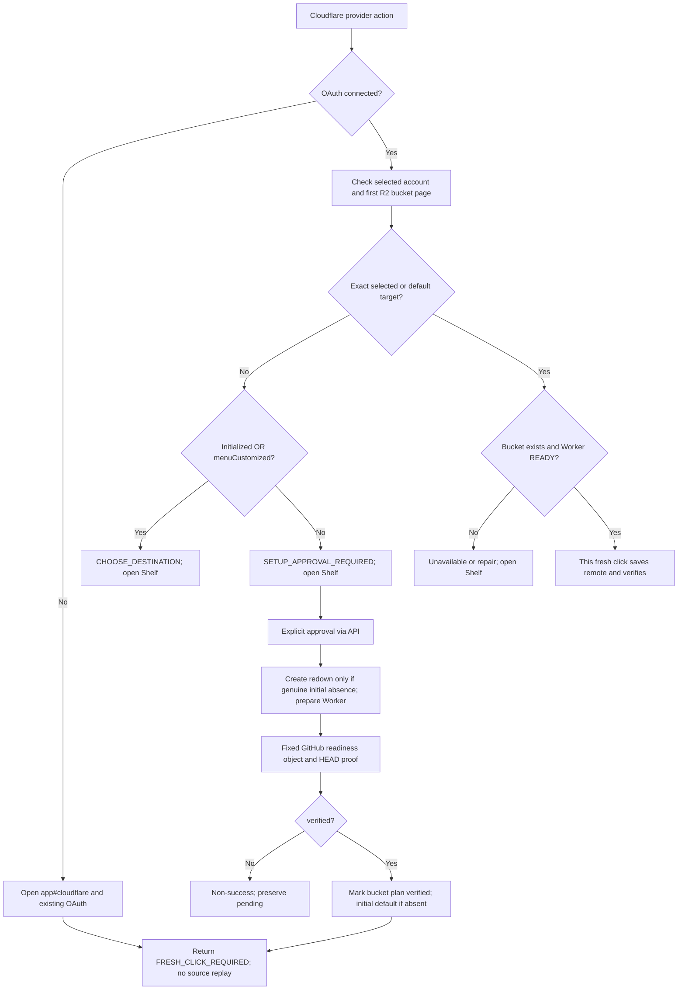
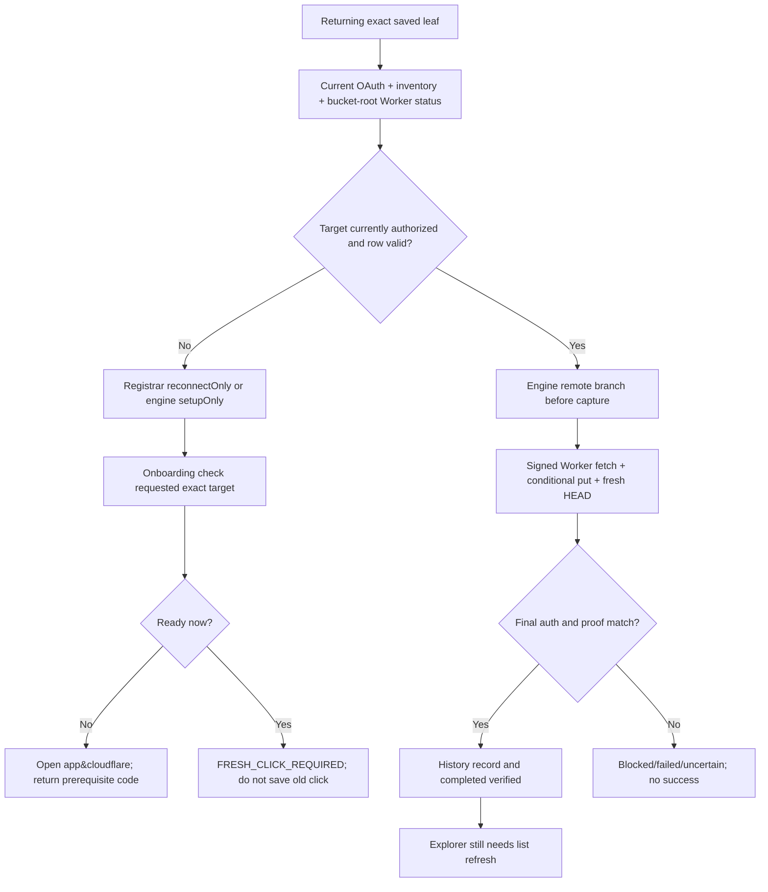

# Click2Cloud P0 right-click forensic audit — 2026-11-06

## Executive status: diagnosis complete within accessible scope; live product NOT VERIFIED

**The installed product has not demonstrated RIGHT-CLICK → CLOUD → VERIFIED SAVE.** The available incident stops at prerequisite selection/setup, not a demonstrated R2 write. Source and read-only local reproductions establish several independent product defects; neither a native ACK nor `inspectCloudflare: completed/OK` proves a transfer. Current live Worker invocation is blocked by this environment's proxy. The user's Windows Chrome profile, current executing service worker, OAuth grant, actual click event and object inventory are not accessible here. Those incident-specific conclusions remain partial.

Audited latest fetched `origin/main`: **`c7135ee12b1596097ae96b66086445d63cd8e91c`**, fetched 2026-11-06. It adds only the controlling audit request atop implementation **`f55b7d0d0a50417bebbc6ba224cfcbb6735c72fc`**. Branch: `audit/right-click-forensic-2026-11-06`. No reset, merge or amendment. Existing checkout was clean. REDOWN remains clean at `a6c17f8d0be22131d5cc38b060da4f8f3544800f`.

Controlling intent: [first-run and returning-user diagrams](../../foundations/cloudflare/README.md), [experience principles](../../foundations/cloudflare/EXPERIENCE_PRINCIPLES.md), [milestone request](../../foundations/cloudflare/CODEX_MILESTONE_01_TRUE_REMOTE_INTEGRATION.md), [implementation handoff and stated limits](../../foundations/cloudflare/MILESTONE_01_IMPLEMENTATION.md), and [this diagnosis-only request](../CODEX_P0_RIGHT_CLICK_FORENSIC_AUDIT_NO_ARTIFICIAL_LIMITS_2026-11-06.md). Relevant V3+1 guidance, FOREVER_WORKS source map, imported API/source/security/review/writer contracts and actual runtime owners were inspected. Historical specifications are behavioral context, not proof of running functionality. The retired scenario atlas was not read or run.

### Ranked root causes

1. **Provider access incorrectly depends on destination customization.** `src/core/menu-spec.mjs:86-89` only creates four providers when uncustomized and configs empty. `src/api/service.mjs:63-75` permanently marks create/delete customized. With no default or other visible choices, delete-last compiles zero rows; `menu-spec.mjs:165-168` prunes empty branches. Reproduced through actual config API: **4 provider rows → Cloudflare branch + one save/setup leaf → 0 rows**. `src/api/config.mjs:7,38` also treats any positive legacy product revision as customization. A genuinely pristine new state does produce four entries; absence on a user's “normal installation” cannot be attributed to this gate alone without their persisted state/executing revision. MENU-001–004.
2. **Menu customization is also incorrectly used as Cloudflare onboarding history.** `src/cloudflare/onboarding.mjs:32,42` returns/refuses setup with `CHOOSE_DESTINATION` when customized but no default, even without prior Cloudflare initialization. This explains a valid inspection returning no selected bucket and dashboard navigation instead of a write. Exact prior user state remains unknown. SETUP-001.
3. **Native connected setup launch has a deterministic initialization error.** `extension/app.mjs:201` awaits `cloudflarePanel()` for `#cloudflare`; its paint reads `readinessNames` at 208 before the declaration at 203 executes. Executing the unchanged app body with Node DOM/Chrome doubles reproduces **`ReferenceError: Cannot access 'readinessNames' before initialization`**. This is local code proof, not a claimed Windows screenshot. GUI-001.
4. **Unready saved rows are mislabeled as enabled saves and route to setup.** `menu-spec.mjs:81-83` enables a save leaf while retaining `WORKER_UNVERIFIED`; registrar `src/chrome/registrar.mjs:190-199` and background `extension/background.mjs:75` divert it to onboarding with `setupOnly:true`. Onboarding `:65` opens the dashboard on any nonready check. There need be **no source fetch or file write at all**. MENU-004/API-002.
5. **Even a ready route excludes almost every website and large/slow files.** Hardcoded two-site policy (`src/cloudflare/deployment.mjs:3`, background27), 64/8 MiB total limits and60s deadline (`worker.mjs:16`),65s host timeout (`transport.mjs:16`), and single-PUT/full unknown-body buffering (imported `cloudflare-r2-writer.mjs:12`, `source-fetch.mjs:26-29`) constrain the product internally. Expanding the list alone would leave an unresolved DNS/connect-time SSRF boundary. SRC-001/002, SIZE-001–004, TIME-001/002.
6. **Result visibility/recovery is incomplete even after a hypothetical successful write.** `extension/background.mjs:80-82` records outcomes but supplies no completion-to-Explorer invalidation port; GUI Refresh is manual (`app.mjs:74,88`). History has receipt inspection but no GO TO (`app.mjs:220`). Outer Worker errors after PUT can return blocked instead of uncertain (`worker.mjs:31,54`), and local history is required to inspect a receipt (`onboarding.mjs:75`). VIS-001–003, WRITE-001, VERIFY-002.
7. **Live acceptance remains blocked despite an accepted deployment.** Current settings GET200 confirms a declared binding/DO/secret; invocation still CONNECT403. Real OAuth provisioning scopes and installed Chrome save/readback remain unproven. AUTH-002/EVID-001/002. No conclusion about the user's actual deployed Worker follows from the separate isolated test Worker.

**Inventory:** 78 entries: A arbitrary internal caps **20**; B prototype artifacts/implementation defects **27**; C documented external constraints **1 grouped entry**; D essential boundaries **13**; E owner policies **5**; F unresolved investigations **12**. Severity: P0 **19**, P1 **30**, P2 **24**, P3 **5**. These are findings, not 78 artificial restrictions: the D/E entries include behavior to preserve, and C groups multiple official external limits. Each primary source guard has an exact excerpt, effects, risk, tests and remedy in the JSON. `verified:true` means source/local proof of the stated behavior, never live product success.

### Classification of each user-observed symptom

| User observation | Classification and precise attribution | What remains unknown |
|---|---|---|
| Four provider entries absent on normal installation | Source-confirmed bootstrap/migration gates are possible root causes (menu-spec86; config7). Truly pristine state does produce four. | Actual initial persisted flags/configs, loaded folder and executing build; do not claim pristine failure reproduced. |
| Manual destination makes entries appear, deletion removes them | Root cause reproduced through actual config API: service63/74 leaves customization true, menu-spec86 disables bootstrap, 165-168 prunes empty branches. | Whether any default or other config survived in user's profile. |
| Generation10 ACK has only Cloudflare branch/lab save, initially disabled then setup-enabled with WORKER_UNVERIFIED | Custom projection is consistent; current setupProvider conversion at menu-spec81-83 proves enabled/reason mismatch. Native ACK is only registration (registrar159). | Initial disabled row could reflect older runtime, providerSetupActions setting or other eligibility reasons; current background80 enables conversion. Generation10 is not source identity. No hardcoded lab target found in active path. |
| Right-click opens dashboard, no Explorer file | Onboarding65 / registrar190-199 explains navigation before save; connected hash can additionally crash (app201/203/208). No refresh subscription contributes only if an object was actually written (background80-82/app74). | Whether a native event dispatched, its actual source and status; there is no incident write receipt. Stale Explorer cannot be asserted as primary cause without proving write. |
| Old runtime exposes33 methods, reload exposes45 and inspectCloudflare | Confirms executing version matters; source registry/service19-41 contains45, build14 generates it. Not an OAuth or R2 symptom. | Exact SHA of either installed runtime and whether build output matched checkout. |
| inspectCloudflare completed/OK with CHOOSE_DESTINATION, no selected bucket/Worker | Successful inspection envelope(service219), nested prerequisite failure(onboarding32). No default plus customized/initialized can cause this. | Exact which marker/account selection caused that particular response; no direct Windows CURRENT access. |
| lastSave empty; no real upload evidence | Evidence gap, not proof of missing R2 activation. Native outcome persistence is asynchronous state/code only(background78); early registrar paths may skip it. | Whether callback/event ever reached outcome bridge or was observed in correct extension runtime. No click or write is inferred. |

## Actual system/module map

All references below describe this baseline. Files are source owners; order is execution dependency, not multiple engines.

| Boundary | Current source and lines | Execution dependency / authority |
|---|---|---|
| Installed package identity | `extension/manifest.json:1-33`; `scripts/build-extension.mjs:6-15` | MV3 service worker, extension-owned pages and host permissions. Build copies src/extension/imported src, generates45-tool registry, preserves ID `ajppphdiamdobknpamcheohmdbdbeoal`. Manifest/API versions alone do not identify source SHA. |
| Boot / trusted bridge | `extension/background.mjs:22-30,73-82,110-131`; `src/chrome/trusted-sender.mjs:1-5` | One CURRENT, OAuth, provisioner, transport, registrar, engine, API. Trusted app/document messages await ready; native click listener does not await ready. Toolbar opens app intentionally. |
| State / migration | `src/persistence/current-store.mjs:83-89,135-169`; `src/api/config.mjs:4-21,32-41` | IndexedDB CURRENT owns configs, product/default, desired/applied generations, retry records/history. Chrome local stores OAuth, discovered inventory and secret Worker plans separately. Restoring config is not restoring authorization or secret plan. |
| Canonical configuration | `src/api/service.mjs:57-89,97-101,164-184` | GUI/agents use preview/commit revision transactions; successful config commits reconcile native menu. Source API gate checks discovered authorized target before create/makeDefault. |
| Projection | `src/core/menu-spec.mjs:36-175`; `src/modes/{simple,nested,depth}/index.mjs`; `src/core/menu-identity.mjs:14-39,86-94` | Same Simple/Narrow/Depth, Quick, placement and exact target identity owners; bootstrap is a conditional projection, not a separate engine. Availability reasons include unverified Worker. |
| Native apply / click | `src/chrome/registrar.mjs:92-169,171-210`; `src/core/action-resolver.mjs:6-34` | Callback ACK only; generation/context/action binding validation. Saved ACK is not current-process ACK. Event bridge may invoke setup before transfer. |
| Save router | `src/core/engine.mjs:40-115,121-153` | Provider actions invoke onboarding; saved target resolves current authority. Cloudflare remote branch precedes capture. Non-R2 legacy byte path retained; no production drivers wired (`background:80`). |
| Onboarding | `src/cloudflare/onboarding.mjs:9-75` | Current OAuth/account + R2 inventory + exact target + Worker status. Approved setup provisions and probes; native nonready opens Shelf. Never auto-replays clicked source. |
| OAuth / discovery | `src/auth/cloudflare-oauth.mjs:8-66`; `extension/background.mjs:32-71` | Existing PKCE/state consent and current session owner; exact account discovery, bucket inventory and current write authority, no environment-token injection into extension. |
| Provision / capabilities | `src/cloudflare/deployment.mjs:6-34`; `wire.mjs:4-20`; `transport.mjs:6-37` | Approved per-account/bucket Worker + DO + R2 binding + secret; signed exact destination/source intent, live authority checks, one POST and fresh verification. |
| Remote coordinator | `right2cloud-module/src/index.mjs:6-29` | Validated canonical intent → authorize → capability → recheck → single remote POST → fresh proof → final auth/proof. Lost response after dispatch uncertain; no blind retry. |
| Worker / claims | `src/cloudflare/worker.mjs:10-59`; imported `cloudflare-worker.mjs:5-28` | Signed principal/session, immutable account/bucket/prefix binding; durable atomic claim before source fetch. One named DO per Worker handles source/write, not just claims. |
| Source / writer / verifier | imported `source-fetch.mjs:2-32`, `cloudflare-r2-writer.mjs:3-20`, `verification.mjs:2-8`; host `writer-registry.mjs:4-9` | Exact-host public HTTPS filter/manual redirects → streamed known length or buffered unknown → suffix HEAD → conditional PUT → separate HEAD. Writer sees stream/name/MIME/opID, not browsing URL. |
| Completion / Explorer | `current-store.mjs:165-169`; `extension/app.mjs:48-112,123-129,220`; `background.mjs:44-56,78-82` | Redacted history + lastSave state/code; independent listing/preview through existing File API. No automatic native-success refresh or GO TO. |
| Existing Universal File API | `src/explorer/r2-adapter.mjs:25-57,147-158,177-228`; `background.mjs:45-48` | Reads preserved; production mutation wrapper explicitly blocks legacy ports. Unreachable old upload constraints are inventoried but not attributed to remote path. |

`src/lab-worker.mjs:1-14` is an isolated health endpoint, not the deployed remote handler; `deployment.mjs:2` names the actual Worker module bundle. Source search found **no hardcoded `__redown_v3plus1_lab__` destination in the active extension/runtime**. The observed lab title is consistent with a saved destination/fixture-origin configuration, but its origin in the user's profile is **unknown**. Do not auto-delete it or replace it with redown. FOREVER_WORKS describes historical REDOWN implementation/provenance, not a reason to edit REDOWN or copy its metadata leaks.

## Native menu lifecycle traces

| Condition | Actual IF / THEN / ELSE | Outcome / evidence |
|---|---|---|
| Truly fresh install | CURRENT missing → product revision0/customized=false; configs empty; default show composite → bootstrap four | Four enabled provider-action siblings in required order; no auth required to access setup (`config:6-7`, menu86-88). Inline probe reproduces. |
| Startup/restart/reload | Background123 loads inventory → APIreconcile(service100-101) → compile → engineapply29-36 → registrarremoveAll126/create145 callbacks | New current-process ACK required. Registrar recover212-215 explicitly disclaims prior processACK. Early click before ACK can block; no native installed reproduction in this audit. |
| Disconnected + no destinations | Bootstrap remains accessible in truly fresh state; provider-action bypasses target auth but still validates ACK/action/context (resolver18-20; registrar182-185) | Cloudflare invokes existing OAuth/setup; placeholders blockedNOT_IMPLEMENTED. Not a save. |
| Connected + no default + never customized | One account auto-select for check(onboarding20); active R2 → SETUP_APPROVAL_REQUIRED32 | User grants initial setup; no manual menu required in this narrow state. Multiple accounts → explicit selection25. |
| Legacy positive revision, empty menu | config7 infers customized=true | No bootstrap; if no default/actions, composite prunes all → zero rows. Cause of user's initial empty installation suspected, not proven without local state. |
| Add manual destination | API63 sets customized;71 appends config; default unchanged unless separate MakeDefault79 | Only represented custom providers/Quick/default appear. Probe: Cloudflare branch + enabledWORKER_UNVERIFIED leaf; other3 provider actions gone. |
| Delete last manual destination | API74 splices; customized remains; default not cleared | If default=null, other modes empty/off/hidden → zero rows. If default survives, default leaf may remain(menu118-120). Never assume deletion always yields zero. |
| Make explicit default | API79 sets exact target + customized; native compile gets default(service100) | Exact configured destination wins; default can persist independently of manager row. No bucket creation from makeDefault. |
| Existing custom modes | menu89-123 respects Simple/Narrow/Depth/Quick/placement | New provider availability must be layered through same compiler without resetting/hiding user custom choices. |
| All display modes off / all rows hidden | No projected save/default; emptybranchespruned165-168 | Zero actions possible independent of transport; deliberate hide choice must not be overwritten as repair. |
| Explicit Flat | menu94-99 only exact Cloudflare default | Absent/default to another provider → DEFAULT_LOCATION_REQUIRED/no action; intentional legacyFlat policy must be retained. |
| Native registration fails | registrar126-160 clears previousACK, partial create gives failedItems and unapplied generation | Resolver rejects unACKed/stale, engine refuses incomplete logical budget. Do not treat config persistence or returned menuID as installed success. |
| Saved Cloudflare unready | getAuthorization uses only authorized+workerready targets(background68-70); registrar198-199 may divert scope/disabled result | Reconnect/setup route, not a file save. Ready same exact saved row can resolve normal save on a fresh click if live authority changes safely. |
| Multiple accounts | onboarding25 rejects absent/unauthorized selection; selected account default precedence mismatch28 can CHOOSE | Explicit selected destination's account should govern; current stale account selector can block a valid default. SETUP-002. |

**Smallest repair is not `menuCustomized=false`.** That would overwrite legitimate intent and could re-enable initial bucket initialization after intentional removal. Preserve customization and provider-specific initialized/removal markers; decouple accessible provider actions from mode configs, with explicit handling of legacy Flat/custom arrangements.

## Cloudflare first-run and returning-user diagrams as implemented



Source: onboarding22-58,60-69. Account ambiguous, inactive, permissions, unknown and network states exit before target branch (25-26). Nonready generic exit opens app, not a differentiated minimal repair launch (65). The connected `#cloudflare` UI may fail before displaying this state due to app201/203/208. The diagrams above describe executable branch intent; they do not certify screen completion.



Source: background27-30,58-78; registrar181-207; engine67-93; transport23-33; app74/88. The active *ready* save branch contains no `openShelf`; unexpected dashboard means earlier setup routing, readiness regression, stale generation/authorization or a different executing build, not an inherent R2 upload step. Global selected-account mismatch affects provider action check, whereas an exact configured leaf normally supplies requested target only during setup.

Foundation comparison:

- **Correct security/intent behavior in source:** same Shelf OAuth, no credential prompt, explicit provisioning grant, no automatic upload replay; custom exact target beats redown; missing chosen bucket refuses creation; nondefault configured repair preserves global default. References onboarding9,35-58,63-69; service117,122; OAuth16-43.
- **Fails convention over configuration:** customization confuses never initialized with intentionally removed (onboarding32/42), no seamless initial setup from arbitrary existing mode state. Pending carries account only, not full repair stage/probe reconciliation (47/54).
- **Readiness does not prove the promised current data path:** Worker capability checks list plus static flags(worker35-37), historical verifiedAt controlsREADY(transport22). Setup probe verifies metadataHEAD, not real independent byte GET. Real OAuth DO/binding permission remains unknown.
- **Returning target preservation mostly retained, account precedence can still block:** selected account comes before default account(onboarding23-28); Worker plans keyedaccount/bucket not exactprefix(deployment7/34), verifiedAt reused across prefixes. Prefix conversion itself strips one trailing slash explicitly(wire6), Worker enforces exact signed prefix and immutable prefixscope(worker13/49). Do not “repair” by falling back to redown.

## Why right-click opens the dashboard instead of saving

Here “retained” distinguishes transient source input from durable replay. Source input may exist in the engine stack; it is never durably queued for an automatic post-login save. Exact repairtarget is persisted in Chrome session storage(background30), **not source URL**.

| Branch / trigger and source | Action + result code | Source / bytes / cloud / receipt / visibility |
|---|---|---|
| Toolbar click, background121 | Explicit navigation | Opens app, no selected source or upload. Do not confuse toolbar with context event. |
| Provider-action, OAuth disconnected, registrar182→engine60-65→onboarding63 | Navigation + same OAuth; FRESH_CLICK_REQUIRED or sanitized login failure | Source transient/discarded; no file fetch, no save Worker, no R2 write, no remote save receipt or refresh. OAuth network calls are not file transfer. |
| Saved row with no authorization, registrar190-192→background75 | reconnectOnly→setupOnly | Source extraction skipped; exact target passed; same auth/setup result. No file transfer. |
| Saved row scope/disabled rejected, registrar198-199 | Divert tosetupOnly | No file transfer; setup can do read-only status network calls. `WORKER_UNVERIFIED` was projection reason; resolution may instead reportSCOPE_UNAUTHORIZED/ITEM_DISABLED. |
| Engine API path auth/resolution failure, engine70-85 | Same onboarding fallback when eligible Cloudflare row | API reserves op before engine(service206); setup outcome does not imply attempted upload. Not identical native orchestration. |
| Onboarding nonready, onboarding64-65 | OpenShelf; readiness state code (CHOOSE_DESTINATION/REPAIR_REQUIRED/ACCOUNT_AMBIGUOUS/etc) | R2inventory and possibly signedWorker `/capabilities` may be called; **no source bytes or R2 object write**. No new remote history entry because transport.save not called. |
| SetupOnly but readiness nowREADY, onboarding66 | FRESH_CLICK_REQUIRED, no dashboard from this branch | Reject stale setup click; next fresh click may save. No automatic transfer. |
| ProviderREADY but missing/nonURL/bytes source, onboarding67 | REMOTE_SOURCE_REQUIRED | No browser fallback; no Worker save or receipt. |
| Unimplemented provider, onboarding61 | Shelf navigation +PROVIDER_NOT_IMPLEMENTED | No fake login/write/receipt. Source not retained. User sees placeholder/remotes; specific native feedback is onlybadge/lastSave. |
| Ready provider route, onboarding68-69 | Transport save; verified→completed | SourceURL+filename to signedWorker; source bytesWorker-only; conditional write; independent HEAD; history recording attempt; no Explorer event. |
| Ready saved leaf, engine86-93 | Remote selected before capture; verified→completed unless completion pending | Same byte route. Remote result recorded(background81); numeric engine operation ID and UUID remoteOperationID differ explicitly. No native dashboard invocation in this branch. |
| Explorer file toCloudflare, engine123 | REMOTE_EXPLORER_SOURCE_UNAVAILABLE | Stops beforestat/readStream; no source bytes, noWorker orR2write. App offers it despite no implemented remote source capability. |
| Source unavailable/denied/oversize, imported Worker20,27 | Blocked SOURCE_DENIED/SOURCE_UNAVAILABLE/SIZE_LIMIT/BUFFER_LIMIT/HTML_NOT_SUPPORTED | May callWorker andfetch headers; nowrite untilwriter stage. Host whitelist often blocks earlier with AUTHORIZATION_DENIED(index16). Failure can enter history; never receipt success. |
| POST lost/timeout afterdispatch, importedindex20-29 | Uncertain RECONCILE_READ_ONLY | R2 may exist; no blind retry. Receipt inspection only if available; no success insertion in Explorer. |

Native outcome bridge stores only `{state,code}` and badge`!` (background78); it does not display a detailed toast or open History on failure. Early registrar catches at 185/192 can return without onOutcome. GUI maps many error codes (`app:5`) but several readiness codes are only explained inside setup (`app:203`). `src/api/menu-view.mjs:12-16` drops `setupProvider`; app preview cannot honestly distinguish setup-enabled saveleaf. These gaps make native “enabled” look like a save promise while silently entering prerequisite handling.

Connected native `#cloudflare` launch additionally crashes as above; disconnected hash boot does not call panel until later, so it can work differently. No automatic source replay is recommended as a shortcut around setup.

## Exact TRUE REMOTE flow and where the observed attempt stops

1. **Projection/ACK:** callback-confirmed rows prove Chrome accepted requested registrations, not rendering, clickdispatch or destination readiness (`registrar:145-169`). User generation10ACK with Cloudflare/lab leaf is consistent with custom mode projection; generation number does not identify source SHA.
2. **Click:** actual native listener must receive menuItemId/sourcecontext; resolver fences current generation/context/actionbinding (`registrar:181-210`, resolver14-32). Empty lastSave does not establish whether the click reached this boundary; it can also reflect early failure/stale runtime or asynchronous outcome persistence. User observation cannot be upgraded to a trace.
3. **Prerequisite gate:** user's `CHOOSE_DESTINATION`, no selected bucket/Worker proof fits onboarding32. Dashboard opening fits onboarding65. Reproduction proves this branch makes **one Shelf call and zero transport.save calls**. This is the strongest located stopping point; no incident evidence establishes a later Worker/source/write stage.
4. **If genuinely ready:** `engine:86-91` bypasses browser capture; `wire:4-6` adapts provider and prefix; `transport:6-13,27-31` authenticates current OAuth/exactbucket/scopedHMAC and signs source digest; POSTonly,no redirects/referrer/cookies. API extra contentType currently causes source digest mismatch (API-003), even with sameURL/name.
5. **Worker:** edge rejects unsigned grants beforeDO(worker58); DO validates immutable binding/revocation/intent(worker10-16), durableclaim(worker24), source public policy/importedfetch, then destination prepare and conditional write. Source privacy: Worker necessarily receivesURL; writer receives stream/name/MIME/opID, no page/referrer metadata.
6. **Write/verify:** knownlength via FixedLengthStream, atomicIf-None-Match, receiptetag/version/size/opID; separate authenticated `/verify`HEAD(worker47-51), final authority/index26-28. HEAD is storage metadata/version evidence, **not source SHA256**. OfficialR2 strong visibility means staleappview is distinct from provider propagation; see officialAPI source under external docs.
7. **Completion:** record redacted result(current165), return completed only when verified(engine92/onboarding69). OuterWorker post-write persistence can misclassify as blocked(WRITE-001); history persistence failures can produce partial(background81/engine92). No success counter/notification consumer is wired through onVerifiedCompletion inbackground80-82. No automatic Explorer invalidation; manualRefresh uses listing API.

No actual user receipt, source URL or cloudkey was inferred, collected or fabricated. The existing isolated Worker binds `redown` and testprefix; it cannot be assumed to be the user's extension's privately stored plan or authorized for their selected folder.

## Restriction inventory and practical alternatives

The following census covers the active call graph plus imported/dormant routes that could be mistakenly enabled. The machine-readable companion has exact primary-line excerpts and full test/risk fields. Secondary numeric choices embedded in a necessary guard are not automatically unavoidable external limits.

Classes: **A** arbitrary internal capacity/policy value; **B** prototype artifact/implementation defect; **C** officially documented external limit; **D** essential security or hostile-input resource boundary; **E** explicitly owner-approved policy; **F** unresolved claim. Classification F does not mean defect proven. Source-confirmed deficiencies can be verified even when live impact is unknown.

| ID / severity / class | Exact call site / guard | Current behavior → next-run direction | Coverage |
|---|---|---|---|
| MENU-001 / P0 / B | [src/core/menu-spec.mjs:86](https://github.com/thanks-cohn/Click2Cloud/blob/c7135ee12b1596097ae96b66086445d63cd8e91c/src/core/menu-spec.mjs#L86) · `bootstrap` | Four provider actions require composite + menuCustomized=false + not Flat + empty configs. Provider access is coupled to custom destination presence. **Next:** Project stable provider access through the existing compiler independently of destination configuration; preserve custom order, Quick and explicit Flat meaning. | Fresh-only test; custom test explicitly expects no provider-actions (tests/cloudflare-integration.test.mjs:17-22). |
| MENU-002 / P0 / B | [src/api/config.mjs:7](https://github.com/thanks-cohn/Click2Cloud/blob/c7135ee12b1596097ae96b66086445d63cd8e91c/src/api/config.mjs#L7) · `menuCustomized ?? revision>0` | Any legacy positive product revision is inferred customized, including a revision caused solely by theme/preferences. Empty configs can migrate to zero rows. **Next:** Migrate explicit menu intent separately from unrelated product revision; do not reset returning-user customization. | Missing focused regression |
| MENU-003 / P0 / B | [src/api/service.mjs:63](https://github.com/thanks-cohn/Click2Cloud/blob/c7135ee12b1596097ae96b66086445d63cd8e91c/src/api/service.mjs#L63) · `applyChanges customization latch` | create/update/delete/makeDefault/show/placement set menuCustomized=true; delete last never restores provider access. If no default/other visible modes remain, zero rows are ACKed. **Next:** Keep customization marker; make provider access independent. Define clear-default/removal semantics explicitly. | Audit inline API probe reproduced 4 -> 2 -> 0 rows. |
| MENU-004 / P1 / B | [src/core/menu-spec.mjs:81](https://github.com/thanks-cohn/Click2Cloud/blob/c7135ee12b1596097ae96b66086445d63cd8e91c/src/core/menu-spec.mjs#L81) · `setupProvider enabled=true` | Unready Cloudflare save leaves become enabled, retaining role=save and reason WORKER_UNVERIFIED/SCOPE_UNAUTHORIZED. Setup semantics are not included in menu-view output. **Next:** Expose an honest action state/requiresSetup in canonical rows, preview and native title/feedback without changing target identities. | Probe reproduced enabled WORKER_UNVERIFIED; src/api/menu-view.mjs:12-16 omits setupProvider. |
| MENU-005 / P2 / E | [src/core/menu-spec.mjs:94](https://github.com/thanks-cohn/Click2Cloud/blob/c7135ee12b1596097ae96b66086445d63cd8e91c/src/core/menu-spec.mjs#L94) · `show.flat` | Explicit legacy Flat is Cloudflare-default-only; absent/non-Cloudflare default yields no action. Custom modes all off or hidden also yield zero actions; branch pruning removes empty headings (165-168). **Next:** Preserve intentional layout and Flat; define independent discoverable provider access with owner intent, not force unhide custom destinations. | Missing focused regression |
| MENU-006 / P2 / A | [src/core/menu-spec.mjs:60](https://github.com/thanks-cohn/Click2Cloud/blob/c7135ee12b1596097ae96b66086445d63cd8e91c/src/core/menu-spec.mjs#L60) · `maxRows/maxOmissions=10000` | Logical row/omission budget is internal. Engine blocks applying incomplete row coverage (engine:29), so large menu cannot register rather than silently truncate. **Next:** Use scalable inspection/projection and explicit native feasibility reporting; no invented Chrome six-web-entry limit. | Canonical budget tests; no official proof that 10000 is Chrome limit. |
| MENU-007 / P2 / A | [src/persistence/schema.mjs:8](https://github.com/thanks-cohn/Click2Cloud/blob/c7135ee12b1596097ae96b66086445d63cd8e91c/src/persistence/schema.mjs#L8) · `MAX_RECORDS=4096` | Config destinations/scopes and journal/checkpoints share 4096 record ceiling (26,46); API arrays also cap4096. **Next:** Separate retention/resource controls from product capacity; page storage/config changes and migrate safely. | Persistence tests cover bounds, not product scale. |
| MENU-008 / P3 / E | [src/modes/depth/index.mjs:6](https://github.com/thanks-cohn/Click2Cloud/blob/c7135ee12b1596097ae96b66086445d63cd8e91c/src/modes/depth/index.mjs#L6) · `maxDepth ??10` | Depth default10 is user configurable positive safe integer, not a global10-level restriction; Narrow has no equivalent depth cap. **Next:** Retain explicit user Depth choice, avoid advertising default as provider limit. | Existing Narrow20 browser fixture; source confirms configurable Depth. |
| MENU-009 / P3 / D | [src/core/menu-spec.mjs:181](https://github.com/thanks-cohn/Click2Cloud/blob/c7135ee12b1596097ae96b66086445d63cd8e91c/src/core/menu-spec.mjs#L181) · `limit<=1000` | Menu inspection page size1000 and destination page20 (service:29,150-152) have continuation; they are per-page bounds, not total transfer/menu capacity. **Next:** Keep bounded pages and stable cursors; ensure callers consume every page. | Existing menu/API pagination tests. |
| BOOT-001 / P1 / F | [extension/background.mjs:123](https://github.com/thanks-cohn/Click2Cloud/blob/c7135ee12b1596097ae96b66086445d63cd8e91c/extension/background.mjs#L123) · `ready/api.reconcile` | Every MV3 evaluation reads inventory then reconciles via API. Native onClicked listener is installed before ready finishes; registrar has no ACK until reapply. A very early click may be blocked; incident timing unavailable. **Next:** Queue/fence lifecycle events until ready; retain only valid generation, report boot errors without treating saved ACK as current. | Missing focused regression |
| BOOT-002 / P2 / F | [src/chrome/registrar.mjs:45](https://github.com/thanks-cohn/Click2Cloud/blob/c7135ee12b1596097ae96b66086445d63cd8e91c/src/chrome/registrar.mjs#L45) · `timeoutMs=3000` | Each Chrome callback has fixed3s deadline; removeAll invalidates prior ACK, partial failures block normal dispatch. No measured proof3s fits all native environments. **Next:** Preserve callback ACK/generation fences; expose recoverable slow/failing registration and measured timeout policy. | Registrar tests cover ACK failures; installed Chrome absent. |
| GUI-001 / P0 / B | [extension/app.mjs:201](https://github.com/thanks-cohn/Click2Cloud/blob/c7135ee12b1596097ae96b66086445d63cd8e91c/extension/app.mjs#L201) · `await cloudflarePanel before const readinessNames` | Connected #cloudflare launch awaits panel, whose paint at 208 reads readinessNames declared at 203. Module evaluation cannot initialize it while awaiting; ReferenceError aborts launch. **Next:** Initialize presentation constants before bootstrap; retain same API/state owners. | Audit executed unchanged app body in Node with DOM/Chrome doubles: ReferenceError before initialization. |
| SETUP-001 / P0 / B | [src/cloudflare/onboarding.mjs:32](https://github.com/thanks-cohn/Click2Cloud/blob/c7135ee12b1596097ae96b66086445d63cd8e91c/src/cloudflare/onboarding.mjs#L32) · `initialized // menuCustomized` | Any menu customization with no default returns CHOOSE_DESTINATION even if Cloudflare never initialized; approved setup also refuses it at 42. Native setup cannot progress automatically from a harmless manual menu configuration. **Next:** Separate provider onboarding lifecycle from menu customization and explicit destination removal; preserve user target/default precedence. | Audit after-delete probe CHOOSE_DESTINATION; onboarding tests only initialized-removal. |
| SETUP-002 / P1 / B | [src/cloudflare/onboarding.mjs:23](https://github.com/thanks-cohn/Click2Cloud/blob/c7135ee12b1596097ae96b66086445d63cd8e91c/src/cloudflare/onboarding.mjs#L23) · `selectedAccountId before default account` | selectedAccountId wins even when stored default belongs to another authorized account; with multiple accounts and no selected account, exact default does not infer account. check returns ambiguous/CHOOSE_DESTINATION. **Next:** Resolve exact selected target first, derive its authorized account; request account choice only without exact intent. | One/multiple account test exists, not default-selection mismatch. |
| SETUP-003 / P1 / F | [src/api/service.mjs:74](https://github.com/thanks-cohn/Click2Cloud/blob/c7135ee12b1596097ae96b66086445d63cd8e91c/src/api/service.mjs#L74) · `splice only` | Deleting config does not clear product.defaultTarget. Default can keep an action present; disappearance occurs only with no surviving default/visible config. Deleting a row may differ from removing save destination. **Next:** Specify separate delete-configuration vs clear-default operations; preserve intent and initialized tombstones. | Missing focused regression |
| SETUP-004 / P1 / D | [src/cloudflare/onboarding.mjs:43](https://github.com/thanks-cohn/Click2Cloud/blob/c7135ee12b1596097ae96b66086445d63cd8e91c/src/cloudflare/onboarding.mjs#L43) · `initial redown vs original` | redown is used only with no original target; initialized/customized/repair/missing selected bucket guards block recreation (42-49). Exact nondefault configured repairs preserve global default. **Next:** Retain these invariants while decoupling onboarding from menu state. Never restore a deleted bucket implicitly. | Focused onboarding positive/negative tests. |
| SETUP-005 / P1 / B | [src/cloudflare/onboarding.mjs:53](https://github.com/thanks-cohn/Click2Cloud/blob/c7135ee12b1596097ae96b66086445d63cd8e91c/src/cloudflare/onboarding.mjs#L53) · `Node.gitignore readiness URL` | All setup requires a fixed Github text probe. Source outage/filter could block readiness for unrelated usable sources. Probe save proves metadata HEAD, not actual byte readback. **Next:** Use a controlled verifiable small probe with independent digest/readback, fail specifically if probe source unreachable; no demo-host product whitelist. | Fixtures replace transport; local workerd mocks source. |
| SETUP-006 / P3 / E | [src/cloudflare/onboarding.mjs:52](https://github.com/thanks-cohn/Click2Cloud/blob/c7135ee12b1596097ae96b66086445d63cd8e91c/src/cloudflare/onboarding.mjs#L52) · `retained readiness prefix` | Readiness creates new .click2cloud-readiness/<uuid>/readiness.txt in selected path and retains it; GUI consent explicitly explains atapp213. Repair repeats new probe. **Next:** Keep transparent consent; offer exact verified probe cleanup with separate permission if desired; do not delete unrelated keys. | Missing focused regression |
| SETUP-007 / P1 / B | [src/cloudflare/onboarding.mjs:46](https://github.com/thanks-cohn/Click2Cloud/blob/c7135ee12b1596097ae96b66086445d63cd8e91c/src/cloudflare/onboarding.mjs#L46) · `reserveOperation before pending` | Duplicate setup idempotency key returns SETUP_RETRY_REQUIRES_INSPECTION; pending tracks account only. No setup-specific operation lookup exposes stage/progress needed to safely resume uncertain bucket/Worker/probe. **Next:** Persist inspectable setup stages with exact account/target/worker/opID; reconcile read-only before authorized continuation. | Provisioner pending fixture tests only, not complete coordinator crash lifecycle. |
| SETUP-008 / P1 / A | [src/cloudflare/onboarding.mjs:15](https://github.com/thanks-cohn/Click2Cloud/blob/c7135ee12b1596097ae96b66086445d63cd8e91c/src/cloudflare/onboarding.mjs#L15) · `reject cursor/truncation` | R2 readiness reads only first1000 buckets; pagination/truncation returns UNKNOWN instead of discovering exact chosen bucket. **Next:** Implement official continuation or exact bucket read; handle repeated cursors/errors safely. | No many-bucket coordinator regression. |
| SETUP-009 / P2 / F | [src/cloudflare/onboarding.mjs:12](https://github.com/thanks-cohn/Click2Cloud/blob/c7135ee12b1596097ae96b66086445d63cd8e91c/src/cloudflare/onboarding.mjs#L12) · `English inactive regex before403` | Text matching R2 ... not enabled/activated can classify any failing status inactive before403 permission handling. Otherwise403 is correctly insufficient permission,5xx/network distinct. Official error-code mapping not proven. **Next:** Use documented structured activation/permission signals, unknown fail closed; no activation on generic403/outage. | Focused tests use English invented fixture strings, not live inactive account. |
| AUTH-001 / P1 / A | [src/auth/cloudflare-oauth.mjs:40](https://github.com/thanks-cohn/Click2Cloud/blob/c7135ee12b1596097ae96b66086445d63cd8e91c/src/auth/cloudflare-oauth.mjs#L40) · `ACCOUNT_PAGINATION_REQUIRED` | OAuth requests first50 accounts then aborts if total_pages>1. Explorer cfAccounts also requests50 and rejects noncursor multipage (background34,41). **Next:** Page complete authorized account inventory without guessing account identity. | OAuth mocks; no large real account inventory. |
| AUTH-002 / P0 / F | [src/auth/cloudflare-oauth.mjs:8](https://github.com/thanks-cohn/Click2Cloud/blob/c7135ee12b1596097ae96b66086445d63cd8e91c/src/auth/cloudflare-oauth.mjs#L8) · `registeredScopes` | Scopes name R2 read/write and workers-scripts content_read/edit plus offline_access. Real OAuth scope sufficiency for DO migrations, Worker secrets/settings/subdomain and account discovery has not been proven; dev-token deployment does not prove it. **Next:** Verify real registered app grant and actual deployment APIs; report exact denied endpoint/scope with no token substitution. | Real OAuth NOT_TESTED; control-plane token GET200 only. |
| READY-001 / P1 / B | [src/cloudflare/transport.mjs:22](https://github.com/thanks-cohn/Click2Cloud/blob/c7135ee12b1596097ae96b66086445d63cd8e91c/src/cloudflare/transport.mjs#L22) · `plan.verifiedAt` | READY uses bucket plan verifiedAt boolean plus capabilities list/digest handshake. No expiry/session/exact-prefix scope of historical probe, no current write/readback. Worker list limit1 probes whole bucket; list permission may exceed prefix-only usability. **Next:** Retain authoritative write checks; make readiness freshness/proof scope explicit, invalidate on binding/auth/code changes and test exact target. | Local tests; no live write proof. |
| READY-002 / P1 / F | [scripts/build-extension.mjs:14](https://github.com/thanks-cohn/Click2Cloud/blob/c7135ee12b1596097ae96b66086445d63cd8e91c/scripts/build-extension.mjs#L14) · `api-tools generated but no runtime build handshake` | Build generates45 tools but manifest version remains0.3.1, API3+1.1; no durable executing-source SHA handshake. A source checkout does not reload Windows Chrome worker; old33-method runtime is a separate executing version. **Next:** Expose nonsecret running build ID/API capabilities and verify installed path/reload before diagnosis. | User observed33 then45 after reload; current installed revision not accessible. |
| READY-003 / P2 / F | [src/cloudflare/deployment.mjs:8](https://github.com/thanks-cohn/Click2Cloud/blob/c7135ee12b1596097ae96b66086445d63cd8e91c/src/cloudflare/deployment.mjs#L8) · `reuse ready plan before current source digest` | Existing ready plans are reused without comparing bundled current source digest (computed onlyat21). Handshake compares saved plan digest to Worker, so both can remain old after extension upgrade. **Next:** Explicit approved upgrade/reconcile strategy keyed to current source identity; no surprise deploy during normal save. | Deployment tests cover reuse, not product update. |
| SRC-001 / P0 / B | [src/cloudflare/deployment.mjs:3](https://github.com/thanks-cohn/Click2Cloud/blob/c7135ee12b1596097ae96b66086445d63cd8e91c/src/cloudflare/deployment.mjs#L3) · `SOURCE_HOSTS` | Only raw.githubusercontent.com and upload.wikimedia.org allowed in host authorization(background27), Worker binding(deployment28) and inspect policy(onboarding74). Legitimate arbitrary public HTTPS files are blocked even if ready. **Next:** Replace exact website list with enforcing general safe egress policy; validate initial URL, all redirects and actual resolved/connect addresses. Do not merely allow wildcard domains. | Audit public python host SOURCE_DENIED; integration mocks only Github. |
| SRC-002 / P0 / F | [src/cloudflare/worker.mjs:27](https://github.com/thanks-cohn/Click2Cloud/blob/c7135ee12b1596097ae96b66086445d63cd8e91c/src/cloudflare/worker.mjs#L27) · `platform egress assumption` | Worker uses ordinary global fetch; string validation does not resolve/pin DNS addresses. No enforcing DNS-rebinding/private-address mechanism demonstrated; controlled host list narrows exposure but is not universal SSRF proof. **Next:** Before removing whitelist, prove platform enforceable public egress or introduce smallest controlled resolver/egress transport with redirect revalidation and connect-time destination guarantees. | Imported SECURITY_PRIVACY_LIMITS.md:13 acknowledges unresolved limitation. |
| SRC-003 / P1 / D | [right2cloud-module/src/source-fetch.mjs:6](https://github.com/thanks-cohn/Click2Cloud/blob/c7135ee12b1596097ae96b66086445d63cd8e91c/right2cloud-module/src/source-fetch.mjs#L6) · `HTTPS/no credentials/local names` | HTTPS, no embedded credentials, private/local/special names, control-free filename and safe redirects are essential security concepts. Never forward cookies/referrer/auth from source browser. **Next:** Retain/generalize network safety; distinguish true private ranges from all-IP and port policies. | Imported negative tests; local private source denied. |
| SRC-004 / P2 / A | [right2cloud-module/src/source-fetch.mjs:6](https://github.com/thanks-cohn/Click2Cloud/blob/c7135ee12b1596097ae96b66086445d63cd8e91c/right2cloud-module/src/source-fetch.mjs#L6) · `reject every IP literal/custom port/fragment` | Current source validator excludes public IP HTTPS and all nondefault ports, plus URL fragment rather than safely stripping it. These are conservative internal policies beyond private-network protection. **Next:** Permit demonstrably public resolved addresses/TLS-safe allowed ports when egress guarantees hold; strip fragment only in explicit source canonicalization. | Imported denies whole categories, no supported safe variants. |
| SRC-005 / P2 / A | [right2cloud-module/src/source-fetch.mjs:11](https://github.com/thanks-cohn/Click2Cloud/blob/c7135ee12b1596097ae96b66086445d63cd8e91c/right2cloud-module/src/source-fetch.mjs#L11) · `hop<=5` | At most5 redirects, missing Location or6th fails REDIRECT_DENIED. Finite loops/time defense necessary;5 is not documented provider limit. **Next:** Use cycle detection and bounded execution budget tied to transfer capability; distinguish loop, unsafe hop and exhausted navigation. | Imported redirect tests; long legitimate chain not supported. |
| SRC-006 / P1 / A | [src/core/menu-spec.mjs:64](https://github.com/thanks-cohn/Click2Cloud/blob/c7135ee12b1596097ae96b66086445d63cd8e91c/src/core/menu-spec.mjs#L64) · `contexts=['image','link']` | Native entries default image/link only; API dispatch accepts only image/link(service38-39) although previews advertise page/selection/video/audio. No selection/video/audio product extraction route. **Next:** Add genuine file media contexts through existing extractor/API; pages are not automatically downloadable files or archives. Define unsupported cases honestly. | Imported source extraction; no installed all-context acceptance. |
| SRC-007 / P2 / A | [right2cloud-module/src/source-fetch.mjs:21](https://github.com/thanks-cohn/Click2Cloud/blob/c7135ee12b1596097ae96b66086445d63cd8e91c/right2cloud-module/src/source-fetch.mjs#L21) · `HTML_NOT_SUPPORTED` | Every text/html body rejected, including legitimate downloadable HTML. No page/archive implementation should be inferred. **Next:** Distinguish selected downloadable HTML vs web page; safe attachment/content handling without executing content. | Audit inline HTML rejection; imported tests assert denial. |
| SRC-008 / P1 / B | [right2cloud-module/src/source-fetch.mjs:31](https://github.com/thanks-cohn/Click2Cloud/blob/c7135ee12b1596097ae96b66086445d63cd8e91c/right2cloud-module/src/source-fetch.mjs#L31) · `pathname-only sourceFromClick` | Filename comes only from decoded last pathname, fallback download. Ignores Content-Disposition, redirected final name, MIME extension, query download name. Type normalized by Worker29, invalid MIME silently falls back,127 char cutoff unproven. **Next:** Trusted source result returns sanitized suggested name/type; preserve valid extension and explicit name, prevent path/control/header injection. | Audit query filename=download; imported filename validation tests. |
| SIZE-001 / P0 / A | [src/cloudflare/worker.mjs:16](https://github.com/thanks-cohn/Click2Cloud/blob/c7135ee12b1596097ae96b66086445d63cd8e91c/src/cloudflare/worker.mjs#L16) · `maxBytes64MiB` | Known-length remote source stops above67108864bytes. Host inspect/UI repeat it; not documented R2 object limit. **Next:** Stream up to verified provider/runtime capabilities; remove product64MiB cap with correct accounting and scalable larger-file strategy. | Integration oversized test asserts current cap; audit header-only probe SIZE_LIMIT. |
| SIZE-002 / P0 / A | [src/cloudflare/worker.mjs:16](https://github.com/thanks-cohn/Click2Cloud/blob/c7135ee12b1596097ae96b66086445d63cd8e91c/src/cloudflare/worker.mjs#L16) · `maxBufferBytes8MiB` | Unknown/decompressed bodies fail above8388608bytes regardless of actual R2 capacity. **Next:** Use bounded-memory multipart/segmented remote pipeline where no-overwrite can be proven; resource-sized buffers are not total-file caps. | Audit generic sourceFetch tiny-budget probe BUFFER_LIMIT; imported buffer tests. |
| SIZE-003 / P1 / B | [right2cloud-module/src/source-fetch.mjs:26](https://github.com/thanks-cohn/Click2Cloud/blob/c7135ee12b1596097ae96b66086445d63cd8e91c/right2cloud-module/src/source-fetch.mjs#L26) · `chunks plus combined buffer` | Unknown lengths fully accumulate chunks then allocate second Uint8Array; roughly2x payload+overhead. Known length streams through FixedLengthStream and strict length counting. **Next:** Keep constant per-part memory; persist multipart progress and provider receipts. Do not remove bound and risk isolate OOM. | Local source mocks, no memory benchmark. |
| SIZE-004 / P0 / B | [right2cloud-module/src/cloudflare-r2-writer.mjs:12](https://github.com/thanks-cohn/Click2Cloud/blob/c7135ee12b1596097ae96b66086445d63cd8e91c/right2cloud-module/src/cloudflare-r2-writer.mjs#L12) · `storage.put only` | No multipart, source-range resumption or durable part manifest. Raising cap alone does not deliver large/slow transfers; resume must not refetch changing source without identity checks. **Next:** Extend minimal R2 writer/remote job ports only after proving final atomic no-overwrite. Use known-length streaming first; durable segmented retrieval with ETag/If-Range for stable resumable sources; fail nonresumable sources honestly. | Official API documents parts but Workers complete has no conditional option; feasibility gate remains. |
| SIZE-005 / P1 / D | [right2cloud-module/src/source-fetch.mjs:24](https://github.com/thanks-cohn/Click2Cloud/blob/c7135ee12b1596097ae96b66086445d63cd8e91c/right2cloud-module/src/source-fetch.mjs#L24) · `byte counting/exact length` | Known-length counts detect short/long bodies; FixedLengthStream supplies R2 known-length requirement. HTTP missing/bad length must not imply wrong size success. **Next:** Retain strict source size validation and independent proof across new transports. | Imported partial/short/long tests; local Workerd conditional write. |
| SIZE-006 / P1 / B | [src/cloudflare/worker.mjs:29](https://github.com/thanks-cohn/Click2Cloud/blob/c7135ee12b1596097ae96b66086445d63cd8e91c/src/cloudflare/worker.mjs#L29) · `delete encoded content-length` | Wrapper asks identity; on any nonidentity encoding drops length/encoding, forcing8MiB buffer branch. Actual Worker decompression/Response behavior on gzip/br not live verified. **Next:** Verify actual runtime decoding semantics; preserve file representation/name consistently and stream safely without trusting compressed length. | Missing focused regression |
| TIME-001 / P0 / A | [src/cloudflare/worker.mjs:16](https://github.com/thanks-cohn/Click2Cloud/blob/c7135ee12b1596097ae96b66086445d63cd8e91c/src/cloudflare/worker.mjs#L16) · `timeoutMs60000` | Worker transfer wall deadline60s includes source acquisition/name probes/write, independently of actual external CPU limits. **Next:** Use progress-aware cancellation and durable transfer jobs for long operations; finite safety bounds must reflect measured platform resources rather than total-file product ceiling. | Imported timeout tests; no long real stream test. |
| TIME-002 / P0 / A | [src/cloudflare/transport.mjs:16](https://github.com/thanks-cohn/Click2Cloud/blob/c7135ee12b1596097ae96b66086445d63cd8e91c/src/cloudflare/transport.mjs#L16) · `AbortSignal.timeout65000` | Each host POST capped65s; long saves become transport uncertainty even if cloud continues. Error normalized TRANSPORT_UNAVAILABLE and saver maps dispatched errors to RECONCILE_READ_ONLY. **Next:** Separate job submission/status from transfer lifetime, propagate precise sanitized stage and reconcile rather than resend. | Local transport tests; no live prolonged transfer. |
| TIME-003 / P1 / D | [src/cloudflare/transport.mjs:11](https://github.com/thanks-cohn/Click2Cloud/blob/c7135ee12b1596097ae96b66086445d63cd8e91c/src/cloudflare/transport.mjs#L11) · `expiresAt+120000` | 2min signed capability (Worker max5min in wire15) bounds replay/offline revocation. Existing whole transfer tied to expiry; increasing total size needs authenticated continuation, not unbounded token. **Next:** Keep finite scoped capabilities and revocation; renew per authorized job/part without replaying writes. | Imported capability/authority tests. |
| TIME-004 / P3 / D | [right2cloud-module/src/cloudflare-worker.mjs:9](https://github.com/thanks-cohn/Click2Cloud/blob/c7135ee12b1596097ae96b66086445d63cd8e91c/right2cloud-module/src/cloudflare-worker.mjs#L9) · `16KiB/5s request parse` | Control JSON16KiB/5s, tokens8192chars, responses64KiB(wire17), verify8KiB/operation1KiB(worker40,48) bound hostile input. Not file-size caps. **Next:** Retain bounded envelopes; stream/phase read timeouts and schema-specific safe sizes, no file bytes in JSON. | Imported bounded parsing tests; no stalled post-header JSON regression. |
| NAME-001 / P2 / A | [right2cloud-module/src/cloudflare-r2-writer.mjs:7](https://github.com/thanks-cohn/Click2Cloud/blob/c7135ee12b1596097ae96b66086445d63cd8e91c/right2cloud-module/src/cloudflare-r2-writer.mjs#L7) · `n<10000 suffix scan` | Sequential HEAD probes hard-stop after10000 and can consume transfer deadline even earlier; no adaptive naming. **Next:** Efficient collision-resistant Keep Both strategy with conditional atomic creation; bounded per-attempt work, no product total-name cap. | Sequential collision + concurrent local workerd checks. |
| NAME-002 / P0 / D | [right2cloud-module/src/cloudflare-r2-writer.mjs:12](https://github.com/thanks-cohn/Click2Cloud/blob/c7135ee12b1596097ae96b66086445d63cd8e91c/right2cloud-module/src/cloudflare-r2-writer.mjs#L12) · `If-None-Match:*` | Conditional put is the actual no-overwrite protection; HEAD search alone is insufficient. Concurrent selection race can failCONFLICT and never overwrite. **Next:** Preserve conditional create; retry only proven no-write conflict under same logical operation with durable stage rules. | Local Workerd verified; live R2 conditional conformance remains unverified. |
| WRITE-001 / P1 / B | [src/cloudflare/worker.mjs:31](https://github.com/thanks-cohn/Click2Cloud/blob/c7135ee12b1596097ae96b66086445d63cd8e91c/src/cloudflare/worker.mjs#L31) · `authenticate/store after written` | After inner written response, outer reauth and result persistence can throw. Outer catch54 returns blocked403 even though bytes may already be committed; saver trusts explicit blocked result(index22). **Next:** Track possibleWrite through wrapper; postwrite storage/auth/serialization failures must remain uncertain with inspectable opID/key. | Audit executed actual RemoteClaims with fake HTTP/R2/KV; one fake PUT committed before injected result-storage failure, response403 blocked/REQUEST_REJECTED. No cloud mutation. |
| WRITE-002 / P1 / D | [src/cloudflare/worker.mjs:24](https://github.com/thanks-cohn/Click2Cloud/blob/c7135ee12b1596097ae96b66086445d63cd8e91c/src/cloudflare/worker.mjs#L24) · `transaction claim` | Durable claim precedes source fetch. Duplicate operation stays uncertain/read-only inspect, not automatic retry; safe retention survives local restart. **Next:** Keep durable claims; add durable transfer state transitions, read-only reconciliation, no timeout-based unsafe release. | Focused real local SQLite restart test. |
| WRITE-003 / P2 / F | [src/cloudflare/worker.mjs:24](https://github.com/thanks-cohn/Click2Cloud/blob/c7135ee12b1596097ae96b66086445d63cd8e91c/src/cloudflare/worker.mjs#L24) · `claims/results/revocations never expire` | Claims, results and revoked sessions accumulate. One named DO per Worker(worker59) handles all transfers for its bucket, with no application admission/rate policy. Throughput/memory/storage ceiling unmeasured. **Next:** Measure concurrency and provider quotas; safe retention/tombstone lifecycle and per-job storage/dispatch; never delete claims before replay window/reconciliation safe. | Restart test only; no sustained real load. |
| VERIFY-001 / P1 / D | [right2cloud-module/src/verification.mjs:2](https://github.com/thanks-cohn/Click2Cloud/blob/c7135ee12b1596097ae96b66086445d63cd8e91c/right2cloud-module/src/verification.mjs#L2) · `acceptProof` | Fresh authorized HEAD compares exact key/destination/opID/version/etag/size. It is independent of initial write response but same Worker trust domain, not source checksum or byte comparison. **Next:** Retain strict R2 proof; add independent GET/digest evidence for real acceptance and scalable integrity where available; label proof honestly. | Imported negative proof tests; local bytes3 checked; live data not verified. |
| VERIFY-002 / P1 / B | [src/cloudflare/onboarding.mjs:75](https://github.com/thanks-cohn/Click2Cloud/blob/c7135ee12b1596097ae96b66086445d63cd8e91c/src/cloudflare/onboarding.mjs#L75) · `history find before /operation` | Receipt inspection requires local history operation. Native process death before record can leave durable Worker receipt with no local inspect path; claim stores digest not prepared key. Write after response-loss may lack result record. **Next:** Persist minimal job/opID/target before dispatch; expose authorized operation status without requiring successful local history; durable prepared/final receipt state. | Local restart test claims only; history-loss recovery absent. |
| VIS-001 / P0 / B | [extension/background.mjs:81](https://github.com/thanks-cohn/Click2Cloud/blob/c7135ee12b1596097ae96b66086445d63cd8e91c/extension/background.mjs#L81) · `record result but no completion/refresh port` | Background records remote result but supplies no onVerifiedCompletion/onSaveOutcome notification to open app. No storage/runtime subscription invalidates Explorer listing on native save. Existing Refresh fetches list(app75,88). **Next:** Publish minimal nonsecret verified destination invalidation through canonical result owner; UI refresh only matching current listing/tree. Never refresh/signal success before proof. | Browser fixtures navigate fake lists; no live native-to-list result test. |
| VIS-002 / P1 / B | [extension/app.mjs:220](https://github.com/thanks-cohn/Click2Cloud/blob/c7135ee12b1596097ae96b66086445d63cd8e91c/extension/app.mjs#L220) · `remoteHistory receipt only` | History shows state/key/receipt; no GO TO exact destination, live update or Explorer invalidation. Native lastSave only state/code(background78), not transfer stage/operation identity. **Next:** Add API-backed exact result navigation/status and live result observation; distinguish readiness from save and ACK from save. | Fixture opens history only; no verified native history navigation. |
| VIS-003 / P2 / A | [src/persistence/current-store.mjs:165](https://github.com/thanks-cohn/Click2Cloud/blob/c7135ee12b1596097ae96b66086445d63cd8e91c/src/persistence/current-store.mjs#L165) · `slice0,100` | Only latest100 results retained; inspectRemoteReceipt depends on retained history. Older unsettled operations lose UI reconciliation even though claims remain. **Next:** Page history with explicit retention and preserve unresolved jobs until resolved; bounded UI pages need not cap retained operation access. | No long-history recovery regression. |
| EXP-001 / P1 / B | [src/core/engine.mjs:123](https://github.com/thanks-cohn/Click2Cloud/blob/c7135ee12b1596097ae96b66086445d63cd8e91c/src/core/engine.mjs#L123) · `REMOTE_EXPLORER_SOURCE_UNAVAILABLE` | All Cloudflare Explorer saves blocked before checking for an authorized remote source. GUI still offers Save to cloud for files and confirmed dispatch, including bootstrap setup actions (app123-127). **Next:** Use existing Universal File API to offer only legal remote source capability (server-to-server read/copy or scoped source), otherwise explicit unsupported before dialog. No browser fallback. | Current tests enshrine unconditional refusal, not future permitted source. |
| LOCAL-001 / P2 / A | [src/core/source-capture.mjs:4](https://github.com/thanks-cohn/Click2Cloud/blob/c7135ee12b1596097ae96b66086445d63cd8e91c/src/core/source-capture.mjs#L4) · `32MiB/30s` | Eligible non-R2 browser capture buffers all file bytes up to32MiB and30s; Cloudflare bypasses this branch(engine86-96). Not Cloudflare64MiB cap cause. **Next:** For future actual non-R2 drivers use streaming/session upload with resource buffers; never route R2 here. | Focused engine capture mocks. |
| LOCAL-002 / P2 / A | [extension/app.mjs:129](https://github.com/thanks-cohn/Click2Cloud/blob/c7135ee12b1596097ae96b66086445d63cd8e91c/extension/app.mjs#L129) · `32MiB local file cap` | GUI picker hard cap32MiB and arrayBuffer copies, filters Cloudflare targets. API byte-array schema max33554432(service39); engine Explorer buffer limit32MiB(engine132). **Next:** Remove arbitrary local-transfer cap through actual supported non-R2 streaming transport/API; keep R2remote-only and useful unsupported UI. | Local fixture only; providers={} in productionbackground80. |
| EXP-002 / P2 / A | [src/api/service.mjs:144](https://github.com/thanks-cohn/Click2Cloud/blob/c7135ee12b1596097ae96b66086445d63cd8e91c/src/api/service.mjs#L144) · `readFile8MiB` | All GUI Open/Download previews use readFile: buffers8MiB then converts bytes to number array. App download is preview blob(app109-112), not independent streaming Download, so larger object download unavailable there. **Next:** Separate bounded preview from streaming authorized download; expose API parity without giant JSON arrays. | Explorer API tests small fixtures. |
| EXP-003 / P3 / A | [src/explorer/configuration.mjs:6](https://github.com/thanks-cohn/Click2Cloud/blob/c7135ee12b1596097ae96b66086445d63cd8e91c/src/explorer/configuration.mjs#L6) · `64MiB/512KiB preview` | Library preview defaults64MiB/512KiB text, tunable. Production app uses readFile8MiB instead. Preview bound is memory safety but value not total-file/provider limit. **Next:** Keep bounded preview/progressive text and independent download; report active limit not dormant default. | Library tests options; actual app different path. |
| EXP-004 / P2 / B | [src/explorer/r2-adapter.mjs:181](https://github.com/thanks-cohn/Click2Cloud/blob/c7135ee12b1596097ae96b66086445d63cd8e91c/src/explorer/r2-adapter.mjs#L181) · `beta300MB upload` | Imported Universal File API has300000000byte beta upload cap/staging .redown-beta-uploads. Production wrapper blocks upload before this code(background47); not an active R2remote cap. Direct library use can still stage browser bytes. **Next:** Keep Cloudflare product wrapperremote-only; label library legacy routes and prevent accidental future wiring. Do not fix audit by enabling old upload. | Source reachability; no production adapter upload enabled. |
| EXP-005 / P1 / E | [extension/background.mjs:47](https://github.com/thanks-cohn/Click2Cloud/blob/c7135ee12b1596097ae96b66086445d63cd8e91c/extension/background.mjs#L47) · `read-only fileApi allow operations` | Only accounts/buckets/list/listRaw/stat/preview/readStream allowed in installed Universal File API wrapper; copy/move/mkdir/delete/upload blocked. It preserves safety of unconfigured legacy mutation ports, not proof every library feature works. **Next:** Expose supported capabilities precisely; add only separately authorized tested operations in future scope. Do not enable legacy mutators as remote-save fix. | Missing focused regression |
| EXP-006 / P2 / A | [src/explorer/r2-adapter.mjs:56](https://github.com/thanks-cohn/Click2Cloud/blob/c7135ee12b1596097ae96b66086445d63cd8e91c/src/explorer/r2-adapter.mjs#L56) · `1000 stat pages` | Metadata lookup scans prefix pages and stops1000; active listing per_page1000 has cursor and repeated/truncated guard. Bucket discovery background41 may refuse page-number APIs. **Next:** Use exact authorized HEAD/stat where supported and complete paging; no fixed total page-count refusal for legitimate large scopes. | Library listing tests; not scale. |
| NET-001 / P2 / A | [src/auth/cloudflare-oauth.mjs:60](https://github.com/thanks-cohn/Click2Cloud/blob/c7135ee12b1596097ae96b66086445d63cd8e91c/src/auth/cloudflare-oauth.mjs#L60) · `default30s request` | Default OAuth fetch signal30s includes object read stream after headers. R2 adapter requestTimeout option is passed as timeoutMs but OAuth request does not consume it, so selected adapter options do not actually override default. readFile8MiB adds tightercap. **Next:** Align source owner request timeout options; distinguish control-call deadline from progressive body streaming. | No real slow-stream API test. |
| API-001 / P2 / D | [src/api/service.mjs:219](https://github.com/thanks-cohn/Click2Cloud/blob/c7135ee12b1596097ae96b66086445d63cd8e91c/src/api/service.mjs#L219) · `completed inspection envelope` | inspectCloudflare outer completed/OK means inspection succeeded, not Cloudflare READY. Nested status can CHOOSE_DESTINATION, blocked or REPAIR_REQUIRED. API schemas allow untyped data{}; easy for callers to conflate. **Next:** Document typed action/readiness states and completion evidence; UI/native consume inner state and expose exact prerequisite. | User observed valid inspection, not upload receipt. |
| API-002 / P1 / B | [extension/background.mjs:75](https://github.com/thanks-cohn/Click2Cloud/blob/c7135ee12b1596097ae96b66086445d63cd8e91c/extension/background.mjs#L75) · `native reconnect bridge` | Native reconnect dispatch calls onboarding.invoke directly; API dispatchSave enters engine. Native gets registrar.setupOnly before source extraction; API saves reserve first and engine may lose precise source errors. Same business owners but different orchestration/error surfaces. **Next:** Canonical shared action route and inspectable intent/result; preserve native event bridge, ACK, exact target, one engine. | Separate fixture route tests, no cross-surface ready/nonready equivalence. |
| API-003 / P1 / B | [src/cloudflare/transport.mjs:12](https://github.com/thanks-cohn/Click2Cloud/blob/c7135ee12b1596097ae96b66086445d63cd8e91c/src/cloudflare/transport.mjs#L12) · `digest(source) vs canonical intent` | cap signs caller source object; imported saver serializes onlyurl+filename(index14). API dispatchSave allows contentType, which is dropped from intent but remains digest. Worker compares digest(intent.source) at 15 and denies. **Next:** Canonicalize source once before digest and transport serialization; reject unsupported fields consistently without dropping authority data. | Audit actual RemoteClaims.authenticate rejects canonical intent signed from same source plus optional contentType: CAPABILITY_DENIED. |
| API-004 / P2 / B | [extension/app.mjs:188](https://github.com/thanks-cohn/Click2Cloud/blob/c7135ee12b1596097ae96b66086445d63cd8e91c/extension/app.mjs#L188) · `direct CURRENT backup staging` | Directory picker writes backup handle directly via new CURRENT owner then callsAPI; Explorer navigation/selection/back/forward/Refresh are GUI-local, although data listing API exists. No stable browse-view/refresh/save-result GO TO command. **Next:** Add minimal trusted host handle-registration port; expose meaningful navigation/result refresh contracts through existing API while keeping ephemeral DOM rendering local. | Existing fixture GUI/API coverage not exhaustive. |
| API-005 / P2 / B | [src/api/service.mjs:223](https://github.com/thanks-cohn/Click2Cloud/blob/c7135ee12b1596097ae96b66086445d63cd8e91c/src/api/service.mjs#L223) · `serialized work queue` | Provision/config/save methods share queue, so long save can block unrelated UI commands; auth/inspect exceptions bypass queue. All mutating GUI API confirms automatically(background111), actual consent lives in app confirm dialogs; trusted host agent grants remain separate. **Next:** Split short revision/claim transaction from awaited transfer; explicit stable consent intents for provision and destructive operations, no duplicate engine. | Focused grant tests; long UI contention not measured. |
| SEC-001 / P0 / D | [extension/background.mjs:117](https://github.com/thanks-cohn/Click2Cloud/blob/c7135ee12b1596097ae96b66086445d63cd8e91c/extension/background.mjs#L117) · `trustedAppSender and no external listener` | Exact extension app/document sender, trusted storage access(background22), expiring method/account grants(permissions11-26), HMAC binding/destination/revocation remain essential. No arbitrary external endpoint/content script added. **Next:** Preserve closed schemas, trusted local gateway, exact destination and scoped capabilities during repairs. | Focused permissions/sender tests. |
| SEC-002 / P0 / D | [right2cloud-module/src/cloudflare-r2-writer.mjs:12](https://github.com/thanks-cohn/Click2Cloud/blob/c7135ee12b1596097ae96b66086445d63cd8e91c/right2cloud-module/src/cloudflare-r2-writer.mjs#L12) · `minimal object metadata` | Only operationId + MIME type written to R2 metadata, not URL/referrer. Host history selects redacted fields(current165); source URL necessarily reaches source-fetch Worker. Claims store fingerprint, not URL. Observability disabled(deployment25). **Next:** Keep provenance out of object metadata, history/export/logs; verify platform logging and source signed-query redaction independently. | Local privacy tests, live metadata not read. |
| SEC-003 / P1 / D | [right2cloud-module/src/common.mjs:11](https://github.com/thanks-cohn/Click2Cloud/blob/c7135ee12b1596097ae96b66086445d63cd8e91c/right2cloud-module/src/common.mjs#L11) · `1024 UTF8 key bytes` | R2 object key max1024bytes is external documented constraint. Prefix+filename checked atwriter.prepare. Core prefix already can be1024bytes before filename, so saved config can be unsaveable after joining. Global key limit on future providers should be capability-specific. **Next:** Validate full final key early per actual provider; retain traversal/control protection; no hard arbitrary folder-depth limit. | Imported key test; official R2 limit corroborates. |
| EXT-001 / P2 / C | [src/cloudflare/worker.mjs:29](https://github.com/thanks-cohn/Click2Cloud/blob/c7135ee12b1596097ae96b66086445d63cd8e91c/src/cloudflare/worker.mjs#L29) · `Cloudflare Worker/R2 runtime` | Official docs:128MB Worker memory,6 outgoing connections/request, plan-dependent activeCPU, R2 known-length stream requirement and documented object/part/key limits. None proves64/8MiB or60/65s product ceilings. **Next:** Measure selected plan + actual DO/Worker route; bounded per-part memory/concurrency and resource-aware strategy. Do not confuse tiny inbound control JSON with remote source bytes. | Official source docs fetchedHTTP200; live data path blocked. |
| PROVIDER-001 / P2 / E | [src/cloudflare/onboarding.mjs:61](https://github.com/thanks-cohn/Click2Cloud/blob/c7135ee12b1596097ae96b66086445d63cd8e91c/src/cloudflare/onboarding.mjs#L61) · `nonCloudflare NOT_IMPLEMENTED` | Drive/Dropbox/OneDrive open Shelf then return PROVIDER_NOT_IMPLEMENTED; production providers={}background80. Four rows do not mean four working upload drivers. **Next:** Keep honest placeholders and stable API/provider identities; future drivers separately authorized and verified. Current next run focus Cloudflare. | Focused blocked placeholder and browser fixture. |
| SEAM-001 / P2 / F | [src/cloudflare/writer-registry.mjs:4](https://github.com/thanks-cohn/Click2Cloud/blob/c7135ee12b1596097ae96b66086445d63cd8e91c/src/cloudflare/writer-registry.mjs#L4) · `R2 production writer only` | Trusted factory seam checks kind/conditionalCreate/methods. Common.destination and verifier still R2specific; injected double proves structural call shape only, not drop-inMEGA or genericS3. **Next:** Retain small tested writer seam; when a real later provider is authorized add its intent/proof/capability adapter rather than weaken R2 proof or rewrite menus. | Structural local test only. |
| EVID-001 / P0 / F | [docs/evidence/cloudflare-m01/browser/browser-results.json:1](https://github.com/thanks-cohn/Click2Cloud/blob/c7135ee12b1596097ae96b66086445d63cd8e91c/docs/evidence/cloudflare-m01/browser/browser-results.json#L1) · `installed extension blocked` | Prior Chromium155 unpacked load administrator-blocked; seven app fixtures are doubles, not native save. Current audit intentionally does not alter browser state. Windows installed profile and executing Worker inaccessible. **Next:** Next authorized run obtain administrator-approved installed Chrome; record build/API/generation/click/request/receipt/readback separately. | Prior committed evidence + user observations; no rerun installed Chrome. |
| EVID-002 / P0 / F | [docs/evidence/cloudflare-m01/live-results.json:1](https://github.com/thanks-cohn/Click2Cloud/blob/c7135ee12b1596097ae96b66086445d63cd8e91c/docs/evidence/cloudflare-m01/live-results.json#L1) · `CONNECT403` | Read-only GET to existing testWorker host again blocked proxyCONNECT403. Settings GET200 proves R2 redown binding,DO/secret declaration only; no data-plane execution/write/readback. Do not redeploy to solve proxy denial. **Next:** Apply supported network setting separately if authorized; reuse owned isolated resource only for later approved verification. No proxy bypass or token request. | Audit current network GET and sanitized control-plane GET; docs/evidence historical BLOCKED. |
| EVID-003 / P1 / B | [tests/cloudflare-integration.test.mjs:21](https://github.com/thanks-cohn/Click2Cloud/blob/c7135ee12b1596097ae96b66086445d63cd8e91c/tests/cloudflare-integration.test.mjs#L21) · `assert no provider-actions customized` | Tests intentionally assert no provider-actions for customized layout, assert oversized rejection and unconditional Explorer refusal; green suite certifies narrowed behavior. Browser fixtures never open connected native #cloudflare bootstrap. **Next:** Use foundations/current request as acceptance authority; add lifecycle/native launch/public source/large stream/live receipt tests before repair. | Current129+49PASS; historical7fixturePASS distinct from native proof. |
| READY-004 / P1 / B | [extension/background.mjs:64](https://github.com/thanks-cohn/Click2Cloud/blob/c7135ee12b1596097ae96b66086445d63cd8e91c/extension/background.mjs#L64) · `remoteReady(s.target) on bucket-root scope` | getInventory tests Worker readiness at bucket-root scope, even for a saved nested target. A Worker whose immutable PREFIX_SCOPE allows only that nested prefix rejects root capability binding, so otherwise valid exact-target saves are excluded from authorizedTargets. Default production provisioning uses empty prefixScope; isolated test deployment is prefix-scoped. **Next:** Cache/check Worker and authority readiness by exact target/prefix; use permitted read checks at that prefix. Preserve immutable prefix restrictions. | Source confirmed; no dedicated configured-prefix-only Worker regression. No incident/live save proof. |

### External constraints verified against official documentation

Cloudflare's official `cloudflare/cloudflare-docs` production branch was fetched read-only on 2026-11-06 (HTTP 200). Retrieval SHA256 values for the first three sources are embedded in the JSON evidence. Public docs establish documented capabilities, not measured limits of this account or deployed route. A guessed standalone multipart documentation path returned 404; no finding depends on it.

| Official reference and inspected source lines | Documented constraint and practical meaning |
|---|---|
| [R2 limits](https://developers.cloudflare.com/r2/platform/limits/) ([official source](https://raw.githubusercontent.com/cloudflare/cloudflare-docs/production/src/content/docs/r2/platform/limits.mdx), 18–31) | Key: 1,024 UTF-8 bytes; metadata: 8,192 bytes; nominal single upload: 5 GiB; multipart object: approximately 4.995 TiB; 10,000 parts; same-key write rate: 1/s. The table and footnote 4 differ in nominal versus exact upload wording (footnote says 5 MiB less than 5 GiB). Verify actual accepted byte boundaries before promising a maximum. None establishes 64/8 MiB as a service limit. |
| [Workers limits](https://developers.cloudflare.com/workers/platform/limits/) ([official source](https://raw.githubusercontent.com/cloudflare/cloudflare-docs/production/src/content/docs/workers/platform/limits.mdx), 25–27, 69–110, 156–165) | 128 MB memory; six simultaneous outgoing connections per request; plan-dependent active CPU budget. Waiting on network is not active CPU. Ordinary HTTP Workers have no hard wall-duration limit while the client remains connected. That does not prove indefinite background processing or this nested Durable Object route. The 60/65-second product deadlines are internal. |
| [R2 Workers API](https://developers.cloudflare.com/r2/api/workers/workers-api-reference/) ([official source](https://raw.githubusercontent.com/cloudflare/cloudflare-docs/production/src/content/docs/r2/api/workers/workers-api-reference.mdx), 117, 235–267) | PUT readable streams must have known length. FixedLengthStream supplies it when known. Multipart parts also need known length, uniform except the final part. A resume handle does not validate that the upload still exists. Incomplete uploads normally abort after seven days. Documented `complete(parts)` has no conditional option: atomic no-overwrite completion must not be assumed. Completed objects are immediately globally readable; the app still needs to refresh. |
| [Durable Object limits](https://developers.cloudflare.com/durable-objects/platform/limits/) ([official source](https://raw.githubusercontent.com/cloudflare/cloudflare-docs/production/src/content/docs/durable-objects/platform/limits.mdx), 13, 27, 36) | Workers limits also apply. SQLite DO active CPU defaults to 30 seconds, configurable up to five minutes, reset by incoming requests. This is not a measured throughput guarantee for a bucket-wide DO. Retrieved source SHA256: `35202d5202aee9ba27ddd5221dffe5c715cd2eed1edb8bec12e6c17ee1b69397`. |

**Practical alternatives to investigate next:**

- General public HTTPS requires an enforcing public-network egress boundary, not a larger website list. Validate initial URLs, redirects and resolved/connect-time addresses. DNS preflight followed by an unpinned second resolution does not solve rebinding. If Worker fetch cannot establish this guarantee, investigate a narrowly scoped trusted resolver/egress transport; keep cookies, browser credentials and referrers absent.
- Keep known-length streaming, exact byte counting and conditional PUT, and remove the arbitrary 64 MiB total cap after testing actual provider/runtime capacity. Keep per-buffer memory bounds. Worker inbound body limits apply to the small control request, not automatically to remotely fetched file responses.
- Unknown-length or very large files need bounded parts and durable state: upload ID, source identity, parts, final proof, inspection and authorized abort. A job submission/status protocol can avoid a 65-second synchronous UI deadline. Short-lived grants should authorize continuation, not expire the whole transfer without recovery.
- **Multipart feasibility gate:** the documented binding completion signature has no `onlyIf`. Do not HEAD then complete over a user's existing filename, or copy staging data without a conditional final commit. Investigate and test official R2 conditional S3 completion or another provably safe R2-specific commit mechanism. Do not promise it works, silently change naming semantics, or implement a generic S3 driver merely to speculate.
- Range/resume requires demonstrated Range support and stable source identity (for example ETag/If-Range with length/integrity checks). A source ignoring ranges or changing bytes cannot be resumed by blind refetch. Evaluate continuously connected streaming or another verified Cloudflare job architecture for such sources; retain uncertainty whenever commit may have occurred.

## GUI / native / programmatic API parity

Registry and implementations: `src/api/service.mjs:19-41,97-224`, version `3+1.1`. Forty-five registered tools do not mean forty-five working cloud operations. Native events may bridge directly to the same engine/business owner; parity requires equivalent authorization, destinations and outcomes, not a second engine.

| Meaningful workflow | Current API / owner | Evidence and gap |
|---|---|---|
| Inspect build, config, connections | describeCapabilities, getConfiguration, getProviderConnections | Present (service127-130); no executing build SHA. Reported 32 MiB sourceCaptureMaxBytes is the browser route's limit. |
| Login, status, cancel, disconnect | loginBegin, loginStatus, loginCancel, disconnect | Existing OAuth owner; agent interactiveAuth grant plus confirmation (service131-133, permissions16). Real consent unverified. Native onboarding invokes the same OAuth owner directly at onboarding63. |
| Readiness, account selection | inspectCloudflare, checkCloudflareR2, selectCloudflareAccount | Present (service118-120); nested state matters, bucket paging and account/default precedence defective. |
| Activation / return / Continue | openCloudflareActivation, checkCloudflareR2 | Guarded by positive inactive result (onboarding73). GUI focus triggers check (app221). Live activation route not verified. |
| Initial setup / repair | approveCloudflareSetup, repairCloudflareDestination | Separate provision scope and confirmation (service117,122); no complete setup-job inspection/resumption API. GUI consent at app213 mentions initial redown even during custom repair. |
| Exact default and destination manager | previewConfigChange, commitConfigChange with makeDefault/create/update/delete | Shared revision/discovery/identity gates (service63-79,168-178). No explicit clear-default operation. Deleting a manager row does not clear default. |
| Modes, titles, Hide, Quick, placement, theme, Favorite, suggestion | Same config API; getOrganizationSuggestion | Shared canonical state (service63-94); preserve explicit user choices. Seven-entry suggestion is usability policy, not a Chrome hard limit. |
| Native preview / apply / ACK / tree | previewNativeMenu, inspectNativeACK, reconcileNativeMenu, inspectMenuTree, previewContextMenu | Same compiler/registrar (service154-184). Preview omits setupProvider (`menu-view:12-16`). Generated, ACKed and observed are separate proof. |
| Provider connect/setup / native action | invokeProviderAction; registrar → engine/onboarding | Exposed (service123); native reconnectOnly shortcut differs from API orchestration (background75). Source-less invocation is setup, not a file save. |
| Ready URL save | dispatchSave → engine.save → remote transport | Real route exists (engine86-93), but installed/live success unverified. API optional contentType creates signature mismatch. |
| Explorer file save | dispatchExplorerSave | Present but all Cloudflare Explorer saves blocked (engine123). GUI can still offer them (app123-127); legal remote-source capability absent. |
| Local file save | dispatchSave with bytes | GUI 32 MiB cap; Cloudflare filtered (app129). No non-R2 production drivers wired (background80). Never enable R2 browser fallback. |
| Accounts, buckets, folders, metadata | listAccounts, listAuthorizedBuckets, listFolders, fileMetadata | Existing File API reads (service135-147); account paging gap and metadata lookup budget. |
| Preview and Download | readFile | 8 MiB buffered JSON route (service144), then Blob download (app109-112); no independent large-file streaming Download in the GUI. |
| Explorer navigation, selection, refresh, result GO TO | Data reads via listFolders; local navigate/source/selection | GUI state at app6/73-88, no stable headless navigation/result refresh/GO TO operation. DOM rendering may stay local, meaningful workflow needs API equivalence. |
| Results and reconciliation | inspectRemoteHistory, inspectRemoteReceipt | Present (service124-125); only latest100, receipt lookup requires local history (onboarding75/current165), no pre-dispatch durable job lookup. |
| Recovery / folder selection / restore / crawl | chooseBackupLocation, inspectBackupRoots, writeRecovery, requestRestorePreview, restoreRightClickMenu, runRecoveryPage | Existing shared commands (service185-197), but directory picker writes a handle directly through CURRENT (app188). Add trusted host capability registration rather than accepting arbitrary filesystem paths. |
| Whole Cloud outlines | enableWholeCloudJob, disableWholeCloudJob, inspectWholeCloudJobs | Existing read-only jobs (service199-202/background92-108). Preserve quiet login and explicit authorization; not an upload path. |
| Legacy File API mutations | Library copy/move/mkdir/upload/etc | Production wrapper blocks them (background47). Do not advertise library capability as installed functionality or enable legacy upload as repair. |
| Agent access | Trusted gateway plus method/account grants | permissions11-26, gateway8-12, background124-130; retain no public listener, no client-issued grants, restrictive account checks. |

## Evidence matrix and why green tests missed it

| Evidence tier | Result | What this establishes |
|---|---|---|
| Source | Latest main c7135ee inspected; runtime identical to f55b7d0 | Source behavior, not the executing Windows build. |
| Maintained focused tests | **129 passed, 0 failed, 0 skipped**, Node24.22.1, `npm run test:focused`, 7924.286238 ms | Local regression suite including real local workerd/R2/SQLite; no actual-account R2 save. |
| Imported module | **49 passed, 0 failed, 0 skipped**, `node --test right2cloud-module/tests/*.test.mjs`, 446.666359 ms | Candidate behavior with injected external ports. |
| New read-only probes | Actual API 4→2→0; CHOOSE_DESTINATION with Shelf1/save0; source/size/HTML guards; hash mismatch; connected hash boot ReferenceError; post-write persistence failure returns blocked403 after one fake PUT | Defects reproduced with actual modules and explicit in-memory DOM/Chrome/HTTP/storage doubles. No browser or cloud mutation. |
| Historical build / type / seven Chromium fixtures | Prior receipts reviewed, **not rerun** | [verification.json](../evidence/cloudflare-m01/verification.json) and [browser-results.json](../evidence/cloudflare-m01/browser/browser-results.json) remain unchanged. Fixtures are not installed-Chrome passes. |
| Installed Chrome | **BLOCKED / NOT VERIFIED** | Prior unpacked load denied by administrator. User's Windows profile and actual native clicks unavailable; browser state was not changed in this audit. |
| Cloudflare control plane | Read-only settings **HTTP200** | Existing isolated Worker declares redown R2 binding, DO binding and secret binding. Does not establish live execution, app OAuth permission or write proof. |
| Worker data plane | **BLOCKED: proxy CONNECT403** | Read-only unsigned GET could not reach the Worker; this is proxy denial, not an application authentication response. |
| Actual R2 write + independent readback from installed extension | **NOT VERIFIED** | No mutations authorized in this audit, no actual object receipt claimed. |
| REDOWN | Clean, unchanged at a6c17f8 | Read-only Git checks only. |

Tests missed the incident because their acceptance scope was narrower:

- `tests/cloudflare-integration.test.mjs:17-22` checks pristine four rows but explicitly expects no provider-actions after customization. No actual API create/delete/restart provider-presence regression exists.
- Its source mock at 51 uses Github and asserts rejection above64MiB. Explorer refusal is asserted at 31. These certify restrictions rather than broad safe source and transfer support.
- `tests/cloudflare-onboarding.test.mjs:8-13` uses preselected account and a fake always-verified transport. It cannot prove real OAuth, a cloud write, independent byte readback or full crash recovery.
- `scripts/test-product-browser.mjs:74-82` logs into a fixture and opens setup using a **button**, not a connected `#cloudflare` bootstrap. The fragment test (`tests/cloudflare-integration.test.mjs:83`) checks trusted sender validity, not page execution. Browser transport is doubled (script13).
- Local restart proves claim survival, not recovery of a receipt missing from local history or failure in outer Worker persistence after commit. Local concurrency may return safe CONFLICT; it does not guarantee every Keep Both save succeeds.

No `cloudflare-live.mjs`, OAuth flow, deployment, browser load, environment change or R2 mutation was run. Existing evidence was not overwritten. The historic default `npm test` and retired scenario atlas were not run; the entire historical test set is not claimed green.

### Reproducible read-only diagnosis

From the audited checkout with Node22+ and installed lockfile dependencies:

```sh
git rev-parse HEAD
git status --short
npm run test:focused
node --test right2cloud-module/tests/*.test.mjs
```

Minimal compile-gate reproduction (no persisted user state):

```sh
node --input-type=module <<'JS'
import {compileMenuSpec} from './src/core/menu-spec.mjs';
import {productState} from './src/api/config.mjs';
const configs={simple:{destinations:[]},nested:{destinations:[]},depth:{scopes:[]}};
for(const product of [productState(),productState({menuCustomized:true}),productState({revision:1})]){
  console.log(product.menuCustomized,compileMenuSpec({mode:'composite',product,configs,inventory:{scopes:[]}}).rows.map(r=>r.label));
}
JS
```

Expected: `false [Google Drive,Dropbox,OneDrive,Cloudflare R2]`, `true []`, `true []`. Full in-memory API/app probe and receipts follow.

### Additional probe receipts and exact harness

This in-memory harness uses actual API/compiler/onboarding/source/app modules with explicitly doubled external owners. It wrote no cloud/browser/persisted user state. Paths below are the audit container checkout. The app body is executed unchanged after removing its import line and injecting its two imported functions; no source file is edited. Buffer probe uses a deliberately tiny test budget to show the generic guard without allocating9MiB.

```json
{
  "initial": {
    "customized": false,
    "default": null,
    "rows": [
      {
        "label": "Google Drive",
        "role": "provider-action",
        "enabled": true,
        "reason": "PROVIDER_ACTION"
      },
      {
        "label": "Dropbox",
        "role": "provider-action",
        "enabled": true,
        "reason": "PROVIDER_ACTION"
      },
      {
        "label": "OneDrive",
        "role": "provider-action",
        "enabled": true,
        "reason": "PROVIDER_ACTION"
      },
      {
        "label": "Cloudflare R2",
        "role": "provider-action",
        "enabled": true,
        "reason": "PROVIDER_ACTION"
      }
    ]
  },
  "createResult": "completed",
  "created": {
    "customized": true,
    "default": null,
    "rows": [
      {
        "label": "Cloudflare",
        "role": "branch",
        "enabled": true,
        "reason": "STRUCTURE"
      },
      {
        "label": "photos",
        "role": "save",
        "enabled": true,
        "reason": "WORKER_UNVERIFIED",
        "setupProvider": "cloudflare"
      }
    ]
  },
  "deleteResult": "completed",
  "deleted": {
    "customized": true,
    "default": null,
    "rows": []
  },
  "migratedPreferenceOnly": {
    "customized": true,
    "default": null,
    "rows": []
  },
  "afterDeleteReadiness": {
    "state": "CHOOSE_DESTINATION",
    "accountId": "a",
    "fromCache": false,
    "statusCheckMs": 76
  },
  "afterDeleteClick": {
    "state": "blocked",
    "code": "CHOOSE_DESTINATION",
    "accountId": "a"
  },
  "effects": {
    "shelves": 1,
    "saves": 0
  },
  "public": "SOURCE_DENIED",
  "private": "SOURCE_DENIED",
  "allowed": "accepted",
  "knownOver64": "SIZE_LIMIT",
  "unknownOverBuffer": "BUFFER_LIMIT",
  "html": "HTML_NOT_SUPPORTED",
  "sourceFilename": {
    "url": "https://raw.githubusercontent.com/download?id=file.png",
    "filename": "download"
  },
  "nativeHashBoot": {
    "name": "ReferenceError",
    "message": "Cannot access 'readinessNames' before initialization"
  }
}
```

Run as a temporary Node module in this container (or replace the checkout prefix locally):

```js
import fs from 'node:fs/promises';
import {compileMenuSpec} from '/workspace/Click2Cloud/src/core/menu-spec.mjs';
import {productState} from '/workspace/Click2Cloud/src/api/config.mjs';
import {createEngineApi} from '/workspace/Click2Cloud/src/api/service.mjs';
import {createCloudflareOnboarding} from '/workspace/Click2Cloud/src/cloudflare/onboarding.mjs';
import {sourceFetch,publicUrl,sourceFromClick} from '/workspace/Click2Cloud/right2cloud-module/src/source-fetch.mjs';
import {modeModules} from '/workspace/Click2Cloud/src/core/menu-spec.mjs';
const target={provider:'cloudflare',connectionId:'cloudflare:a',accountId:'a',bucketName:'photos',prefix:''};
let state={product:productState(),configs:Object.fromEntries(Object.entries(modeModules).map(([k,m])=>[k,m.createConfig()])),generation:{desired:0,applied:null}};
const inventory={scopes:[{target,authorized:true,workerReady:false,folders:[],complete:true}]};
const compile=s=>compileMenuSpec({mode:'composite',product:s.product,configs:s.configs,defaultTarget:s.product.defaultTarget,inventory,providerSetupActions:true,generation:1});
const summary=s=>({customized:s.product.menuCustomized,default:s.product.defaultTarget,rows:compile(s).rows.map(r=>({label:r.label,role:r.role,enabled:r.enabled,reason:r.reason,setupProvider:r.setupProvider}))});
const current={read:async()=>structuredClone(state),findRetry:async()=>null,commitProduct:async n=>{state={...state,product:{...n.product,revision:state.product.revision+1},configs:n.configs};return {before:n.expectedRevision,after:state.product.revision};}};
const engine={compile:async()=>compile(state),apply:async()=>({state:'completed'}),getEvidence:()=>({})};
const api=createEngineApi({engine,current,getInventory:async()=>inventory,authorize:async()=>true,confirm:async()=>true,recovery:{writeVerified:async()=>({state:'verified'})}});
const call=changes=>api.invoke({version:'3+1.1',method:'commitConfigChange',params:{changes,expectedRevision:state.product.revision,idempotencyKey:crypto.randomUUID()}},'gui');
const output={initial:summary(state)};
output.createResult=(await call([{type:'createDestination',mode:'simple',target}])).state;output.created=summary(state);
output.deleteResult=(await call([{type:'deleteDestinationConfig',mode:'simple',id:state.configs.simple.destinations[0].id}])).state;output.deleted=summary(state);
output.migratedPreferenceOnly=summary({...state,product:productState({revision:1})});
const oauth={authority:async()=>({sessionId:'s',accounts:[{id:'a'}]}),status:async()=>({state:'CONNECTED',accounts:[{id:'a'}]}),request:async()=>Response.json({success:true,result:{buckets:[{name:'photos'}]}})};
let shelves=0,saves=0;
const onboarding=createCloudflareOnboarding({current,oauth,provisioner:{},transport:{status:async()=>({state:'blocked',code:'WORKER_SETUP_REQUIRED'}),save:async()=>{saves++;}},openShelf:async()=>{shelves++;}});
output.afterDeleteReadiness=await onboarding.check();output.afterDeleteClick=await onboarding.invoke({provider:'cloudflare',source:{url:'https://public.net/file',filename:'file'}});output.effects={shelves,saves};
for(const [name,url] of Object.entries({public:'https://www.python.org/file',private:'https://127.0.0.1/file',allowed:'https://raw.githubusercontent.com/file'})){try{publicUrl(url,['raw.githubusercontent.com','upload.wikimedia.org']);output[name]='accepted';}catch(e){output[name]=e.code;}}
for(const [name,headers,body,buffer] of [['knownOver64',{'content-length':String(67108865)},'x',8388608],['unknownOverBuffer',{},'12345',4],['html',{'content-type':'text/html'},'x',8388608]]){try{await sourceFetch('https://raw.githubusercontent.com/file',{fetch:async()=>new Response(body,{headers}),allowedHosts:['raw.githubusercontent.com'],maxBytes:67108864,maxBufferBytes:buffer});output[name]='accepted';}catch(e){output[name]=e.code;}}
output.sourceFilename=sourceFromClick({linkUrl:'https://raw.githubusercontent.com/download?id=file.png'});
const code=(await fs.readFile('/workspace/Click2Cloud/extension/app.mjs','utf8')).split('\n').slice(1).join('\n');
const node={hidden:true,open:false,addEventListener(){},replaceChildren(){},showModal(){this.open=true;},classList:{toggle(){}},setAttribute(){}};
const document={querySelector:()=>node,querySelectorAll:()=>[],documentElement:{dataset:{}},addEventListener(){}};
const chrome={runtime:{sendMessage:async m=>({state:'completed',data:m.method==='getConfiguration'?state:m.method==='loginStatus'?{state:'CONNECTED',accounts:[{id:'a'}]}:m.method==='inspectCloudflare'?{onboarding:{selectedAccountId:'a'},status:{state:'CHOOSE_DESTINATION',accountId:'a'},sourcePolicy:[],limits:{knownLength:67108864,unknownLength:8388608}}:[]})}};
try{await new (Object.getPrototypeOf(async function(){}).constructor)('document','chrome','location','window','ancestors','targetKey',code)(document,chrome,{hash:'#cloudflare'},{addEventListener(){}},()=>[],()=> 'key');output.nativeHashBoot='completed';}catch(e){output.nativeHashBoot={name:e.name,message:e.message};}
console.log(JSON.stringify(output,null,2));
```


### Additional actual Worker-wrapper probes

These execute unchanged RemoteClaims with fake HTTP/R2/KV ports. One fake PUT succeeds, then injected result persistence fails; response is blocked403 despite possible commit. Optional contentType also reproduces CAPABILITY_DENIED during actual authenticate. No cloud mutation.

```json
{
  "extraContentTypeAuthentication": "CAPABILITY_DENIED",
  "resultPersistenceFailure": {
    "writes": 1,
    "httpStatus": 403,
    "result": {
      "state": "blocked",
      "code": "REQUEST_REJECTED"
    }
  }
}
```

## Smallest safe next-run implementation blueprint

**Recommendations only; no repairs in this commit.** Keep one V3+1 compiler, registrar, resolver, engine, existing OAuth, CURRENT and Universal File API. No MEGA S4, generic S3 driver or REDOWN changes.

| Order / gate | Exact owners and interfaces | Migration, security and acceptance |
|---|---|---|
| 0. Identify executing code; repair bootstrap | scripts/build-extension, service.describeCapabilities, background/app bootstrap | Expose nonsecret running build SHA and Worker protocol/digest; confirm installed path and methods. Preserve manifest key/OAuth callback. Move UI constants before boot; test connected native hash. Do not reset user state. |
| 1. Stable provider access | menu-spec, resolver, registrar, api/menu-view; conservative config migration | Provider access independent of destination presence, using existing rows. Preserve custom modes, Quick priority, placement and explicit Flat meaning. Distinguish setup/repair/save honestly. Persist provider initialization/removal separately; never blanket-reset menuCustomized. Four initial entries; accessible providers after custom/delete/restart without unhiding intentionally hidden targets. |
| 2. Minimal genuine onboarding | onboarding.check/setup, service setup/repair, app, provisioner | Derive account from exact selected target; page inventory or read exact bucket. Separate provider history from menu revision. Persist inspectable setup stages/opID/target/Worker. Approved first-time initialization only may create/reuse redown; never resurrect removed bucket/default. Verify real OAuth permissions. |
| 3. Correct fast dispatch | registrar/background/engine/onboarding shared intent; service dispatch/invoke | Same canonical action-kind/required-action/stage/operation-ID/exact-target results. Ready fresh click must not open app. Canonicalize source once before signing/serialization; contentType must not break authentication. Retain current ACK/session/scope checks after awaits, no stale click replay. Do not hold config queue during transfer. |
| 4a. General safe source | imported source-fetch, host authorizeSource, Worker fetch port | Remove two-site restriction in all layers only after connect-time public egress is proven. Keep redirect, private-address, DNS rebinding and credential defenses. Handle filenames/disposition/type and real image/link/video/audio files; do not pretend a page is an archive. |
| 4b. Scalable transfer | R2 writer, Worker job/capability ports, transport protocol | Known-length constant-memory streaming beyond64MiB up to verified service bounds. Unknown length needs bounded parts and durable job state, with proven atomic final create. Renew short grants per authorized continuation; progress/stall timeouts must not impose arbitrary total-file ceiling. Investigate R2-specific conditional multipart completion; no unsafe HEAD→complete fallback. |
| 5. Honest completion and recovery | Worker wrapper, coordinator, proof, inspectOperation, CURRENT/service | Persist minimal opID/target before dispatch. Track possibleWrite through outer auth/storage failures. Independent strict HEAD plus real GET/digest acceptance; retain unresolved jobs and read-only lookup beyond last100 history. Never retry uncertain write under a new ID automatically. |
| 6. Visible verified result | background completion port, result API, app Explorer/History | Minimal verified-target invalidation, refresh only matching view, GO TO exact destination. Reuse existing listing API; no synthetic success insertion. Keep setup probes separate. Reject unsupported Explorer remote source before misleading confirmation; add legal server source capability only when implemented. |
| 7. Parity and regression | service schemas/d.ts/permissions, gateway, GUI/native/browser tests | API operations for meaningful setup, repair, status, refresh/navigation and handle registration. Keep typed additive versioning and restrictive local grants. Native/API outcomes equivalent except platform-owned interaction. Replace restriction-enforcing acceptance with foundation-led regression tests while retaining security negatives. |
| 8. Future provider seam | writer-registry; provider-specific intent/proof adapters later | Structural writer test without R2 version assumption; keep R2 verifier strict. No future provider production code in this run. Adding later provider must not require a new menu engine. |

### Concrete acceptance tests and commands for the next run

1. **Menu lifecycle:** four entries on pristine boot; restart/reload; old preference-only revision; existing Simple/Narrow/Depth, Quick, placement; default elsewhere; delete-last; hidden/off modes; legacy Flat; disconnected provider. Assert exact user state preserved, no bucket recreation. Run `npm run test:focused` and `node --test right2cloud-module/tests/*.test.mjs`; do not run the retired atlas.
2. **Bootstrap/API:** load real app at `#cloudflare` connected and disconnected, not just a button. No pageerror. Optional contentType signs the same canonical intent. No provisioning without confirmation; changing target/session during await fences the operation. Source-less provider setup never claims file completion.
3. **Transfer positive:** safe public host outside old list, binary image and file link, redirected/query/disposition filename, known length above64MiB, unknown length above8MiB, active stream longer than65s, zero bytes, dense naming collisions and concurrent Keep Both, exact custom bucket/deep prefix. Measure memory, CPU and throughput on actual authorized plan; test external boundaries without inventing numbers.
4. **Negative security/recovery:** private/metadata/IPv6/obfuscated IP, DNS rebinding and redirect, credentials, ignored Range/changing source, short/long body, expiry/revocation, lost response after PUT, outer receipt-store failure, process death, wrong key/version/opID, stall/cancel and safe conditional conflict. Possible commits stay uncertain until inspection; no blind replay.
5. **Visibility:** verified result + durable opID + exact receipt; History GO TO; relevant open Explorer refreshes; independent provider list/stat/GET matches. No success on failure, no source provenance in metadata/history/logs, unresolved jobs survive reload/retention.
6. **Build and browser, next run only:** `npm run build:extension`; real installed acceptance below. `C2C_EVIDENCE_DIR=<new-directory> npm run test:browser` remains a fixture gate until actual native/OAuth assertions are implemented. Never overwrite old receipts or promote fixtures to live proof.

### Windows installed-Chrome verification — no tokens requested

These are **future** operator steps. This audit did not modify browser state. Do not clear storage, remove the extension, reset a profile or recreate buckets to force a fresh state.

1. Build the reviewed next-run revision. In `chrome://extensions`, record Click2Cloud ID/version and the installed unpacked folder. Use normal Reload/Load unpacked only in the next authorized verification session; generated path is `dist/click2cloud`. Preserve ID `ajppphdiamdobknpamcheohmdbdbeoal` and corresponding `/cloudflare` OAuth callback. If enterprise policy blocks loading, record it; do not bypass policy.
2. Open its Service Worker **Inspect**. Inspect nonsecret running build/capabilities, current configuration, ACK and readiness:

   ```js
   await click2cloud.ready
   const inspect = method => click2cloud.api.invoke({version:'3+1.1',method,params:{}}, 'gui');
   (await inspect('describeCapabilities')).data.tools.map(t=>t.name)
   await inspect('getConfiguration')
   await inspect('inspectNativeACK')
   await inspect('inspectCloudflare')
   await inspect('inspectRemoteHistory')
   await chrome.storage.local.get('lastSave')
   ```

   Baseline expects45 methods including inspectCloudflare. If33, executing build is stale/different; verify built folder and reload before interpreting runtime behavior. Never dump all Chrome storage, OAuth records or `remoteTransport:*`; these contain secrets. Keep account/folder configuration private and redact any shared diagnostic output.
3. With existing configs intact, right-click a public image and file link. Record visible order/custom layout and ACK generation separately. If entries are missing, compare show flags, customized flag, config counts and default presence without editing them. Later deletion/restart tests must use explicitly approved disposable configuration, not remove existing user choices.
4. Use existing Shelf login only if necessary. Genuine consent must verify account/scopes; website sign-in and dev-token availability are not extension authorization. Activate R2 only after a trusted positive inactive result. On current baseline, connected `#cloudflare` can throw GUI-001; that is not proof of OAuth denial.
5. **Only in a later authorized implementation/verification run**, approve genuinely necessary initial infrastructure/readiness probe or repair the exact target. Require verified readiness, not binding/ACK alone. No default substitution to lab/redown. This audit does not exercise earlier deployment permissions.
6. Once ready, perform a fresh native click on an approved disposable public file. Dashboard must remain closed. Record redacted stage, operation ID, destination fingerprint, exact new key, size/version/etag/proof and timestamps. Do not share Authorization, source request body, signed URL, tokens or browsing provenance.
7. Independently stat/HEAD and GET/download only that new object through authorized R2 dashboard/File API; compare length and cryptographic digest with controlled source bytes. Separate Worker HEAD is storage evidence, not source equality. Inspect metadata; Refresh/GO TO exact folder. Repeat with custom destination and MV3/Chrome restart. Cleanup requires specific later authorization; none was performed here.

## Explicit unknowns and blockers

- User's actual prior/current Windows configs, default, onboarding markers, executing SHA and native click trace are unavailable. “Normal installation” does not establish pristine IndexedDB. The delete/gate mechanism is reproduced; exact initial-install attribution remains unknown.
- Extension OAuth grant, selected account/bucket and private Worker plan are unavailable. Real OAuth rights for scripts, bindings, DO migrations and subdomain remain unverified. Environment dev credentials must not substitute for application consent.
- Current managed network policy is restricted and enforced; the existing test Worker hostname returns proxy CONNECT403. Control-plane GET works. No network settings or environment publication were changed.
- Prior Chromium unpacked loading was administrator-blocked. This audit intentionally did not load/reload Chrome or change browser state. Historical seven fixtures are insufficient native evidence.
- General DNS/connect-time public egress, safe conditional multipart commit, actual plan resource limits and large-source continuation require proof. They are not declared impossible without investigation.
- Claim/result storage growth, sustained concurrency, post-write persistence, readiness freshness, platform logging and real metadata privacy need targeted acceptance. No live file receipt was manufactured.

**Later permissions:** this audit does not authorize bucket/Worker creation or updates, bindings/secrets/OAuth configuration, readiness writes, multipart creation/abort, cloud cleanup, or user browser-state changes. The next implementation run must use its applicable explicit consent before these actions. No additional permission was needed for the completed source review, in-memory tests, read-only settings GET and documentation commit.

Only the two requested audit documents are commit outputs. **NO runtime/test/manifest changes. NO R2 or Worker mutations. NO OAuth/environment changes. REDOWN unchanged.**
