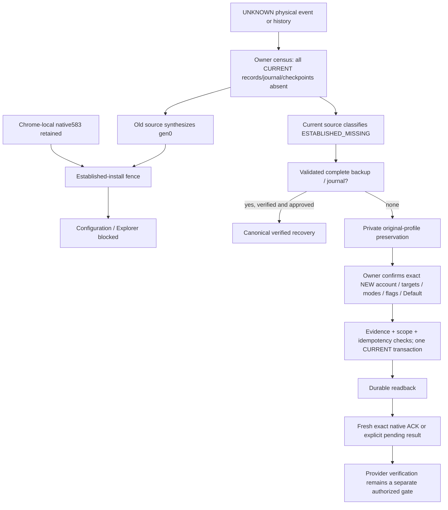

# CURRENT incident and agent-native reliability ratchet — engineering handoff

**Development branch:** `dev/p0-agent-reliability-ratchet`, from main `08703cd`. **Version:** 0.3.15, same extension ID `ajppphdiamdobknpamcheohmdbdbeoal`, canonical API `3+1.1`. Exact final production SHA/build digest, test counts and script hashes: `verification.json`. No merge, publication, deployment, live cloud mutation or REDOWN change is included.

**Outcome:** working production safeguards, assisted owner reconstruction, account-scoped agent controls, queryable reliability contracts, bounded diagnostic persistence, sanitized Help reports and executable CI guards. **Original configuration NOT recovered; original physical deletion cause UNKNOWN; release gate BLOCKED.** The original Windows profile and an independently verified owner copy are not available here. No private owner profile/configuration snapshot was collected or placed in this repository.

## 1. What the incident actually establishes

| Classification | Evidence / conclusion |
|---|---|
| OWNER_PROVEN | The assignment records the owner's Windows census: CURRENT has zero remaining records, zero journal/checkpoints, one same-origin DB; native desired583 survives, OAuth Connected; 0.3.14 health completes its inspection while correctly reporting ESTABLISHED_MISSING. No accessible complete external candidate. These are owner-reported observations, not a profile inspected in this environment. |
| SOURCE_PROVEN | Old `loadState` can synthesize product/modes/gen0 when local presence/journal evidence is absent; background rejects that against native>0. This explains the observed blocked workflow, not deletion. 0.3.14 already fixes direct false-fresh reads and guards native clearing. |
| REPRODUCED_EQUIVALENT | `baseline/results.json`: unchanged original 0.3.13 app/background, real Chromium IDB, synthetic Chrome/OAuth. Exact census **remainingRecords=0, journal=0, checkpoints=0**, Connected, direct desired0, getConfiguration missing, native583 and raw records unchanged. The fault fixture clears ONLY a disposable test profile. Native history is the surviving establishment proof; no artificial external provenance marker is seeded. |
| SOURCE_PROVEN / REPRODUCED_EQUIVALENT | A 0.3.14 restore can commit successfully then return generic failure when native reconciliation throws. The immutable baseline and corrected partial-result case both execute. New code retains the committed configuration/outcome with NATIVE_RECONCILE_UNAVAILABLE, never fake native/save success. |
| REPRODUCED_EQUIVALENT | Adversarial verification found a new rebuild-scope regression during this development run: branch baseline204d400 permitted an agent for account A to replace retained native history for B. The regression was caught before publication. Current code binds affected prior/native accounts and new intent before preservation and again before commit; the unauthorized case is denied. This was not identified as the cause of the owner's historical loss. |
| RULED_OUT (within audited source/history) | CurrentStore normal config commits, normal OAuth read/login, current DB upgrade/versionchange handlers and normal journal/retry pruning do not contain a production full-CURRENT deletion/reset. 0.3.12→0.3.13 changes did not rename the database or erase these records. This does not rule out an unobserved external/old execution path. |
| PLAUSIBLE_UNPROVEN | Browser/site-storage policy/eviction, manual or OS-level removal, wrong/copied profile/origin history, an unknown older transition. Persisted native data and the same public extension ID do not prove which physical profile was used or what erased IDB. A same-named empty schema could have been opened after earlier loss. |
| UNKNOWN | Physical erasing operation, time, responsible process, surviving independent offline copies outside the inspected origin, original hidden/mode/default/approval/history details. No blame is assigned to OAuth. No evidence here implies deletion of R2 objects. |



Edges through the original physical event are unknown; no timestamp correlation is promoted into proof. The source-linked branches are `src/persistence/current-store.mjs:loadState/commitBoundary/recoverProduct`, `extension/background.mjs:readCurrent`, `src/api/service.mjs:restorePreview/rebuildPreview/affectedConfigurationAccounts`, and `src/chrome/registrar.mjs:apply`. The previous 275/24 passes did not restore data. Earlier fixtures retained miscellaneous setup/retry rows; this run strengthens the Shelf fault to the owner's **entirely empty** CURRENT census.

## 2. Actual production repair and preservation boundaries

Existing verified restore is retained. Existing `requestRestorePreview` and `restoreRightClickMenu` also accept a separate `rebuild` intent. There is no second config engine or bypass around established-state validation.

Rebuild requires ESTABLISHED_MISSING, no surviving config/generation/integrity/provenance rows, zero journal/checkpoints, a confirmed connected account identity, explicit canonical config changes and acknowledgement that old semantics are unknown. Any surviving partial configuration or complete candidate requires validated recovery/review instead of overwrite. New target principals must match the selected Cloudflare account; native projection is private partial evidence only. No hidden/Quick/Default/mode/approval is inferred from it.

Before mutation, the owner must independently preserve the complete original Chrome User Data/profile with Chrome closed. The new explicit local Windows tool copies ordinary files to a **new private destination outside source**, compares source/copy chunks, checks Chrome.exe is absent before/after, and writes a private manifest only after verified readback. It never deletes/overwrites the source or an existing destination. Browser and trusted local-agent filesystem owners share `verifyProfileCopy`; it rereads every manifest file in bounded 1 MiB chunks. A manifest above 16 MiB is refused as a diagnostic memory budget, not a cloud-transfer cap. Malformed, wrong-extension, incomplete, changed or inaccessible copies block repair.

**Proof limits:** file readback is not an OS-atomic forensic image, continuous proof that Chrome never restarted during copying, a portable DPAPI backup, or proof that the operator selected the correct original User Data directory. The owner must identify that directory from chrome://version and keep Chrome closed. Alternate browsers/platforms, NTFS metadata/ADS and actual Windows producer behavior are not certified here. The test manifests explicitly simulate the Windows producer; their actual file readback/OPFS is real. No owner copy was made. Profiles with links are refused for review; failed copies retain partial private files without a valid success manifest. An existing different recovery root is not silently replaced.

After verified attachment, preview shows exact NEW product/mode settings, source evidence, unknown semantics and fingerprint. Separate confirmation precedes a private CURRENT/native preimage readback. The API revalidates evidence, account/method grants after I/O, and expected revision where readable. `recoverProduct` performs the sole atomic missing-state commit; unrelated records/handles remain. Configuration origin is durably `OWNER_CONFIRMED_REBUILD`, retained through generation ACK and later edits. The result is `REBUILT_WITH_OWNER_CONFIRMATION`, `originalStateRestored:false`, remote save `NOT_VERIFIED`. Routing generation advances from retained evidence through the normal compiler/registrar, not a manual 583 edit.

The registrar still refuses unknown CURRENT. Fresh Chrome callbacks are required for ACK. Inventory/registration failure after commit returns the committed configuration plus explicit native pending/partial status. Retrying the same idempotency request does not create a second configuration/menu. Changed intent cannot reuse a token/key. Existing Worker readiness may be checked read-only for exact targets; no bucket/Worker/approval is created. True remote success still requires existing authority and independent provider proof.

## 3. Agent controls and self-description

One source registry: `src/glaciaring/reliability.mjs`. `describeCapabilities({section:'reliability'})` derives the 56 methods' actual input schemas, permission/effect class and version from `toolRegistry`; it adds canonical entry owner, mechanism family, storage authority, dependencies, pre/postconditions, completion evidence, invariant/test links and explicit PARTIAL gaps. `permissionPolicy` is read from the actual permissions owner, not a copied grant table. `system-map.json` is a generated artifact checked against source, not a runtime authority. Existing observability inventory is labeled historical and linked to this current contract.

The map is **not** a complete dynamic call graph. Mechanism families summarize delegation; not every internal provider branch or cross-owner causal link is wired. These gaps are machine-queryable. Missing/duplicate method mapping, nonexistent source/test paths, static GUI API calls without registry entries, removed invariant tests or stale generated contracts fail the maintained focused suite. Dynamic GUI call coverage is explicitly not asserted complete.

The existing host gateway rejects a `gui` agent grant and enforces actor/method/expiry. The separate permissions owner still enforces account bindings and one-operation human approval. Traversal rejects cycles without rejecting legitimate shared references. Recovery and root attachment require full-configuration authority. Restores/rebuilds bind prior affected accounts and new intent; configuration changes bind prior as well as next state; reconciliation checks authoritative configured accounts. Valid CURRENT governs stale native projections; native historical principals matter when CURRENT is missing. UI owner authorization remains through the existing trusted sender.

No client can assert debug authority, supply a filesystem path/copy-success flag, issue a grant or approve itself. Private native clues/configuration previews require the existing trusted restore/account policy. No new message handler, external listener, localhost admin server or universal token exists. `scripts/agent-client.mjs` remains an in-process JSON-lines adapter; a real Chrome/native-host bridge and authenticated actor remain host responsibilities, not an automatically provided end-user connection.

Useful existing API requests:

```json
{"version":"3+1.1","method":"describeCapabilities","params":{"section":"reliability"}}
{"version":"3+1.1","method":"getEngineHealth","params":{}}
{"version":"3+1.1","method":"getEngineHealth","params":{"view":"trace","operationId":123,"limit":64}}
{"version":"3+1.1","method":"getEngineHealth","params":{"view":"support"}}
```

Trace receipt IDs are numeric `receipt.traceId`; `receipt.operationId` remains the existing request UUID. Cursor paging reuses Glaciaring's existing read-only snapshot API with canonical grant rechecks, bounded pages and TTL. A received token is not execution authority. Discover → inspect → trace → run the linked sanitized isolated fixture → compare source/build → preview → host-approved domain execution → readback/native/provider verification uses existing owners. Destructive reproduction is never available against an end-user profile through diagnostics.

## 4. Causal recorder and support privacy

Glaciaring retains its 512-slot typed ring (32,256 bytes), 15-minute event retention and bounded snapshot mechanism. New API/CURRENT read/commit signals correlate numeric roots/parents and explicit dependencies. Supported parent/retry fields do not mean every cross-owner or retry edge has been wired; missing edges remain gaps. Receipt duration measures actual API time. No arbitrary request/exception text is captured.

An optional severity hook batches/coalesces source-vocabulary events into the dedicated Chrome-local diagnostic key: at most 32 durable entries, seven-day retention, 250 ms deferred flush, 128 distinct signature budget per worker. Only source stage/code/outcome, numeric operation/revision/generation/epoch/time and safe build/schema metadata are stored. Writes have readback; failures/drops/coalescing/pending/expired-or-omitted state are exposed. Unknown diagnostic schemas and unreadable prior stores are preserved, not reset. The diagnostic subsystem cannot veto a business result or become configuration authority.

A worker killed before deferred flush can lose pending events. All-storage deletion can erase every trace. Raw-source execution lacks a packaged build hash and reports that absence. These are limits, not recovery successes. Read-only health/discovery/trace/support suppress new CURRENT observations and cause zero product/durable diagnostic writes; ordinary operation failures may schedule bounded critical evidence. No steady-state polling, network telemetry or per-pointer deep read is added.

Help → Diagnose → Review invokes the same canonical health API. The report is built by whitelist, not redaction of a raw dump: build/schema, safe physical-presence/count/generation evidence, stable failure signature, incident content hash, retained checkpoints, gaps, known/unknown cause, recovery status and invariant/test IDs. Earliest retained failure is explicitly **not the original deletion event**. Auth is NOT_PROBED by support inspection; no credential refresh is triggered. Account IDs, paths, bucket/object/file names, source URLs, tokens, native plans and private copy manifests are excluded. Clipboard copy requires an explicit click; there is no upload endpoint.

## 5. Reliability ratchet and quality gates

There are 11 stable invariants and six initial confirmed failure signatures. This is the initial relevant P0 knowledge set, not a claim that the full historic defect register is encoded. Original physical loss remains an unresolved signature; detection repairs are not relabeled as data restoration. Source owners, exact test IDs/files, execution surface, baselines, repair evidence and installed/live acceptance gaps are queryable.

Existing CI runs the focused/source drift tests, the remote module tests, builds the same-ID extension, and executes real-IDB crash/recovery plus actual Shelf dependency fixtures and original-source loss reproduction. The execution ledger requires **all six known-failure cases plus eight browser invariant cases** to appear as executed PASS/REPRODUCED results. Removing an invocation while leaving a test file/registry row is rejected. This extends the existing job; there is no new CI service or retired scenario atlas. Hosted CI itself has not run because this branch has not been published.

The five papers' disciplines are enforced practically:

| Quality obligation | Executable boundary / evidence |
|---|---|
| Preserve established intent | Missing-all/native583, partial/corrupt/conflict and legacy-migration cases; no fake fresh setup. |
| Durable complete state | Strict IDB transaction, readback, expected evidence/revision, retry records; transaction fault/property tests and actual browser Worker/process termination. Hardware power loss remains unverified. |
| Separate authorities | OAuth independent; CURRENT authoritative; native observation partial; cloud success only from provider verification. |
| Contain failures | Recorder outage cannot affect product; unavailable native reconciliation cannot hide committed repair; permissions rechecked after preservation. |
| Bounded fast UI | No new pointer/render loops or boot cloud sweep; bounded buffers, asynchronous critical I/O; actual before/after fixture timing kept separate from Windows acceptance. |
| Maintainability | Registry/source/schema/test drift and execution receipt checks; known failures become permanent fixtures rather than more ad hoc troubleshooting. |

## 6. FMEA and million/billion-client release review

| Failure / scale concern | Containment / gate | Confidence |
|---|---|---|
| Entire CURRENT disappears while Chrome-local survives | Established fence, native preserved, critical evidence where storage permits, private verified recovery or honest rebuild | PROVEN source + SIMULATED equivalent; owner recovery BLOCKED |
| Every copy / diagnostic store is erased | UNKNOWN/UNOBSERVED; cannot reconstruct unknown intent | Fundamental limit; no software guarantee |
| Crash/abort/response loss during commit | Atomic old/new state, readback/idempotency; real IDB + Web Worker/SIGKILL tests | SIMULATED lifecycle; actual MV3/OS power loss NOT_TESTED |
| Quota/security/unknown schema | Block unsafe config, preserve user/diagnostic records, independent auth; synthetic failures | SIMULATED; actual managed Windows storage NOT_TESTED |
| Wrong profile/origin/extension or copied backup | Same ID/origin guards and copy manifest checks; operator must verify actual source profile | Source checks PROVEN; exact owner profile BLOCKED |
| Prior/new account scope or grant revoked during I/O | Bind affected intent, reject impersonated GUI/expired/cyclic/incorrect account requests; reauthorize before commit | SIMULATED security fixtures; real host bridge NOT_TESTED |
| Native prepare/ACK or inventory unavailable | Stop before unsafe clear; committed repairs stay visible/pending; no false ready/save | SIMULATED Chrome callbacks; installed gate BLOCKED |
| OAuth expiry/offline/provider quotas | Existing auth containment, no provisioning from login; uncertainty not replayed | Fixture/source evidence; live provider NOT_TESTED |
| R2/Worker rate/billing/remote outcomes | No new setup; exact capability and independent readback retained | Local-provider tests; live current-run save NOT_TESTED |
| Diagnostic flood / million separate incidents | Per-client bounded ring/batch, deterministic signatures, local review/opt-in sharing; no centralized ingestion | Bounded source/microbench PROVEN; fleet behavior NOT_TESTED |
| Support/privacy at billion installs | No default uploads, no user identifiers in support packet; one grouped signature, private source review only under scope | Adversarial fixture checks; fleet support cost NOT_TESTED |
| Version skew/rollback | Same DB/key/API, 0.3.12/13 migration fixtures; unknown diag schemas quarantined; old copies retained | SIMULATED; real Windows rollback NOT_TESTED |
| Large saved menus/history and rendering | Existing stress/virtualization tests; no new render work; recovery file hashing is explicit/cooperative | Fixture only; Windows latency NOT_TESTED |

Do not extrapolate a passing suite to billion-install reliability. Smallest next release gates: verify the correct original-profile private copy, perform an explicitly approved original recovery or new rebuild on Windows, verify restart/native menu/Explorer/session continuity, then an independently verified R2 save under separate write authorization. Use a small staged release and stop on persistence/privacy regression. No remote telemetry infrastructure is justified by these tests.

## 7. Windows preservation and acceptance — preview first

This run keeps the development branch local. After review/delivery of that branch, obtain its source without uninstalling or clearing anything. Do not load a new extension build into the owner profile before preservation. Read chrome://version locally to identify the actual User Data location; do not post that private path.

Close Chrome completely and keep it closed while the local tool runs. In CMD from the reviewed repository checkout, with Node 22+:

```bat
node scripts\preserve-chrome-profile.mjs --confirm-private-copy "%LOCALAPPDATA%\Google\Chrome\User Data" "%USERPROFILE%\Click2Cloud-private-copy-NEW"
```

The source above is the standard Chrome location only; use the actual original User Data root if different. The destination must be NEW and private, outside source, with enough disk space. Never upload that copy/manifest. A failed run is not a verified copy and must not be used to justify repair. This environment did not run the Windows producer.

After the verified copy is retained:

```bat
npm ci
npm run test:focused
npm run build:extension
```

Reload the **existing** unpacked extension at `dist/click2cloud`; same ID, version 0.3.15. No uninstall, storage reset, nativeRegistration deletion or generation edit.

1. Open Shelf: Remotes first, login/status independent, no R2/Worker/default provisioning. With lost CURRENT, Inspect recovery remains read-only. Review Help report locally; only its sanitized contents may be copied deliberately.
2. Try verified original recovery only if a real complete source exists. If none exists, choose **Verify private profile copy** and select the private copy root. Verification rereads all files and may take time; it does not establish that original configuration survived.
3. Choose **Rebuild with my choices**. Confirm the real account. Review historical locations as partial data only. Explicitly enter exact buckets/prefixes, labels, Simple/Narrow/Depth, Quick/hidden and optional Default. Review the full new configuration and acknowledge unknown original semantics.
4. Apply only with explicit owner approval. Expect REBUILT_WITH_OWNER_CONFIRMATION, never original-state restoration. Verify configuration origin, exact targets and fresh native ACK; if pending, keep the committed state and use canonical reconciliation after correcting the reported blocker. No repeated provisioning or automatic recreation.
5. Verify multiple Shelf opens, extension reload, full Chrome restart, Explorer/Settings/menus, existing credentials and exact destination/default persistence. Confirm no cloud resources were changed by local repair. Real remote saving is a separate acceptance gate; perform writes only under an explicitly authorized test procedure, and require independent object verification.

Actual Windows profile preservation/rebuild, installed Chrome menu behavior, real MV3 suspension and live R2 verification remain BLOCKED/NOT_TESTED here. The genuine unpacked attempt is recorded under `installed/`; administrator policy is not bypassed.

## 8. Evidence, commands and remaining limits

`verification.json` indexes final source/build hashes, all receipts, classifications and performance. `system-map.json` is the source-derived contract. `baseline/`, `persistence/`, `boot/`, `product/`, `images/`, `installed/`, `diagnostic-overhead.json` and `startup/` have separate proof classes. Screenshots/configuration are synthetic only. No owner snapshot exists in Git.

Local isolated commands: `npm run test:focused`; `node --test right2cloud-module/tests/module.test.mjs`; `npm run build:extension`; `node scripts/test-current-recovery-browser.mjs`; `node scripts/test-boot-login-browser.mjs`; `node scripts/assert-reliability-receipts.mjs <current/browser.json> <boot/results.json> <original/results.json>`. Browser runners require the documented baseline git archives (see existing CI) and Chromium, with C2C_CHROME_EXECUTABLE override. Run destructive fault cases ONLY in the generated disposable profiles, never the owner's profile.

**Unresolved:** exact physical loss mechanism/time and original settings; original-profile/source-copy provenance; actual Windows producer/installed host; real Chrome/MV3/native/provider outcomes; complete dynamic call graph/causal retry linkage; complete historic failure inventory; actual fleet/provider quotas/support rate; OS power-loss guarantees. Unsupported partial/corrupt configuration rebuild or replacement of a different existing recovery root stays blocked for review. Original forensic P0 stays OPEN. No merge/deployment/live resource changes are authorized by this handoff.


## 9. Final measured results and coherent commits

Runtime source is `b105f526e2dec7ffbe1255520081435421008b1f`, version 0.3.15, API3+1.1; build source digest `8ed7ff58b2087ecd807e6dcd6b3577d43b5c63a389a10f0d5f357dbbdfe68782`. Extension ID unchanged. Worker digest unchanged. Final documentation/evidence/CLI/CI corrections follow this source commit without changing runtime modules. All primary final runtime receipts report this SHA and runtimeSourceDirty:false.

| Evidence | Result | Boundary |
|---|---|---|
| Focused suite | 280 PASS, zero failures | Node production modules |
| Remote module | 49 PASS, zero failures | Local module/provider tests, no live cloud |
| Final registry/drift | 10 PASS | Node declarations/source/current-map/execution gate |
| Persistence browser | 29 PASS, 3 REPRODUCED, zero FAIL | Real Chromium IDB/OPFS, fixture Chrome callbacks |
| Boot/browser | 16 PASS, 2 REPRODUCED, zero FAIL | Real app/background/IDB, fixture Chrome and OAuth |
| Product Explorer/menu | 30 PASS, 3 BLOCKED, 1 NOT_TESTED | Real GUI, fixture boundaries; no installed/live claim |
| Images | 15 PASS | Decoded pixels in Chromium, fixture File API |
| Original exact loss | REPRODUCED | Original 0.3.13 source, zero state/journal/checkpoints, native583, connected fixture OAuth; raw state preserved |
| Reliability ledger | 6 known failures +8 browser invariants executed | Removed/failed/unexecuted cases reject |
| Genuine unpacked attempt | BLOCKED | Administrator policy, describeCapabilities response:null, no bypass |

Startup comparison (30 reloads each, identical isolated Linux fixture, not Windows performance): visible Remotes p50/p95 **111.4/230.5ms →100.9/128.1ms**; configuration plus two frames **299.9/532.4ms →266.0/299.2ms**. This is a local sampled comparison, not a causal fleet speed guarantee. Both versions performed zero cloud resource writes during startup. Recorder microbenchmark: 10,000 healthy emits median disabled3.49ms/ring4.16ms/hook4.46ms; preallocated32,256bytes; fault flood coalesced/bounded to32 retained events and one6,400byte memory-adapter write. The receipt asserts80,000 accepted healthy events and zero drops. It does not establish disk timing or Windows input latency. Additional actual IDB timings and Explorer/context-menu fixture metrics are retained in their per-gate JSON. Current-run live save-dispatch timing is NOT_TESTED.

Coherent runtime commits:

- `6bceb02cbe436b1c43a07bf422ee8c654c4274b3` — Add preserved owner rebuild and source-backed agent reliability ratchet
- `6e85b78c1eb3547568c5350283032855dc4de0e9` — Keep trace coverage gaps and mechanism contracts in the closed catalog
- `aafd904c7ac7493eb50688b25054d23f6865a3ef` — Include safe loss evidence and retained-history limits in support reports
- `9fdb14615dfe57fd03f380a534f8fe694552eef1` — Preserve unknown diagnostic storage instead of replacing unreadable evidence
- `204d400611e8aa89f636afc3ea907bebdf933517` — Declare executable invariant surfaces for the reliability receipt gate
- `b105f526e2dec7ffbe1255520081435421008b1f` — Authorize all affected account intent before agent configuration repair

No merge, push or deployment was performed. Original P0 remains OPEN and release BLOCKED pending the explicit Windows/original-profile/provider gates above.
