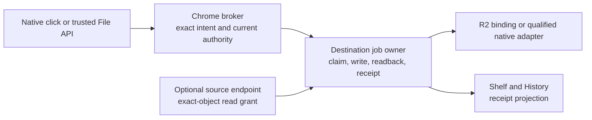

# Click2Cloud and full ReDown architecture decision

**November 18, 2026** · Read-only investigation, published separately after completion.

## Decision

Keep Click2Cloud’s destination Worker and durable operation claim as the single authority for each transfer. Simplify that path first. Send healthy public-URL saves and same-bucket operations through the existing destination endpoint. Qualify a provider-native adapter for cross-bucket copies wherever it can enforce the same write and verification contract. Otherwise, let the destination pull from the source endpoint with an exact-object, short-lived read grant. Retain existing pair Workers for jobs they already admitted and as a controlled compatibility route during migration.

This design needs one durable job owner and one receipt contract. A source endpoint supplies bytes only when the chosen adapter needs it. A general orchestration service would add another state owner to the ordinary save path. Begin any new cross-account route with verified copy and source retention. Qualify cleanup separately. Confidence is high for the immediate simplifications below. Native copy, multipart completion and cross-account cleanup remain conditional on provider testing. [Enterprise proposal](../../../codex-ideas/ENTERPRISE-CLOUD-OPERATIONS-ENGINE-HYBRID-ARCHITECTURE-2026-11-18.md) · [Previous comparison](../r2-operations-overhaul/Click2Cloud-vs-ReDown-audit.md)

## Scope and evidence

- **Click2Cloud** was inspected at `c1ea866baedb568fb44361573a9a558f2cd39818` on `codex/ux-filename-search-audit-2026-11-18`. Relative to the previous `6c401f5` audit, the transfer protocol is unchanged. The newer Shelf and filename inventory wrap existing File API and receipt paths. The pre-overhaul tag still points to `c337e415596be01f061e161f167d9f5aed13825c`. [Inspected revision](https://github.com/thanks-cohn/Click2Cloud/tree/c1ea866baedb568fb44361573a9a558f2cd39818) · [Protected tag](https://github.com/thanks-cohn/Click2Cloud/tree/pre-r2-worker-overhaul-narrow-explorer-minimal-v0.3.19-2026-11-18)
- **Full ReDown** was inspected at the `95-percent-plus-success` tag, which resolves to `653ad9b5fdd59532df571514fc60053d8a7b13bb`. The comparison also checked `main` at `c78babc314acc5891203e95b169f027756e956c1`. The reviewed transfer and auth paths agree, with a post-tag receipt-recorder call in the inspected background file. The bucket profile deploys the embedded `WORKER_SOURCE` from that file. [Tagged source](https://github.com/thanks-cohn/REDOWN/blob/653ad9b5fdd59532df571514fc60053d8a7b13bb/extension/background.js#L55) · [Main comparison](https://github.com/thanks-cohn/REDOWN/compare/653ad9b5fdd59532df571514fc60053d8a7b13bb...c78babc314acc5891203e95b169f027756e956c1)

Both working trees were clean when the investigation ended. The audit used source and existing evidence. Fresh live transfers, provider mutation and installed-Chrome measurements remain separate acceptance gates.

## Current authority and byte paths

Each arrow identifies the order of responsibility. Explorer enters the background through the trusted File API in Click2Cloud and `cfTransferObjects` in ReDown. Native saves begin with the browser’s context-menu event.

| Operation | Click2Cloud | Full ReDown |
| --- | --- | --- |
| Public URL save | Chrome click → current acknowledged menu generation and exact target → signed destination intent → Worker durable claim → public HTTPS fetch → conditional R2 write → independent R2 HEAD → History | Chrome click → active V3 resolution and bucket profile → capability check → Worker fetch and conditional write → independent Worker HEAD → History and delivery counter |
| Same-bucket copy or move | Shelf → File API → bucket Worker and durable claim → stream within the R2 binding → verify destination → recheck and delete for move | Shelf → profile and folder/conflict planning → bucket Worker copy and verify → separate source cleanup request for move |
| Same-account cross-bucket | Shelf → File API → ordered pair Worker with two R2 bindings → stream and read back in the same Worker → check source and delete for move | Shelf → two prepared profiles → destination Worker pulls from source Worker → destination R2 HEAD. For move, the background asks the source Worker to verify the destination again and delete the source. |
| Distinct accounts | `fileOperationTarget` rejects before dispatch. | Two profiles can route across accounts when current authorization can inspect both Worker configurations. The destination receives the source profile bearer. Move cleanup sends the destination profile bearer to the source Worker. |

[Click2Cloud menu dispatch](https://github.com/thanks-cohn/Click2Cloud/blob/c1ea866baedb568fb44361573a9a558f2cd39818/src/core/engine.mjs#L64) · [Click2Cloud File API routing](https://github.com/thanks-cohn/Click2Cloud/blob/c1ea866baedb568fb44361573a9a558f2cd39818/src/api/service.mjs#L353) · [Pair routing](https://github.com/thanks-cohn/Click2Cloud/blob/c1ea866baedb568fb44361573a9a558f2cd39818/src/cloudflare/file-transport.mjs#L13) · [Worker file operations](https://github.com/thanks-cohn/Click2Cloud/blob/c1ea866baedb568fb44361573a9a558f2cd39818/src/cloudflare/files.mjs#L17) · [ReDown transfer planning](https://github.com/thanks-cohn/REDOWN/blob/c78babc314acc5891203e95b169f027756e956c1/extension/background.js#L1876) · [ReDown save verification](https://github.com/thanks-cohn/REDOWN/blob/c78babc314acc5891203e95b169f027756e956c1/extension/background.js#L2135)

**What makes the ReDown interaction feel fast.** It acknowledges the click before OAuth or I/O, resolves against active profiles and gives an ordinary ready save a short synchronous path. V3 explicitly keeps implicit provisioning out of that path. The separate HEAD and detailed per-item transfer results are valuable. Trade-offs include whole-body buffering for unknown-length ingest under a default 300 MiB profile limit against a documented 128 MB isolate budget. The inspected verifier checks the current OAuth record after HEAD and attaches its session ID. The save path does not compare that ID to a session captured at dispatch. An older pending History receipt can delay admission of a fresh save. The REST authentication-refresh branch can resend the original request, including a write, while its transient throttle and service-error retries are restricted to safe reads. [Click acknowledgement](https://github.com/thanks-cohn/REDOWN/blob/c78babc314acc5891203e95b169f027756e956c1/extension/background.js#L2985) · [Prepared profile](https://github.com/thanks-cohn/REDOWN/blob/c78babc314acc5891203e95b169f027756e956c1/extension/background.js#L1725) · [Ingest buffering](https://github.com/thanks-cohn/REDOWN/blob/c78babc314acc5891203e95b169f027756e956c1/extension/background.js#L659) · [History admission](https://github.com/thanks-cohn/REDOWN/blob/c78babc314acc5891203e95b169f027756e956c1/extension/background.js#L3074) · [Authentication retry](https://github.com/thanks-cohn/REDOWN/blob/c78babc314acc5891203e95b169f027756e956c1/extension/cloudflare-api.js#L46)

Click2Cloud gates native actions on the acknowledged menu generation, matching CURRENT configuration and exact target. The prepared bucket plan supports healthy Simple, Narrow ancestor and Depth saves. Explorer authority is independent of native menu ACK. Setup or credential recovery preserves prior configuration and requires a fresh click after a blocked gesture. The Worker owns its claim and validates signed intent and session. Chrome maintains configuration, setup plans and the local receipt projection. The filename cache is derived from authorized listing. [Native and setup routing](https://github.com/thanks-cohn/Click2Cloud/blob/c1ea866baedb568fb44361573a9a558f2cd39818/extension/background.mjs#L202) · [OAuth and session fencing](https://github.com/thanks-cohn/Click2Cloud/blob/c1ea866baedb568fb44361573a9a558f2cd39818/src/auth/cloudflare-oauth.mjs#L90) · [File Worker setup](https://github.com/thanks-cohn/Click2Cloud/blob/c1ea866baedb568fb44361573a9a558f2cd39818/src/cloudflare/onboarding.mjs#L309)

## Communications and immediate fixes

These are source counts for warm paths. OAuth refresh, redirects, retries and provisioning are excluded. One HTTPS exchange includes its response. A native save starts with one Chrome event. An Explorer action starts with one request and response across the Shelf and background processes. A Click2Cloud Worker-to-Durable-Object handoff is internal.

| Warm operation | Exchanges and their purpose |
| --- | --- |
| Click2Cloud save with immediate completion | Two Worker exchanges for submit and verify. Two OAuth bucket GETs surround the write. Public-source egress uses one source GET and two parallel DNS queries for a hostname. The known-length case with an unused name uses at least three R2 binding calls for name check, conditional write and readback. Pending work adds status and lease exchanges. |
| ReDown ready save | Three Worker exchanges for capabilities, ingest and HEAD. Exact-path capability checking can add one. The Worker fetches the source and writes to R2 before the independent readback. |
| Click2Cloud Explorer action | `/files` always returns pending, including for a small mkdir. It takes one submission, at least one status exchange and any lease renewals. With `b` bound buckets, `p` polls and `l` renewals the transport makes `b × (2 + 2p + l)` OAuth bucket GETs, excluding setup and compatibility checks. Dual binding avoids a Worker-to-Worker byte exchange. |
| ReDown Explorer action | One capability exchange for a same-bucket path. A cross-bucket path starts with two capability exchanges and two OAuth settings GETs. Copy adds one exchange per 25 items. Move adds one cleanup exchange per 100 verified copies. Cross-bucket streaming uses a source-Worker GET for each streamed item and cleanup uses a destination-Worker HEAD for each checked item. Folder listing and collision planning add requests. |

[Click2Cloud transport](https://github.com/thanks-cohn/Click2Cloud/blob/c1ea866baedb568fb44361573a9a558f2cd39818/src/cloudflare/transport.mjs#L89) · [Click2Cloud R2 writer](https://github.com/thanks-cohn/Click2Cloud/blob/c1ea866baedb568fb44361573a9a558f2cd39818/right2cloud-module/src/cloudflare-r2-writer.mjs#L27) · [ReDown transfer batches](https://github.com/thanks-cohn/REDOWN/blob/c78babc314acc5891203e95b169f027756e956c1/extension/background.js#L1928)

1. **Project the durable verified receipt already recorded by the background.** An open Shelf can receive `verified` and call `inspectRemoteReceipt` again. Each Shelf can add another Worker inspection, R2 HEAD and OAuth rechecks. Retain the initial independent verification. A live recheck belongs to ambiguous results and explicit inspection. Verify that multiple open Shelves consume one verified effect notification without issuing extra provider probes. [Shelf result handler](https://github.com/thanks-cohn/Click2Cloud/blob/c1ea866baedb568fb44361573a9a558f2cd39818/extension/app.mjs#L1077)
2. **Record the stable execution route on admission.** Explorer records its operation ID and destination, while pair routing uses account, destination bucket and source bucket. Generic receipt inspection looks up the primary destination Worker. A lost pair-Worker reply can consequently produce `OPERATION_UNKNOWN` from the wrong owner. Store a versioned route ID with the operation and use it for status, cancellation and read-only reconciliation. Test historical primary receipts and interrupted pair jobs before changing routing. [Explorer history record](https://github.com/thanks-cohn/Click2Cloud/blob/c1ea866baedb568fb44361573a9a558f2cd39818/src/api/service.mjs#L366) · [Pair plan key](https://github.com/thanks-cohn/Click2Cloud/blob/c1ea866baedb568fb44361573a9a558f2cd39818/src/cloudflare/deployment.mjs#L22) · [Receipt resolution](https://github.com/thanks-cohn/Click2Cloud/blob/c1ea866baedb568fb44361573a9a558f2cd39818/src/cloudflare/onboarding.mjs#L362)

## Alternatives

Scores run from 1 for a material obstacle through 3 for mixed or conditional evidence to 5 for a strong fit. A reflects the observed implementation. B and C are estimates. D reflects documented provider capabilities and integration gaps. E is a recommendation conditioned on the contracts and acceptance gates below. Higher migration scores indicate lower migration risk.

| Design | Correctness and recovery | Security | Fewer messages | Diagnosis | Scale | Latency | Throughput | Cost | Extensibility | Simplicity | Migration |
| --- | ---: | ---: | ---: | ---: | ---: | ---: | ---: | ---: | ---: | ---: | ---: |
| A · Harden pair Workers | 4 | 4 | 2 | 3 | 1 | 3 | 3 | 2 | 2 | 2 | 5 |
| B · General peer-Worker protocol | 3 | 4 | 2 | 3 | 3 | 2 | 3 | 3 | 4 | 2 | 2 |
| C · Per-account or multi-tenant transfer service | 3 | 2 | 2 | 3 | 4 | 3 | 4 | 3 | 5 | 2 | 1 |
| D · Provider-native operations alone | 2 | 3 | 5 | 3 | 5 | 4 | 4 | 5 | 2 | 3 | 2 |
| **E · Destination-owned job with optional adapters** | **4** | **4** | **4** | **4** | **4** | **4** | **3** | **4** | **4** | **4** | **4** |

A is useful for rollout and rollback, with deployment growth tied to ordered pair use. B amortizes deployments but adds peer calls to copying and cleanup. C concentrates deployment and job scheduling at the cost of a broader binding or credential boundary. D offers the shortest eligible copy path. E preserves the existing URL ingest path and allows a specific provider shortcut only after it meets the same admission and proof contracts.

Cloudflare documents R2 `CopyObject` with source preconditions, conditional `CompleteMultipartUpload`, and one bucket per temporary credential. Destination overwrite protection for the chosen copy path, immutable source identity across multipart copy, and cross-bucket credential permissions need evidence. Keep a destination conditional write where provider-native copy cannot demonstrate equivalent conflict behavior. [R2 S3 compatibility](https://github.com/cloudflare/cloudflare-docs/blob/71887c4dd651ecb8718833af10feb53ac7433cf6/src/content/docs/r2/api/s3/api.mdx) · [Temporary credentials](https://github.com/cloudflare/cloudflare-docs/blob/71887c4dd651ecb8718833af10feb53ac7433cf6/src/content/docs/r2/api/s3/temporary-credentials.mdx)

## Deployment, cost and performance

| Buckets | Potential ordered pairs in one account | Same-account pairs across up to 10 balanced accounts | Distinct-account pairs in that layout | Reusable endpoints if every bucket participates |
| ---: | ---: | ---: | ---: | ---: |
| 1 | 0 | 0 | 0 | 1 |
| 10 | 90 | 0 | 90 | 10 |
| 100 | 9,900 | 900 | 9,000 | 100 |
| 1,000 | 999,000 | 99,000 | 900,000 | 1,000 |

Potential pair deployments follow the sum of `B × (B − 1)` over accounts. Actual deployments depend on used pairs and retained plans. The per-account alternative concentrates deployment to one service per participating account, subject to binding and tenancy constraints. An eligible native copy adds zero pair deployments. Even reusable per-bucket endpoints can hit the documented defaults of 100 Free or 500 Paid Workers per account. Check actual headroom, bindings, provider API throttling, memory, CPU and subrequest quotas at onboarding. A new Click2Cloud plan persists pending identity, uploads the script and bindings, enables the hostname, and verifies capability and readiness. ReDown uses a profile deployment with script upload, route enablement, settings, health and marker checks before publishing the profile. Each additional deployment adds repair and version-rollout work. [Click2Cloud plan](https://github.com/thanks-cohn/Click2Cloud/blob/c1ea866baedb568fb44361573a9a558f2cd39818/src/cloudflare/deployment.mjs#L35) · [ReDown profile setup](https://github.com/thanks-cohn/REDOWN/blob/c78babc314acc5891203e95b169f027756e956c1/extension/background.js#L1163) · [Workers limits](https://github.com/cloudflare/cloudflare-docs/blob/71887c4dd651ecb8718833af10feb53ac7433cf6/src/content/docs/workers/platform/limits.mdx)

Click2Cloud’s earlier local workerd comparison verified 180 writes. With a 260 ms source delay, Simple, Narrow and Depth p50 changed from 1,081 / 1,109 / 1,089 ms to 408 / 418 / 395 ms. Immediate-source results were mixed. ReDown recorded 950 native-listener fixture saves with independent fixture HEADs. These environments and workloads leave the installed-Chrome and live-R2 latency comparison open. Click2Cloud admits four jobs per claims instance under its buffer budget. Unknown-length source spooling adds PUTs, GETs and cleanup per staged part. [Click2Cloud workerd evidence](../r2-operations-overhaul/save-benchmark.json) · [ReDown fixture evidence](https://github.com/thanks-cohn/REDOWN/blob/c78babc314acc5891203e95b169f027756e956c1/docs/P0_CRASH_CAPLESS_REPORT_2026-11-12.md#L81) · [Click2Cloud memory budget](https://github.com/thanks-cohn/Click2Cloud/blob/c1ea866baedb568fb44361573a9a558f2cd39818/src/cloudflare/resources.mjs#L3)

As a marginal Standard R2 forecast, one million copies with one Class A write and four Class B reads per object cost $5.94 before allowances, Worker and Durable Object charges, storage and additional collision checks. Move increases readback and source identity checks. Staging and multipart add requests and storage. Infrequent Access retrieval and other providers require separate accounting. Measure request counts, CPU, quota consumption, cleanup, bytes moved and sustained throughput at each workload rather than treating the estimate as a bill. [R2 pricing](https://github.com/cloudflare/cloudflare-docs/blob/71887c4dd651ecb8718833af10feb53ac7433cf6/src/content/docs/r2/pricing.mdx)

## Proposed ownership and protocol

| Responsibility | Current split | Proposed owner |
| --- | --- | --- |
| Target and local authorization | Menu, OAuth, broker and Worker contribute checks | The broker resolves an exact canonical intent. The destination admits only the matching signed intent and binding. |
| Job state and retry | Worker claim, API reservation, local History and notifications hold different observations | Destination claim owns effects and sequence. Local state holds the route, job ID and receipt projection. |
| Source bytes | Pair binding or forwarded ReDown profile bearer | Source authority issues a narrowly scoped read grant when required. |
| Verification and receipt | Write ack, verification and sometimes a second Shelf readback | Destination owner records independent readback with the exact identity and proof kind. Clients inspect the same receipt by ID. |
| Cleanup | Read source and destination, then delete source | Source authority grants cleanup separately. The destination job records each item’s cleanup outcome. |

Bind each job ID to a canonical fingerprint of tenant, both account identities, exact source and destination identity, verb and conflict policy. A repeated ID and matching fingerprint attach to the existing job. A different fingerprint is rejected. Grants carry audience, expiry, session or revocation epoch, replay identifier, permitted operation and, for source reads, the expected version or strong ETag and allowed range. Recheck the applicable grant before renewal or cleanup. Keep source credentials at their issuer. Cross-account reads and writes require independent authority, and delete requires its own grant.

Use `pending → copying → written → verified` for copy or save. Move continues to `cleanup_pending → completed` only with a verified copy. Use `failed` for a known failure and `uncertain` for an ambiguous write or delete. Represent conflicts and skips per item. Cancellation fences further work and preserves existing effect evidence for inspection. Receipt fields include job and route IDs, exact key, byte count, source and destination identities, proof kind, timestamps and per-item results. Size and version/ETag readback is distinct from content checksum proof. History delivery has its own state. [Click2Cloud claim](https://github.com/thanks-cohn/Click2Cloud/blob/c1ea866baedb568fb44361573a9a558f2cd39818/src/cloudflare/worker.mjs#L46) · [Proof matching](https://github.com/thanks-cohn/Click2Cloud/blob/c1ea866baedb568fb44361573a9a558f2cd39818/right2cloud-module/src/verification.mjs#L3)

Both engines perform a separate source check and R2 delete. An independent writer can replace the source between the check and delete. The destination can also change after verification. Keep the source in the new cross-account path until a version-conditional delete and a protected destination can be proven, or the operator explicitly chooses the legacy non-atomic cleanup policy. Preserve both copies when identity differs or any outcome is uncertain. [Click2Cloud cleanup](https://github.com/thanks-cohn/Click2Cloud/blob/c1ea866baedb568fb44361573a9a558f2cd39818/src/cloudflare/files.mjs#L59) · [ReDown cleanup](https://github.com/thanks-cohn/REDOWN/blob/c78babc314acc5891203e95b169f027756e956c1/extension/background.js#L567)

## Failure register and phased rollout

| Failure surface | Contract and regression gate |
| --- | --- |
| Wrong bucket, stale menu or changed OAuth session | Preserve exact target and binding checks, including native generation before dispatch. Reject replay, wrong account, changed intent and revoked grants without affecting the selected destination. |
| Duplicate dispatch, lost reply and restart | Use the admitted route and job ID for reconciliation. Inject lost replies on both sides of the write and verify one write, one receipt and an inspectable uncertain outcome when evidence is incomplete. |
| Polling and verification fan-out | Allow bounded small file actions to return a terminal receipt. Back off when polling a live lease. Project verified records across Shelves. Count provider calls and verify that lost replies still enter reconciliation. |
| Forwarded bearer or retry of an effectful request | Use audience-bound exact-object read tickets. Keep automatic transient retries to safe reads. Resolve ambiguous writes before any new attempt. |
| Interrupted large copy, version change or cleanup | Checkpoint per object and immutable part identity. Resume proven parts with the same source identity. Preserve originals when delete is uncertain. Exercise expired grants, partial commits, quota, revocation and destination replacement. |
| History, diagnostics or cache unavailable | Project authoritative effect state without gating new work on unrelated local repair. Preserve diagnostics, recovery, appearance preferences and local listing when provider operations settle. |

1. **Baseline.** Measure installed-Chrome delivery, immediate acknowledgement, provider dispatch and verified completion using explicitly authorized disposable R2 accounts. Compare cold setup, warm save and bulk runs separately. Include Simple, Narrow at root and ancestors, Depth, Explorer CRUD, reconnect, restart, stale menu generation and lost replies.
2. **Small independent changes.** Feature-flag persisted route resolution and verified event projection separately. Measure duplicate calls with multiple Shelves. Preserve current proofs, account gates, recovery and native ACK.
3. **Adapter qualification.** Test native copy conditions, credential boundaries and multipart completion with disposable data. Add the scoped source-pull adapter only where needed. Keep cross-account cleanup behind its own gate. Use the same intent and receipt contract for future provider adapters and a headless File API.
4. **Scale and reversible adoption.** Run 1, 10, 100 and 1,000 concurrent jobs in simulation first, then an approved live subset. Report p50/p95/p99 with sample counts, throughput, bytes moved, Worker CPU, R2 calls, quota, partial outcomes and cost. Require zero unauthorized or wrong-target effects, independent proof for each success, an inspectable state for each admitted job, and fewer requests without measurable loss of interactive tail performance. Rollback changes the route for new intents while old claims, receipts and status routes remain available.

The remaining decision gates are live latency and quota headroom, conditional multipart completion through the chosen adapter, cross-account revocation after interruption, and non-atomic deletion. The two immediate Click2Cloud fixes can be validated independently of these gates.

## Implementation evidence from the preceding phases

| Phase | Commit | Verification |
| --- | --- | --- |
| Shelf UX | `ccf9223f2cb627a33d0c9bab6bd55196a9483aea` | 549 regression tests and seven Chromium gates. At 360 px the gallery gained 52 px in Remote V1, 58 px in Bit o’ Polish and 87.3 px in Minimal. Minimal’s header went from 93.3 to 56 px. |
| Filename search | `c1ea866baedb568fb44361573a9a558f2cd39818` | 554 regression tests, seven search browser gates, six real IndexedDB checks and extension build. A warm 10,000-name search measured 188 ms p50 and 505 ms p95 with zero provider listing calls. |
| Installed Shelf | `c1ea866baedb568fb44361573a9a558f2cd39818` | Chromium administrator policy blocked unpacked-extension loading. Installed native menus, live OAuth and live Cloudflare transfers remain unverified. |

The 100-name benchmark took 166 / 262 ms cold and 12 / 43 ms warm at p50 / p95. The 10,000-name directory took 2,338 / 2,594 ms cold and 188 / 505 ms warm. A directory of 10,000 direct children within a million-name bucket took 2,661 / 2,932 ms cold and 162 / 222 ms warm. Warm complete searches used zero listing calls in all three cases. The flat million-name scan took 17,617 / 24,508 ms cold through explicit continuation and found the final-page match in all seven trials. It retained 31,000 names within the estimated inventory budget and returned partial warm results. Database and sampled renderer heap measurements are in the raw benchmark. The legacy product browser runner reached the same pre-existing login assertion on the baseline and both implementation commits. Its auth-only expectation differs from the fixture’s login-and-setup contract.

[UX before](ux-before-360.png) · [UX after](ux-after-360.png) · [UX browser gates](ux-browser-results.json) · [Filename API contract](../filename-search.md) · [Search browser gates](search-browser-results.json) · [IndexedDB checks](indexeddb-results.json) · [Raw benchmark](filename-benchmark.json) · [Installed Shelf result](installed-shelf-result.json)
