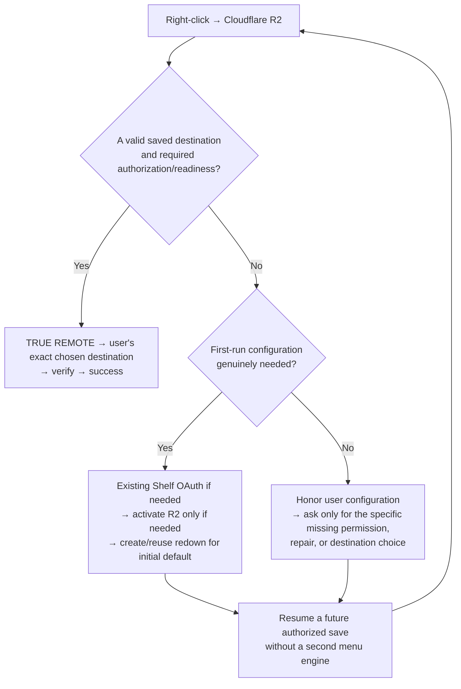

# Cloudflare experience principles — the intent behind the diagrams

> **Owner's guiding design philosophy, not a new implementation or a second decision engine.**
>
> Read alongside the first-run and returning-user flowcharts in [README.md](README.md). These diagrams establish *the desired behavior*, not a command to hardcode a separate state machine for every possible condition.

## The experience in one sentence

**Right-click → Click2Cloud checks what is genuinely needed → saves to the user's chosen destination.**

A first-time user may need authorization, R2 activation and a usable initial destination. A returning user with a valid configuration should simply save. Technical work is absorbed by Click2Cloud, not pushed onto the user.

## One small conceptual diagram

The diagram is a **conceptual principle**, not a mandate to reissue an earlier click or blindly retry an uncertain upload. Following onboarding or repair, a fresh authorized click saves. Any actual saved transfer requires final destination verification.

## The principles

### 1. Convention over configuration

A new Cloudflare user who approves setup should get a sensible working starting point: a lowercase `redown` R2 bucket, initialized once if missing, prepared for TRUE REMOTE and selected as the *initial* default.

The initial four flat right-click providers are **Google Drive → Dropbox → OneDrive → Cloudflare R2**, with Cloudflare last. No extra nesting initially. The existing V3+1 menu engine retains user customization through Simple, Narrow, Depth, Quick Select and provider placement.

**`redown` is the introduction, not the architecture.** It must not become a mandatory intermediate bucket or permanent destination constraint.

### 2. User intent and configured state outrank defaults

The precedence is:

**Explicit user-selected destination and menu settings → existing authorized configuration → first-run defaults.**

Once a user chooses a bucket/folder, that exact selection governs their saves. Changing a bucket, disconnecting a destination, deleting `redown`, reorganizing menu options or removing the initial default must not trigger automatic restoration of earlier choices.

Do not conflate **not yet configured** with **intentionally removed**. A missing or invalid destination after onboarding is a reason to offer a relevant repair/selection action, not to recreate the `redown` bucket without permission.

### 3. Onboarding should disappear after it serves its purpose

The existing Shelf Cloudflare login is the authoritative OAuth flow. A right-click on an unconnected Cloudflare entry should direct the user into that same action, not create a parallel login mechanism.

After OAuth, check R2 availability. Offer Cloudflare's R2 activation page **only when confirmed necessary**. After activation, check again using the authorized API; if access exists, complete only the missing authorized preparation.

A website login is not extension authorization; a successful OAuth login is not proof that R2 billing/activation is complete. An API error is not automatically a signup problem. No perpetual activation prompts or repeated setup wizard when already ready.

### 4. Progressive disclosure: ask only what is missing

Users need not learn bucket bindings, signing, Worker provisioning, or transfer plumbing to save a file. Click2Cloud should inspect trusted readiness and respond with the **smallest relevant action**:

- Need authorization? Use existing Shelf OAuth.
- R2 confirmed inactive? Offer official activation and an easy return/check.
- First-time account ready but no destination? Create/reuse `redown` with approved setup permission.
- Returning user's destination unavailable? Offer Reconnect, Repair or Choose Another, without changing their intent.
- Everything ready? Save immediately with no dialog.

These are examples of intent-driven behavior, **not independent flows to implement and maintain separately**.

### 5. One engine, one API, one normal action

Keep the existing **canonical V3+1 MenuSpec → native registrar → action resolver → Universal File API** and put the missing auth/readiness/provisioning or transfer capabilities *behind* those boundaries.

Do not construct a second right-click engine, menu compiler, configuration store, upload registry or GUI-only business logic to implement the diagrams. The GUI, native menu, and programmatic API should use the same authorization, destination identity, result types and inspection operations.

Provider and destination configuration are independent of transport choice. New provider adapters should not force a redesign of the menu.

### 6. Cloudflare TRUE REMOTE is fixed; destination is flexible

Cloudflare R2 uses **TRUE REMOTE exclusively**, never the default browser-byte transfer route and never a silent browser fallback.

Its Worker retrieves the permitted source and sends bytes into the **currently selected authorized bucket/path**. The original source URL and browser provenance are not object metadata. Success follows only a verified destination write/readback. Uncertain writes require inspection, not automatic replay.

The user can choose any supported, properly authorized Cloudflare destination: `redown/` is simply where we start.

## How Codex should interpret the two flowcharts

The flowcharts in [README.md](README.md) illustrate **first-run setup** and **normal returning-user behavior**. They should be used as behavioral acceptance examples of the principles above.

**Do not translate every box into a special-purpose subsystem.** Instead:

1. Reuse the source owners and current API.
2. Identify the canonical user intent and exact saved destination.
3. Determine the smallest unmet prerequisite.
4. Satisfy that prerequisite through the existing trusted authorization/provisioning boundary, with appropriate consent.
5. Execute a **new authorized save** when ready; never blindly replay an ambiguous old one.
6. Expose a verifiable result to the same GUI/native/API callers.

A useful test of every proposed implementation decision:

> **Does this make the next ordinary right-click simpler while preserving what the user chose?**

If not, reconsider the design before adding another branch, onboarding screen, menu owner or state store.

## Two representative cases

**Fresh user:** Right-clicks Cloudflare → existing Shelf authorization → R2 activation only if required → authorized creation/reuse of `redown` → prepare and verify TRUE REMOTE → next right-click just saves.

**Returning user:** Originally started with `redown` → later selected another bucket or folder → perhaps even deleted `redown` → right-click saves into the *new chosen destination* if available. If that chosen destination is missing, explain/repair/choose; do not silently re-create `redown` or replace the saved configuration.

## Final foundation invariant

**Initialize what is genuinely missing. Preserve what the user has configured. Ask for authorization only when necessary. Otherwise, execute the intended save through the existing engine.**

The end-user promise is simple: **Right-click. Save.** The infrastructure exists to make that possible, not to become a repeated part of the user experience.

---

**Implementation status:** This document records the agreed design and does **not** certify that the Cloudflare onboarding, the four flat native menu entries, R2 auto-provisioning, or live TRUE REMOTE saves have been implemented or validated.
