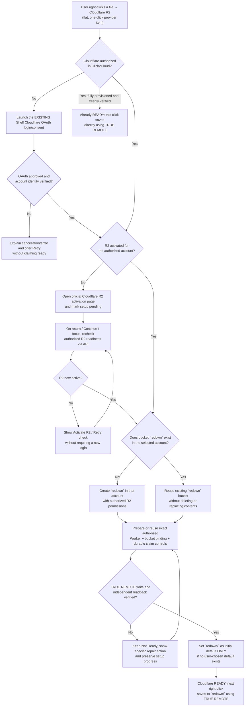

# Cloudflare foundation — Click2Cloud / REDOWN

> **Status:** Owner-approved product behavior and implementation foundation, **not yet an implemented or live-verified feature**.
>
> **Canonical location:** `/foundations/cloudflare/README.md`
>
> **Scope:** Cloudflare R2 first-use flow, native flat right-click entry, existing Shelf authorization, automatic `redown` bucket readiness and default destination, TRUE REMOTE-only transfer. Build around the existing V3+1 menu engine, Universal File API and isolated `right2cloud-module`; do not replace them.

## 1. Foundational user-experience decision chart

This chart is the primary behavioral reference for implementation.

**Interpretation:** The ordinary *first* click may start onboarding instead of transferring. After readiness is established, the *next* click saves instantly. A pending source from before activation is **never replayed automatically** after OAuth, checkout, or uncertain upload. Do not confuse website sign-in with application authorization.

## 2. The native right-click default (before the user customizes it)

Inside Chrome's extension-created grouping, display **four direct, actionable, one-click provider entries in exactly this order**:

1. Google Drive
2. Dropbox
3. OneDrive
4. **Cloudflare R2** — last

No initial provider submenus, no unnecessary second REDOWN submenu, and no user-required Simple/Narrow/Depth configuration. Provider rows must remain clickable when disconnected: in that state the action is **connect/setup**, not save. When connected and ready, the same provider row is **save**. Connected providers must target their explicit configured destination; no guessed account or folder.

The owner may later customize layout, Quick Select, Simple/Narrow/Depth, provider organization or exact defaults using existing V3+1 tools. **Do not rebuild or replace the canonical MenuSpec, native registrar, action resolver or mode configurations.** The four-item first-run layout is a default *projection/registration policy*, not a new right-click engine.

## 3. Cloudflare login versus R2 activation

- The **Shelf's Cloudflare Log in/Connect button always launches Click2Cloud's existing first-party Cloudflare OAuth flow**, matching the current REDOWN-style authorization experience. Never substitute an API-token popup or Cloudflare R2 checkout for Shelf login.
- On a Cloudflare native right-click when not authorized, launch that **same trusted Shelf authorization action** (or bring the Shelf's Cloudflare connect surface forward and invoke it through the same API). There is **one** authorization owner, no parallel login implementation.
- After OAuth, inspect the exact authorized Cloudflare account and R2 API readiness. A Cloudflare website login or successful OAuth consent **does not prove R2 is activated**.
- If R2 is not active, open the official activation destination:
  `https://dash.cloudflare.com/?to=%2F%3Aaccount%2Fr2%2Foverview`
  (the navigation route must be verified against Cloudflare's current dashboard; use a safe official dashboard fallback if it changes).
- The user completes any Cloudflare-controlled account, billing or R2 activation step. **Click2Cloud never bills, subscribes, or accepts Cloudflare terms on the user's behalf.**
- Click2Cloud records `setupPending` for the authorized account, rechecks when the app is foregrounded or the user selects **Continue/Check R2**, and can offer another nonintrusive retry. Do not promise an automatic provider callback from R2 checkout or infinite background polling.
- Distinguish R2 not activated, insufficient OAuth scopes, account mismatch, API outage, and revoked authorization. Each gives a comprehensible next action rather than a generic login loop.

## 4. Automatic `redown` bucket and default

Once an authenticated API check establishes usable R2 access **and** the user has approved the extension's first-run auto-setup:

1. Read the selected account's bucket inventory or specifically check bucket `redown` with appropriately scoped credentials.
2. If `redown` exists and is accessible in that account, **reuse it**. Never clear, delete, reconfigure, or overwrite its objects.
3. If absent, call Cloudflare's authorized R2 bucket-creation API to create the exact lowercase name `redown`. Treat already-exists races idempotently by re-reading the actual account.
4. Bind or verify the Worker to **that selected authorized account + exact bucket**, not an arbitrary bucket supplied by an untrusted menu item.
5. Prepare durable operation claims, authenticated Worker transport, source-host protections, scoped capability, and independent R2 HEAD/readback verification. A bucket's mere existence is **not** proof that TRUE REMOTE is functional.
6. After verified readiness, make `Cloudflare R2 / redown /` the **initial** default destination **only if the user has not explicitly chosen another default**. Subsequent logins/reconnects must not reset the user's choice. If the user later chooses a different Cloudflare folder, honor the configured destination.
7. Publish `READY` to native menu and Shelf using the **same canonical API state**. The user's next click saves instantly without another setup screen.

The first-run setup is an authorized, idempotent infrastructure action. Never create resources before the user has granted the relevant Cloudflare permissions and approved the automatic initial configuration. Provision only necessary resources; do not silently deploy unrelated functionality.

## 5. Permanent Cloudflare transfer rule: TRUE REMOTE ONLY

**Cloudflare R2 must never use browser-byte transfer as fallback.** Every Cloudflare right-click save is:
`native menu → existing V3+1 resolver → exact authorized save intent → isolated right2cloud-module → authenticated Cloudflare Worker remote HTTPS source fetch → conditional R2 write → independent authorized R2 HEAD/readback → verified outcome`.

- A readiness failure leads to a clear setup/repair action, **not** a browser fallback.
- The source file is fetched by the Worker; the browser does **not** stage the file bytes for the Cloudflare destination.
- Keep Both must be conditional/atomic; ambiguous writes remain uncertain and demand read-only reconciliation instead of blind retry.
- The destination writer receives minimal file data only: no original source URL, referring page or browsing provenance in R2 object metadata.
- Success feedback, History, counters and completion effects occur **only after** verified destination confirmation.
- Other providers (Google Drive/Dropbox/OneDrive and future S3 services) may use their own independent browser transfer initially; their later optional TRUE REMOTE support is a separate capability decision.

## 6. What is already present versus what still needs implementation

**Existing source boundaries at the time this foundation was recorded (2026-11-06):**
- V3+1 already has canonical MenuSpec, native registrar, Simple/Narrow/Depth projection, stable destination identities and an API.
- The existing Cloudflare OAuth path is in `src/auth/cloudflare-oauth.mjs`; Shelf runtime is in `extension/app.mjs`; menu/runtime dispatch is in `extension/background.mjs`, `src/core/engine.mjs`, `src/core/menu-spec.mjs` and `src/chrome/registrar.mjs`.
- `right2cloud-module/` is an **isolated extraction candidate**, with reported 49/49 local tests; it is **not integrated, deployed or live-verified**.
- The existing Click2Cloud application has not yet supplied/verified a working Worker mutation transport; the four-provider first-run native layout and unconnected click-to-onboard behavior are not yet wired end-to-end.

**Required implementation (not already fixed):**
- [ ] Default four-provider *flat* menu, in exactly the required order, including actionable disconnected entries, with native registration ACK and installed-Chrome validation.
- [ ] Route Cloudflare row's unready state to existing Shelf OAuth / readiness coordinator without creating a second menu owner.
- [ ] R2 activation handoff, resumable `setupPending`, foreground/API readiness check and explicit differentiation of permission vs subscription vs network failures.
- [ ] Idempotent `redown` bucket creation/reuse, correct account selection and user-default preservation.
- [ ] Authorized Worker/binding setup and secure durable operation/receipt ports required by `right2cloud-module`.
- [ ] Cloudflare TRUE REMOTE-only dispatcher branch **before** current browser byte capture.
- [ ] Independent live R2 write + HEAD/readback validation and comprehensive negative tests.
- [ ] Versioned, permission-gated programmatic API equivalents for every onboarding, readiness, bucket/default, save and inspection operation; GUI is a client of those operations.
- [ ] Regression tests proving Simple/Narrow/Depth, manual defaults, Quick Select and other providers are unchanged.
- [ ] Observable, separately measured menu dispatch, auth/status checks, provisioning and Worker transfer latency; no invented success or performance claims.

## 7. Acceptance scenarios (IF / THEN / ELSE)

| Given | When | Required outcome |
| --- | --- | --- |
| Brand-new user, no Click2Cloud Cloudflare authorization | Cloudflare R2 menu item clicked | Existing Shelf OAuth login flow starts; never silently uploads |
| OAuth granted, R2 not activated | Readiness check executes | Official R2 activation link; pending state preserved |
| R2 activated while user visits Cloudflare website | User returns/focuses Click2Cloud or selects Continue | Authenticated API rechecks account readiness; no website-cookie scraping |
| R2 ready, no `redown` bucket | Initial authorized setup runs | Create exactly `redown` once; verify bucket exists |
| R2 ready, bucket exists | Setup runs | Reuse `redown`, preserve objects and permissions |
| Multiple Cloudflare accounts | Setup begins | Use explicit authorized account selection; never guess account |
| Setup complete, no prior explicit default | Readiness reaches verified | `redown/` becomes initial default |
| User previously selected another default | Cloudflare reconnects | Existing chosen default remains unchanged |
| Cloudflare fully ready | User clicks Cloudflare R2 flat row | TRUE REMOTE transfer only; verified destination outcome |
| Worker unavailable or auth revoked | User clicks flat row | Clear non-success state/repair action; never browser fallback |
| Cloud provider not connected | User clicks its flat row | Provider's existing authorization flow, never misleading success |
| Native menu config or transfer preference changes | Menu is refreshed | Same canonical menu/action IDs and authorized targets; no duplicate registrar |
| Worker PUT outcome unclear | Save result received | Uncertain/read-only reconciliation; no automatic replay |

### Foundation invariant

**Four flat providers initially (Google Drive → Dropbox → OneDrive → Cloudflare R2). Existing Shelf OAuth for Cloudflare. R2 activation only if needed. Authorized automatic `redown` bucket creation/reuse and initial default. Cloudflare TRUE REMOTE only. Same V3+1 menu engine and Universal File API for everything. The user should never need to understand or manually configure buckets, Workers or adapters.**
