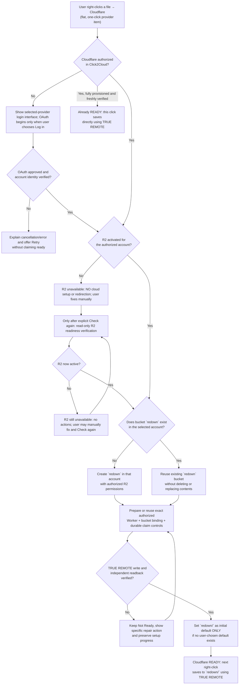
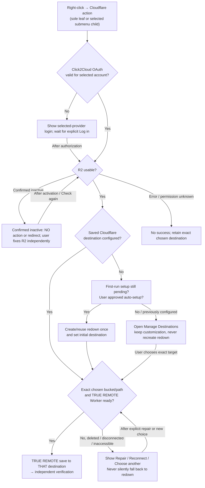
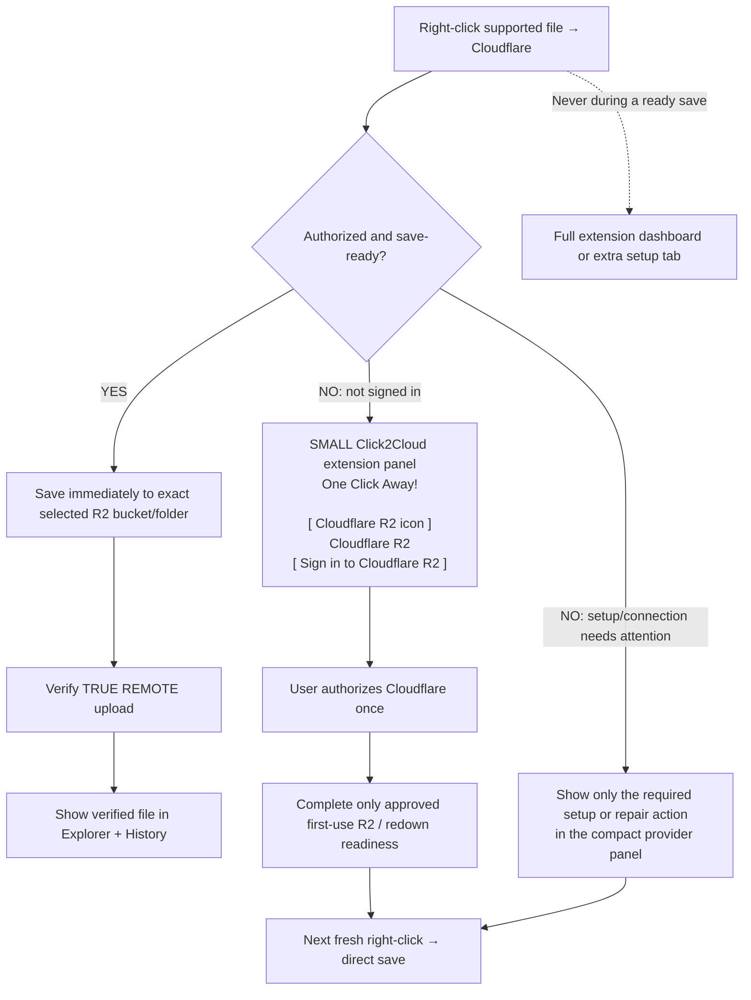
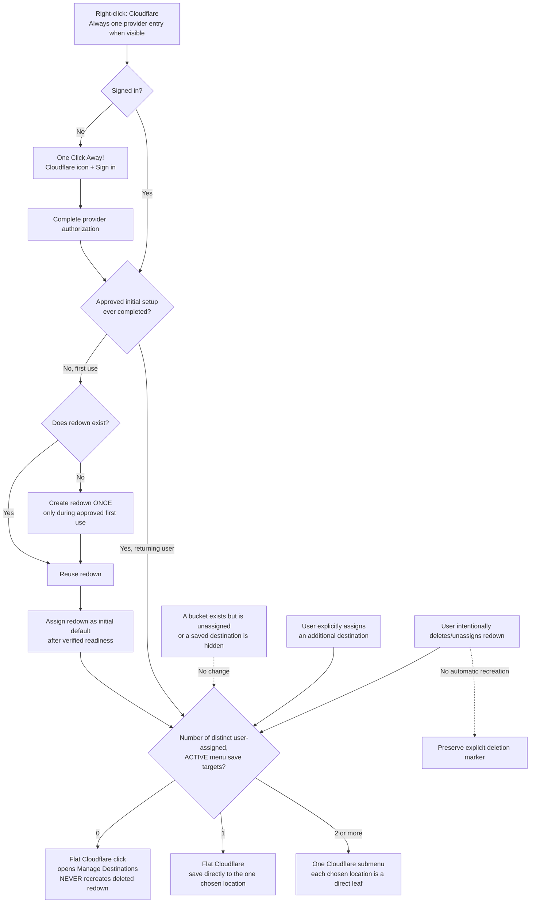
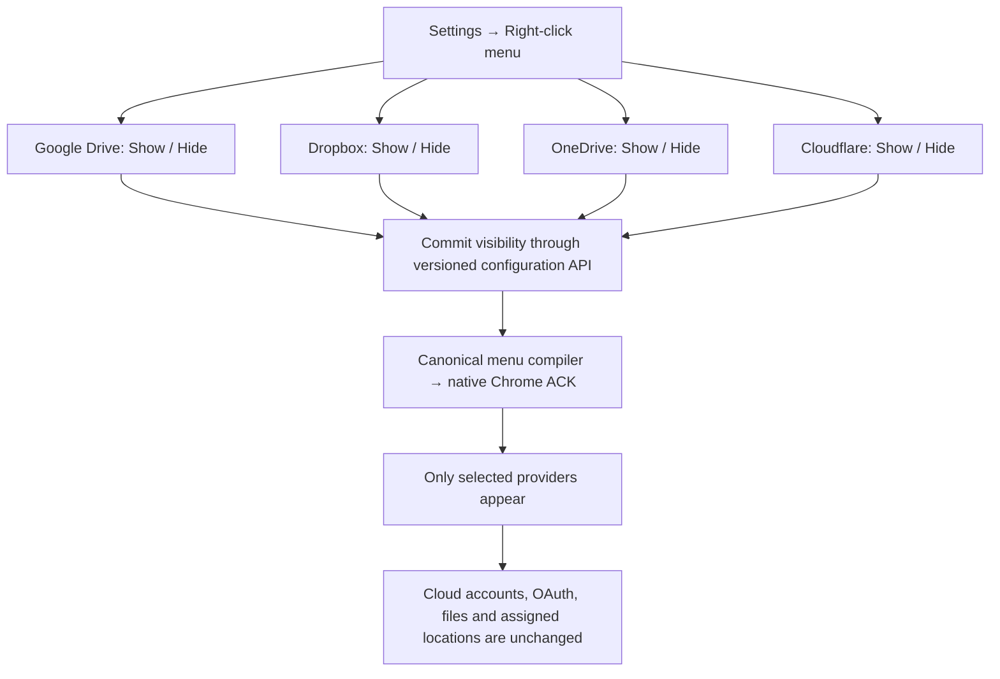

# Cloudflare foundation — Click2Cloud / REDOWN

**CURRENT NOVEMBER 7 OWNER OVERRIDE — READ BEFORE ANY DIAGRAM:** [Master implementation and NO-BLOAT contract](../../docs/CODEX_MASTER_2026-11-07_SINGLE_ENGINE_REDOWN_PARITY_AND_WORKINGS.md). The real source behavior is mapped in [right-click-workings.json](../../11.2026/workings/right-click-workings.json), which requires a complete code audit before it can be labeled 1:1 verified. **R2 is unavailable / inactive / unknown? Do NOTHING in Cloudflare and never redirect to signup: the user enables or repairs R2 manually.** **R2 confirmed available?** During one user-approved first-use setup, reuse bucket redown if it exists or create it otherwise; prepare necessary Worker and independently verify remote write/readback, set its bucket root as initial default unless user chose another. Thereafter native Cloudflare right-click saves directly. Explicit deletion or default changes remain binding. No extra engines, no automatic R2-website navigation. Older diagrams below are historical where they differ; do not execute their obsolete navigation arrows.

**FINAL November 7 authentication precedence:** The [November 7 master contract, Sections 5 and 5A](../../docs/CODEX_MASTER_2026-11-07_SINGLE_ENGINE_REDOWN_PARITY_AND_WORKINGS.md) now requires the REDOWN-style **Shelf ONLY** as Click2Cloud's standard login/setup/repair surface: disconnected right-click → Shelf focused on the chosen provider → explicit Log in → real OAuth consent → readiness → next right-click directly saves. Settings auto-attention OFF uses a cause-specific notification; Shelf failure also falls back to notification with diagnostics. **No toolbar popup-first flow, no second extension login implementation, no R2 activation redirect.** Native menu topology and the permanent redown removal rules remain unchanged. Older diagrams below are historical where they contradict this decision.

> **Status:** Owner-approved product behavior and implementation foundation, **not yet an implemented or live-verified feature**.
>
> **Canonical location:** `/foundations/cloudflare/README.md`
>
> **Scope:** Cloudflare R2 first-use flow, native flat right-click entry, existing Shelf authorization, automatic `redown` bucket readiness and default destination, TRUE REMOTE-only transfer. Build around the existing V3+1 menu engine, Universal File API and isolated `right2cloud-module`; do not replace them.

## 1. Foundational user-experience decision chart

This chart is the **approved first-run onboarding reference only**: ordinary login itself does not create buckets. After first-run authorization and separate setup approval, the post-onboarding flow takes precedence and preserves the user's saved configuration. In every native menu diagram the provider is labeled **Cloudflare** (R2 is its service type). Explicit Settings provider visibility OFF hides the Cloudflare entry; the default state is visible.

**Interpretation:** The ordinary *first* click may start onboarding instead of transferring. After readiness is established, the *next* click saves instantly. A pending source from before activation is **never replayed automatically** after OAuth, checkout, or uncertain upload. Do not confuse website sign-in with application authorization.

## 1A. Returning user — normal right-click decision chart (authoritative after onboarding)

**The R2 activation link is not an ordinary save step.** Once OAuth, R2 and the user-configured destination are ready, a normal right-click saves directly. The extension checks live authorization and exact destination readiness as needed, but must not reopen signup, overwrite a custom configuration, or silently restore a deleted bucket.

### Returning-user rules (nonnegotiable)

1. **Existing valid custom destination wins.** The native Cloudflare item saves to the user's currently selected *exact* Cloudflare connection, account, bucket and folder prefix. `redown` was only the **initial first-run default**, never a permanent destination override.
2. **No automatic R2 activation navigation or repeated login.** If R2 is inactive, unavailable or unknown, perform zero Cloudflare resource mutation and no external redirect: the user resolves R2 manually. Expired tokens first use safe silent refresh, and only revoked or unrenewable tokens prompt Shelf reauthorization. R2 403, API outage or missing permission must never be assumed to mean inactive R2.
3. **If `redown` was intentionally removed/deleted and one other assigned destination remains,** Cloudflare becomes a flat direct-save leaf pointing at that survivor. With two or more remaining assignments, it stays nested. Do not search for or recreate `redown`. If `redown` is merely temporarily unreachable, treat it as unavailable rather than deleted.
4. **If the selected destination itself is deleted, disconnected, inaccessible, or its Worker binding is broken,** do not save elsewhere. Show "Destination unavailable" with **Reconnect / Repair / Choose another bucket**. A repair of a removed bucket or infrastructure requires explicit user authorization; no silent bucket recreation, surprise rebinding or upload replay.
5. **If the user removed their destination configuration after onboarding,** show Choose destination. Do not treat an empty config as first-run onboarding. A persisted `onboardingCompleted` / `defaultWasExplicitlyChosen` marker (or equivalent migration-safe state) distinguishes *never configured* from *intentionally removed*. Do not reset it merely because the user logged out, cleared a menu entry or deleted the original bucket.
6. **Cloudflare remains TRUE REMOTE only.** A successful save requires Worker-to-selected-bucket conditional write and independent verification. No browser-byte fallback, guessing, redirected destination, or success feedback after an unconfirmed transfer.
7. **No forced R2 polling every right-click.** Reuse a short-lived, explicitly validated readiness snapshot where safe, but revalidate authorization and exact target as required for secure dispatch. The Worker must remain authoritative at write time. Cache usability for UX, never as a substitute for upload authorization.
8. **Menu configuration is independent of transfer mode.** Existing Simple/Narrow/Depth/Quick Select/custom layouts are respected. This post-onboarding logic is an adapter/action routing rule behind the canonical V3+1 menu engine, not an alternate registrar or menu compiler.

**Example:** The user began at `Cloudflare R2 / redown /`, later changed their default to `Cloudflare R2 / photos / saved /`, then deleted `redown`. Their next Cloudflare right-click goes to `photos/saved/` after ordinary authorization and readiness checks. It does **not** ask them to activate R2 again or recreate `redown`.

**Different example:** They intentionally delete `redown/` while `Photos` remains assigned to Cloudflare. The menu removes the obsolete `redown` assignment and becomes a flat `Cloudflare` leaf saving directly to the sole surviving `Photos` destination, with the default updated as part of the deliberate deletion transition. If no other location survives, the flat Cloudflare entry offers destination setup. If a bucket unexpectedly disappears or its availability cannot be confirmed, present a clear unavailable/repair state rather than guess or reassign. Never recreate `redown` automatically.

---

## 1B. Cloudflare — right-click and minimal login card

---

## 2. The native right-click default (before the user customizes it)

### Diagram 2A — Chosen Cloudflare destinations, permanent deletion, and empty-menu routing

**Precedence for all diagrams:** an explicit Settings "Hide Cloudflare" selection removes its native entry entirely; otherwise the provider is always shown. The 0/1/2+ calculation counts **distinct user-assigned Cloudflare save targets actively displayed by the current menu configuration** (not discovered buckets, hidden destinations, disabled modes or duplicate Simple/Narrow projections). A returning account with zero active targets uses **Manage Destinations**. A brand-new first-use account may create/reuse `redown` only in its separately approved setup. Hiding or unassigning a destination never deletes an actual R2 bucket. Explicit deletion of the real `redown` bucket is respected permanently until a fresh user-requested creation.

**Decision rule:** Only user-chosen and assigned Cloudflare destinations count. A new bucket by itself changes nothing. With `redown` + `Photos` assigned, Cloudflare shows one submenu containing both. If `redown` is intentionally deleted and `Photos` alone remains, Cloudflare becomes flat and saves to `Photos`. If no assigned locations remain, clicking flat Cloudflare opens **Manage Destinations** (or provider sign-in first if disconnected). Explicit deletion is permanent unless the user explicitly requests creation again.

### Diagram 2B — Settings: independently show/hide providers in the Chrome menu

Provider visibility defaults to ON for all four. An OFF provider has no native menu children; its settings and assigned destinations remain saved for later re-enabling.

### Cloudflare destination-count rule (definitive)

**Count distinct, explicitly assigned Cloudflare save targets active in the current menu, not every bucket visible in the account.** Hidden destinations, modes not selected for display, and duplicate representations of the same exact target do not increase this count. Explicit Settings provider OFF hides Cloudflare entirely. The same native provider item changes shape as the number of assigned destinations changes:

| Cloudflare assigned destinations | One native Cloudflare item | Action |
| --- | --- | --- |
| 0, including brand-new users | Flat clickable leaf | Unconnected first-time: minimal provider login/approved first setup; connected returning user with no assignments: open **Manage Destinations**, never recreate deleted redown |
| 1: `redown` | Flat clickable leaf | Save directly to `redown` when ready |
| 1: only another user-assigned bucket, after `redown` was removed/deleted | Flat clickable leaf | Save directly to the remaining bucket when ready |
| 2: `redown` + `Photos` | One submenu | `Cloudflare → redown / Photos`; each child saves to its exact target |
| 2+: other surviving assigned destinations | One submenu | Show those assigned destinations, without inventing `redown` |

The **moment** a user explicitly assigns a second bucket/folder to Cloudflare, the compiler changes the one existing Cloudflare entry into a submenu; no separate Cloudflare R2 menu row, no third nesting layer. Creating an R2 bucket without assigning it to the menu **does not** trigger nesting. Removing an assigned destination triggers a menu recompile and native ACK. Intentional deletion of `redown` removes its assignment and does not trigger automatic recreation; with exactly one surviving assigned destination, that sole destination is the direct-save target (including updated persisted default). A temporary network failure or missing permission cannot be mistaken for an intentional deletion. **This is a menu/configuration rule, not permission to delete real cloud objects without user authorization.**

**ZERO-CONFIGURATION ACCEPTANCE RULE:** On install show four flat clickable providers. A disconnected Cloudflare native click opens the **single provider-focused Shelf** with a **Log in** button; only the button begins genuine OAuth. After login, perform read-only R2 availability check. If inactive or unknown, do nothing in Cloudflare and never auto-redirect to activation; user fixes it manually. If active and a new approved first-use setup, reuse existing lowercase bucket `redown` or create it exactly once, prepare and verify necessary remote capabilities and set the bucket root prefix `''` as the initial default unless another choice exists. Every subsequent READY right-click saves directly without setup/UI. No bucket editor for normal first use. Unassigned buckets do not affect menu nesting. Explicitly deleted redown is never silently recreated.

**NOVEMBER 6 OWNER PRIORITY — native menu projection (overrides older Simple/Flat examples):** At initialization show one flat `Cloudflare` entry even with no assigned destinations; its initial authorized first-time target is bucket `redown` (root prefix). No `Cloudflare R2` sibling or duplicated Cloudflare parent. When the user **assigns** a second Cloudflare save location, change the one entry into **Cloudflare → redown / extra assigned destination**. With exactly one assigned destination, use a flat Cloudflare leaf to that sole target. If the user deletes/unassigns `redown` and exactly one other assignment remains, that survivor becomes the flat target; never recreate `redown`. Merely creating a bucket without assigning it does not add a submenu. A custom user-chosen default is honored unless intentionally removed. Additional hierarchy modes remain opt-in. **These are presentation/routing rules for the single canonical engine, not permission to create cloud resources or a new engine.** See `AGENTS.md`.

Inside Chrome's extension-created grouping, display **four direct, actionable, one-click provider entries in exactly this order**:

1. Google Drive
2. Dropbox
3. OneDrive
4. **Cloudflare** — last (R2 service; native name is Cloudflare)

No initial provider submenus, no unnecessary second REDOWN submenu, and no user-required Simple/Narrow/Depth configuration. Provider rows must remain clickable when disconnected: in that state the action is **connect/setup**, not save. When connected and ready, the same provider row is **save**. Connected providers must target their explicit configured destination; no guessed account or folder.

The owner may later customize layout, Quick Select, Simple/Narrow/Depth, provider organization or exact defaults using existing V3+1 tools. **Do not rebuild or replace the canonical MenuSpec, native registrar, action resolver or mode configurations.** The four-item first-run layout is a default *projection/registration policy*, not a new right-click engine.

## 3. Cloudflare login, manual R2 availability, and separate initial setup

- When a provider requires authorization, Click2Cloud opens the **single Shelf/side-panel login interface** focused on that provider using one shared typed API/OAuth owner. Opening the Shelf does not start OAuth. The user presses Log in to initiate genuine provider consent. Settings OFF or Chrome side-panel-opening failure shows an accurate provider/cause notification; there is no toolbar-popup-first/fallback chain. Only one extension-owned login system exists.
- After authorized login, perform **read-only** R2 availability and exact selected-account checks. OAuth success alone does not prove R2 is usable.
- **If R2 is confirmed inactive/unavailable, requires subscription, or cannot be verified as active, NO cloud action occurs.** Do not visit an activation website, create buckets, deploy Workers or Durable Objects, write readiness objects, start billing, poll continuously, guess a new account, or retry provisioning. User must resolve R2 manually outside Click2Cloud. A user-selected Check again may perform a read-only recheck.
- **Never classify an HTTP 403 alone as inactive R2.** Distinguish permission denial, wrong account, expired/revoked OAuth, API/network failure, and confirmed subscription inactivity. Do not mask these with a false login loop.
- If R2 is confirmed active, the **separately approved, first-use** redown/Worker readiness process described below may proceed. A single clear approval describes the necessary infrastructure and potential costs. Signing in alone does not authorize billable resource creation.
- Ready returning users save immediately, without user-facing setup pages or redirections. No source selected before login may be replayed automatically.

## 4. Automatic `redown` bucket and default

**Decision: Is this a new, authorized first-time connection with no previously selected destination?** If yes, test the selected account for `redown`. If present, use it. If absent, create it through the approved initial setup. After verified transfer readiness, make it the default without prompting for bucket names, picking another bucket, or opening the full dashboard. This is true even when there are zero existing R2 buckets. A flat, clickable **Cloudflare** menu item exists even before this setup; it triggers minimal sign-in/approved first setup for new users, or **Manage Destinations** when a returning connected user intentionally has no locations. Later explicit removal and custom choices remain authoritative.

Once an authenticated API check establishes usable R2 access **and** the user has approved the extension's first-run auto-setup:

1. Read the selected account's bucket inventory or specifically check bucket `redown` with appropriately scoped credentials.
2. If `redown` exists and is accessible in that account, **reuse it**. Never clear, delete, reconfigure, or overwrite its objects.
3. If absent **during authorized first-run setup only**, call Cloudflare's R2 bucket-creation API to create the exact lowercase name `redown`. Treat already-exists races idempotently by re-reading the actual account. **Never infer permission to recreate `redown` solely from its later absence**; the user may have intentionally deleted or disconnected it.
4. Bind or verify the Worker to **that selected authorized account + exact bucket**, not an arbitrary bucket supplied by an untrusted menu item.
5. Prepare durable operation claims, authenticated Worker transport, source-host protections, scoped capability, and independent R2 HEAD/readback verification. A bucket's mere existence is **not** proof that TRUE REMOTE is functional.
6. After verified readiness, make `Cloudflare R2 / redown /` the **initial** default destination **only if the user has not explicitly chosen another default**. Subsequent logins/reconnects must not reset the user's choice. If the user later chooses a different Cloudflare folder, honor the configured destination.
7. Publish `READY` to native menu and Shelf using the **same canonical API state**. The user's next click saves instantly without another setup screen.

The first-run setup is an authorized, idempotent infrastructure action. Never create resources before the user has granted the relevant Cloudflare permissions and approved the automatic initial configuration. Provision only necessary resources; do not silently deploy unrelated functionality.

## 5. Permanent Cloudflare transfer rule: TRUE REMOTE ONLY

**Cloudflare R2 must never use browser-byte transfer as fallback.** Every Cloudflare right-click save is:
`native menu → existing V3+1 resolver → exact authorized save intent → isolated right2cloud-module → authenticated Cloudflare Worker remote HTTPS source fetch → conditional R2 write → independent authorized R2 HEAD/readback → verified outcome`.

- A readiness failure leads to a clear setup/repair action, **not** a browser fallback.
- The source file is fetched by the Worker; the browser does **not** stage the file bytes for the Cloudflare destination.
- Keep Both must be conditional/atomic; ambiguous writes remain uncertain and demand read-only reconciliation instead of blind retry.
- The destination writer receives minimal file data only: no original source URL, referring page or browsing provenance in R2 object metadata.
- Success feedback, History, counters and completion effects occur **only after** verified destination confirmation.
- Other providers (Google Drive/Dropbox/OneDrive and future S3 services) may use their own independent browser transfer initially; their later optional TRUE REMOTE support is a separate capability decision.

## 6. What is already present versus what still needs implementation

**Existing source boundaries at the time this foundation was recorded (2026-11-06):**
- V3+1 already has canonical MenuSpec, native registrar, Simple/Narrow/Depth projection, stable destination identities and an API.
- The existing Cloudflare OAuth path is in `src/auth/cloudflare-oauth.mjs`; Shelf runtime is in `extension/app.mjs`; menu/runtime dispatch is in `extension/background.mjs`, `src/core/engine.mjs`, `src/core/menu-spec.mjs` and `src/chrome/registrar.mjs`.
- `right2cloud-module/` is an **isolated extraction candidate**, with reported 49/49 local tests; it is **not integrated, deployed or live-verified**.
- The existing Click2Cloud application has not yet supplied/verified a working Worker mutation transport; the four-provider first-run native layout and unconnected click-to-onboard behavior are not yet wired end-to-end.

**Required implementation (not already fixed):**
- [ ] Default four-provider *flat* menu, in exactly the required order, including actionable disconnected entries, with native registration ACK and installed-Chrome validation.
- [ ] Route Cloudflare row's unready state to existing Shelf OAuth / readiness coordinator without creating a second menu owner.
- [ ] R2 activation handoff, resumable `setupPending`, foreground/API readiness check and explicit differentiation of permission vs subscription vs network failures.
- [ ] Idempotent `redown` bucket creation/reuse, correct account selection and user-default preservation.
- [ ] Authorized Worker/binding setup and secure durable operation/receipt ports required by `right2cloud-module`.
- [ ] Cloudflare TRUE REMOTE-only dispatcher branch **before** current browser byte capture.
- [ ] Independent live R2 write + HEAD/readback validation and comprehensive negative tests.
- [ ] Versioned, permission-gated programmatic API equivalents for every onboarding, readiness, bucket/default, save and inspection operation; GUI is a client of those operations.
- [ ] Regression tests proving Simple/Narrow/Depth, manual defaults, Quick Select and other providers are unchanged.
- [ ] Observable, separately measured menu dispatch, auth/status checks, provisioning and Worker transfer latency; no invented success or performance claims.

## 7. Acceptance scenarios (IF / THEN / ELSE)

| Given | When | Required outcome |
| --- | --- | --- |
| Brand-new user, no Click2Cloud Cloudflare authorization | Cloudflare native menu clicked | Open the Shelf for Cloudflare with a **Log in** button; OAuth starts only if user clicks it, with no setup/upload yet |
| OAuth granted, R2 confirmed inactive or unknown | Read-only readiness check executes | Zero Cloudflare resource mutations and no automatic activation/checkout redirect; user repairs R2 manually |
| R2 made available manually outside Click2Cloud | User explicitly selects Check again | Authenticated read-only API rechecks readiness; no website scraping or automatic retry loop |
| R2 ready, no `redown` bucket | Initial authorized setup runs | Create exactly `redown` once; verify bucket exists |
| R2 ready, bucket exists | Setup runs | Reuse `redown`, preserve objects and permissions |
| Multiple Cloudflare accounts | Setup begins | Use explicit authorized account selection; never guess account |
| Setup complete, no prior explicit default | Readiness reaches verified | `redown/` becomes initial default |
| User previously selected another default | Cloudflare reconnects | Existing chosen default remains unchanged |
| Cloudflare fully ready | User clicks Cloudflare R2 flat row | TRUE REMOTE transfer only; verified destination outcome |
| Worker unavailable or auth revoked | User clicks flat row | Clear non-success state/repair action; never browser fallback |
| Cloud provider not connected | User clicks its flat row | Provider's existing authorization flow, never misleading success |
| Native menu config or transfer preference changes | Menu is refreshed | Same canonical menu/action IDs and authorized targets; no duplicate registrar |
| Worker PUT outcome unclear | Save result received | Uncertain/read-only reconciliation; no automatic replay |

### Foundation invariant

**Four flat providers initially (Google Drive → Dropbox → OneDrive → Cloudflare). ONE Shelf login backed by the existing OAuth owner; no competing popup login implementation. If R2 is inactive or unknown, no Cloudflare changes; user repairs it manually. If R2 is verified active, reuse/create redown only during approved first-use setup. Redown is removable and never overrides customization or deletion. Honor exact target identity, TRUE REMOTE only, verified receipts, and ONE V3+1 engine/Universal File API.**
