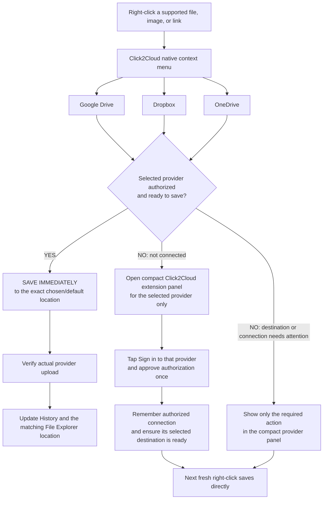
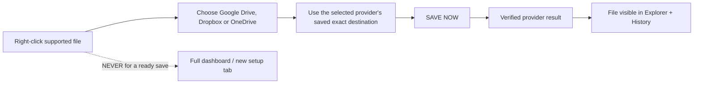
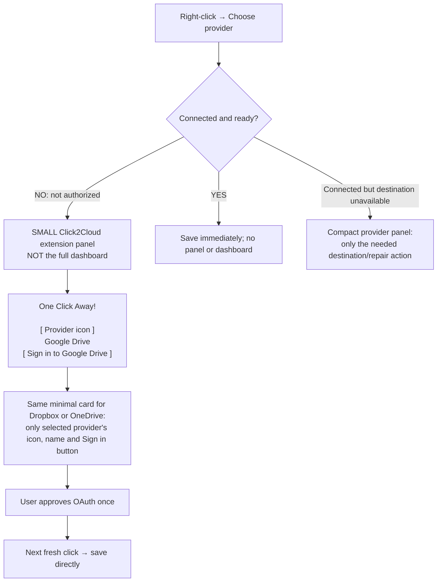

# Other clouds — right-click and minimal login diagrams

## Diagram 1 — Google Drive, Dropbox and OneDrive: visible from the start

## Diagram 2 — Already signed in and ready: save, nothing else

## Diagram 3 — Not connected: the entire mini extension panel

