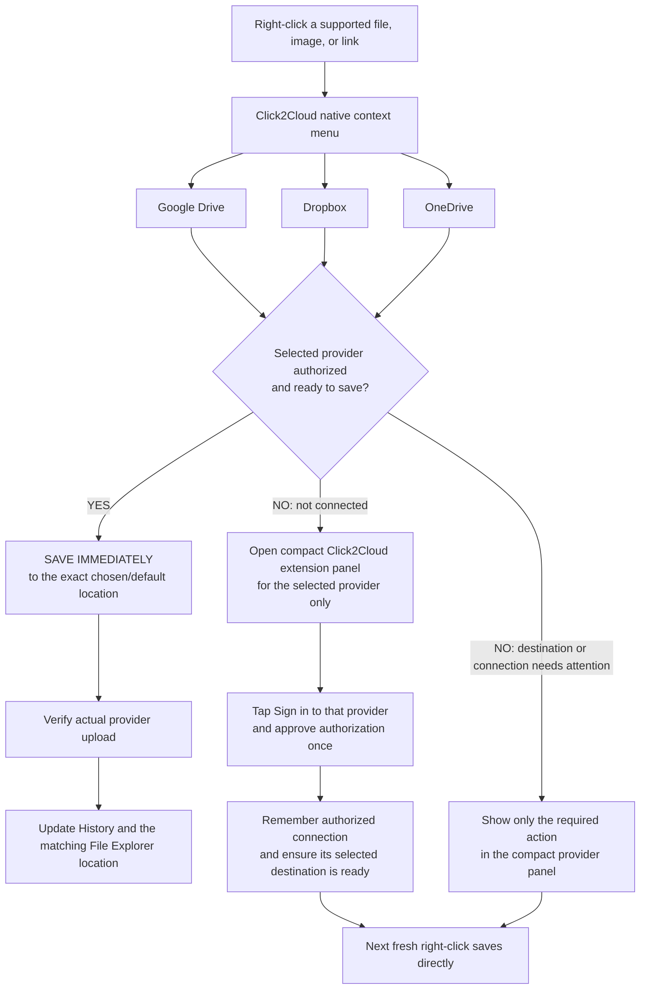
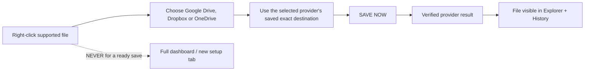
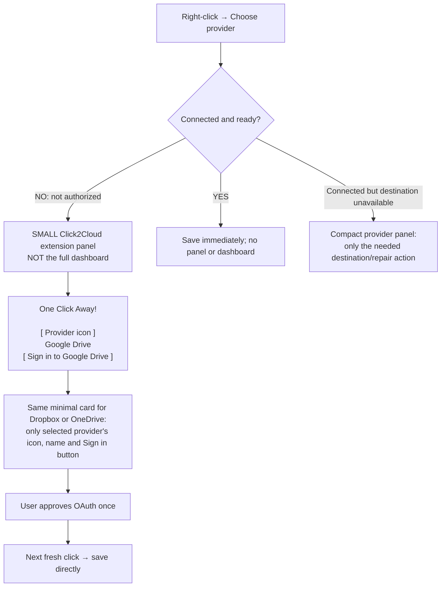

# Other clouds — right-click and minimal login diagrams

**NOVEMBER 7 MASTER PRECEDENCE:** [docs/CODEX_MASTER_2026-11-07_SINGLE_ENGINE_REDOWN_PARITY_AND_WORKINGS.md](../../docs/CODEX_MASTER_2026-11-07_SINGLE_ENGINE_REDOWN_PARITY_AND_WORKINGS.md) is the current source of desired behavior and [11.2026/workings/right-click-workings.json](../../11.2026/workings/right-click-workings.json) is the incomplete source-grounded actual-behavior bootstrap Codex must complete before refactoring. Older details here are historical when inconsistent: no automatic R2 activation/checkout website navigation or cloud actions if R2 is inactive/unknown; new user with active R2 gets one approved reuse-or-create redown setup and subsequent direct saves. The four-provider native menu rules and permanent redown deletion are unchanged. Use one current V3+1 engine and the existing trusted API.

**FINAL November 7 owner presentation rule:** [Master contract Sections 5/5A](../../docs/CODEX_MASTER_2026-11-07_SINGLE_ENGINE_REDOWN_PARITY_AND_WORKINGS.md) supersede the earlier popup-first description. When an unconnected provider is selected and Settings auto-attention is ON, open the **single REDOWN-style Shelf** with that provider's Log in button; user action begins real provider OAuth. OFF or Chrome Shelf-opening failure → an appropriate provider-specific notification. **No parallel popup login system**, no fake implemented provider adapters, and no changes to independent native menu visibility.

## Diagram 1 — Google Drive, Dropbox and OneDrive: visible from the start

## Diagram 2 — Already signed in and ready: save, nothing else

## Diagram 3 — Not connected: the entire mini extension panel

## Settings — choose which cloud providers appear in Chrome

All four providers start visible. In Settings → Right-click menu, Google Drive, Dropbox, OneDrive and Cloudflare each have an independent Show/Hide checkbox. Hiding a provider removes its Chrome menu entry, not its connection, files or saved destinations. Re-enabling it restores its configured menu action after native registration. The settings use the same versioned API that drives the GUI. See the companion Cloudflare diagram 2B in `foundations/cloudflare/README.md`.
